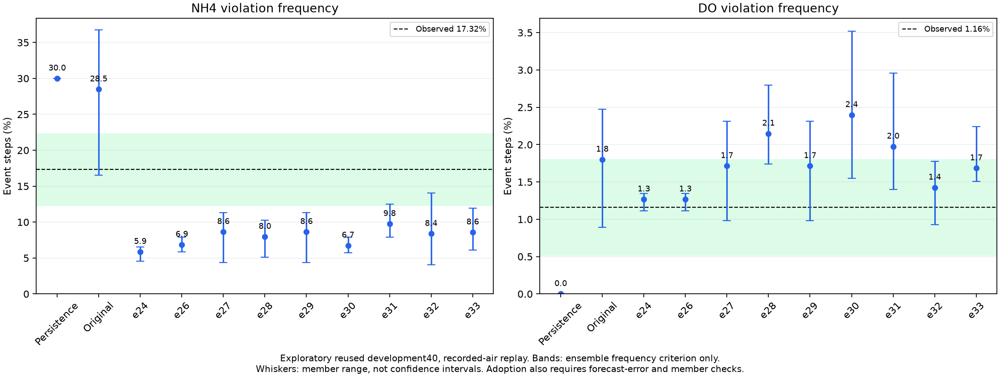

# Active DARROW research goal

The goal remains active. No agent extension improvement over FCSRL is verified.
Previous environment failures and the negative first policy pair do not exhaust
reasonable alternatives. No external blocker currently prevents useful work.
This is an execution snapshot, not a live process monitor. Inspect the actual
runner/child processes before waiting, restarting or declaring a run stopped.

## Frozen environment and limits

e40 passes all unchanged e16 point-estimate gates and independent sklearn/full-day
reconstruction. Selection is pit_b95_a0.5, five structural members, eight primary
noise draws and sixteen-draw sensitivity. NH4/DO frequency is13.4993/.7211 percent
versus actual17.3158/1.1579. Normalized MAE.775476 and NH4 MAE1.977722 improve over
the original predictor. e42/environment_freeze.json pins weights, PIT bank,
authorized input and inference sources. Do not change them during paired studies.

Onset prediction remains weak. NH4 AP improves.30003 to.42675, but probability-.5
recall drops.53191 to.18997 and one-hour onset matching drops10/89 to3/89.
DO AP.01149 and AUC.48475 are near chance; no DO onset is matched. Brier error
improves over the original for both constraints, but DO is worse than persistence.
See e40/results.md and event_reference_audit.json. Passing frequency gates does
not establish accurate onset prediction or real-plant causal safety.

The bands show point-frequency criteria only. Member ranges are not confidence
intervals and do not establish agent improvement. Failed e16 to e39 experiments
remain in their experiment folders and archived checkpoints/logs. e41 is a
prepared causal-history alternative with unit checks, not a fitted result.

## Completed work

- All15 e42 baseline jobs finish: five original-model FCSRL, five frozen-model
  FCSRL and five frozen-model PPO seeds. Each uses401280 transitions and cost
  limit12. Both simulators use the same terminal reward/air accounting fix;
  the historical reset alias, unchanged states/costs and correction are tested.
- All ten cross-model evaluations of the five original-model final policies
  finish in results/e44_old_policy_cross. Native metrics reproduce checkpoint
  replay. Compact evidence is e42/old_baseline_validation.json.
- e43 split and independent two-head summed-cost capacity-control implementations
  pass target-boundary, shared initialization/RNG, original-objective limit,
  gradient, EMA, serialization and one-update pipeline checks. These checks
  are not policy seeds or performance evidence.
- Full split seed0 and its formal matched-air evaluation finish. At air47194.44
  versus47206.56m3, cost increases24.121875 to28.468125 and NH4 increases25.35855
  to29.96645 percent. DO decreases.03289 to0. The air mismatch is.02568 percent.
  Native split uses84893.57m3 and cost12.1325. This is a retained negative
  single-seed result, not a five-seed conclusion. See e44/split_seed0.json.
- Source, checkpoint and budget guards, air-only matching, five-seed reporting
  and common-reference capacity contrast are implemented. Reports reject smoke
  runs, missing/duplicate seeds, mixed references and excessive actual air gaps.

## Latest verified continuation

All ten split/capacity policies finish401280 transitions. All five split
matched evaluations finish. split_comparison.json fails the prespecified
criterion: matched mean cost22.464125 to24.681125, NH4 percentage23.20868
to25.57026 and DO percentage.43776 to.40987. All three paired uncertainty
intervals cross zero. Every seed matches air within1 percent. This neither
proves improvement nor establishes consistent worsening.

Capacity seeds0 and1 finish training and matching. Capacity seeds2..4 are
launched in results/e44_capacity_later with three workers after the training
runner exits successfully. Inspect that batch before waiting or restarting.
Do not duplicate any completed pair. Full split evaluation queries are uploaded
to the existing draft; e44/split_evaluation_artifacts.json verifies remote SHA.

Capacity seed0 at matched air47157.57m3 increases cost24.121875 to28.294375.
Seed1 at matched air65276.90m3 decreases cost13.33625 to12.208125, but DO
increases.17566 to.22697 percent. These are retained mixed single-seed results,
not a five-seed improvement. Finish the original complete comparisons.

Both ten-case cross-model evaluation batches and the five PPO checkpoint
replays finish. New validation JSONs and model_sensitivity.json preserve the
strong simulator dependence. The sensitivity figure compares native air and
does not establish matched-air dominance. Split artifacts for all five seeds
are uploaded to the existing draft with verified size and SHA256.

Action diagnosis does not support more zero-air actions or sharper air changes
as the split seed0 failure explanation. Encoder synchronization logs do not
demonstrate a large single-update shock. Training-only observation probes are
descriptive, not causal. DARROW_NEXT_HYPOTHESIS.md records a prospective
severity-aware auxiliary target; no such policy is trained yet.

## Prior launch record and next actions

- results/e43_first_pair contains completed split and capacity-control seed0.
  Do not duplicate either job.
- results/e43_remaining launches the required eight split/capacity seed1..4
  jobs with five workers. Inspect its real runner and status before acting.
- results/e44_new_policy_cross and results/e44_ppo_native are complete.
- Capacity seed0 matching finishes in results/e44_capacity_first, seed1 in
  results/e44_capacity_seed1. Run capacity seeds2..4 in a fresh
  results/e44_capacity_later after their final checkpoints finish. Split
  seeds1..4 matching uses results/e44_split_remaining. Exact runner commands and
  definitions are in e42/e43/e44 READMEs. Never overwrite a prior result folder.
- Assemble exactly five seed pairs for each variant with e44/report.py, then
  use capacity_contrast.py on both sets matched to the same FCSRL reference air.
  Keep native results and actual air mismatch visible. Seed counts, members,
  noise draws and dates are different uncertainty units. Matching changes
  candidate actions using air only; it is not a native-policy dominance claim.
- If the complete comparison fails, diagnose consistent train/validation and
  action-distribution differences before defining another justified extension.
  Do not replace the predefined matching rule or omit seed0 to rescue a result.
  Continue reasonable alternatives rather than declaring failure an external block.

Do not modify e42/darrow training Python sources while policy runners are active:
source hashes are locked and later launches reject changed implementations.
Evaluation batch manifests similarly pin their runtime source files.

## Artifacts and constraints

Policy draft release id443333191, tag lee-e42-e44-policy-comparison-20261113,
contains separate completed original-FCSRL, frozen-FCSRL and PPO subsets with
verified remote size/SHA256 in e42 artifact indexes. Archive existence is not
an improvement claim. Source data and residual/PIT banks are excluded. Earlier
environment archives and PIT reconstruction are in DARROW_REPRODUCTION.md.

Work remains under Lee/ on lee/darrow-safety-calibration. Preserve original
FCSRL commit d882b91054d52c7a63a18a21f7db67bbbed82b63 and Apache license, keep
final test41 unused, and run scope/paper checks before pushing. No agent or
real-plant success claim is justified yet. Continue the full user objective.
