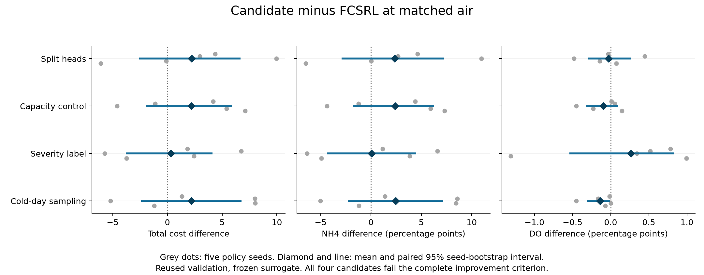

# Active DARROW research goal

The goal remains active. No agent extension improvement over FCSRL is verified.
Previous environment failures and the negative first policy pair do not exhaust
reasonable alternatives. No external blocker currently prevents useful work.
This is an execution snapshot, not a live process monitor. Inspect the actual
runner/child processes before waiting, restarting or declaring a run stopped.

## Frozen environment and limits

e40 passes all unchanged e16 point-estimate gates and independent sklearn/full-day
reconstruction. Selection is pit_b95_a0.5, five structural members, eight primary
noise draws and sixteen-draw sensitivity. NH4/DO frequency is13.4993/.7211 percent
versus actual17.3158/1.1579. Normalized MAE.775476 and NH4 MAE1.977722 improve over
the original predictor. e42/environment_freeze.json pins weights, PIT bank,
authorized input and inference sources. Do not change them during paired studies.

Onset prediction remains weak. NH4 AP improves.30003 to.42675, but probability-.5
recall drops.53191 to.18997 and one-hour onset matching drops10/89 to3/89.
DO AP.01149 and AUC.48475 are near chance; no DO onset is matched. Brier error
improves over the original for both constraints, but DO is worse than persistence.
See e40/results.md and event_reference_audit.json. Passing frequency gates does
not establish accurate onset prediction or real-plant causal safety.

The bands show point-frequency criteria only. Member ranges are not confidence
intervals and do not establish agent improvement. Failed e16 to e39 experiments
remain in their experiment folders and archived checkpoints/logs. e41 is a
prepared causal-history alternative with unit checks, not a fitted result.

## Completed work

- All15 e42 baseline jobs finish: five original-model FCSRL, five frozen-model
  FCSRL and five frozen-model PPO seeds. Each uses401280 transitions and cost
  limit12. Both simulators use the same terminal reward/air accounting fix;
  the historical reset alias, unchanged states/costs and correction are tested.
- All ten cross-model evaluations of the five original-model final policies
  finish in results/e44_old_policy_cross. Native metrics reproduce checkpoint
  replay. Compact evidence is e42/old_baseline_validation.json.
- e43 split and independent two-head summed-cost capacity-control implementations
  pass target-boundary, shared initialization/RNG, original-objective limit,
  gradient, EMA, serialization and one-update pipeline checks. These checks
  are not policy seeds or performance evidence.
- Full split seed0 and its formal matched-air evaluation finish. At air47194.44
  versus47206.56m3, cost increases24.121875 to28.468125 and NH4 increases25.35855
  to29.96645 percent. DO decreases.03289 to0. The air mismatch is.02568 percent.
  Native split uses84893.57m3 and cost12.1325. This is a retained negative
  single-seed result, not a five-seed conclusion. See e44/split_seed0.json.
- Source, checkpoint and budget guards, air-only matching, five-seed reporting
  and common-reference capacity contrast are implemented. Reports reject smoke
  runs, missing/duplicate seeds, mixed references and excessive actual air gaps.

## Latest verified continuation

All ten split/capacity policies finish401280 transitions. All five split
matched evaluations finish. split_comparison.json fails the prespecified
criterion: matched mean cost22.464125 to24.681125, NH4 percentage23.20868
to25.57026 and DO percentage.43776 to.40987. All three paired uncertainty
intervals cross zero. Every seed matches air within1 percent. This neither
proves improvement nor establishes consistent worsening.

All five capacity comparisons finish, with matched mean cost24.6515 versus
baseline22.464125. Its three quality uncertainty intervals cross zero and the
prespecified improvement criterion fails. The split/capacity common-reference
contrast also fails. Both match-reference and mutual air checks pass. These
are retained negative or inconclusive results, not an external blocker.
capacity_comparison.json and capacity_contrast.json hold full five-seed data.
Both methods' generated evaluation queries and weights are uploaded to the
existing draft with verified remote size/SHA256 in the artifact indexes.

e45 prepares a single-head severity-supervision candidate. Training-only label
and support checks, original objective/gradient/RNG equivalence, serialization
and380 actual environment-transition equivalence checks pass. A6080-step smoke
and its independent1600-case final-checkpoint replay finish successfully.
All five full severity seeds and the queued matched-air comparison finish
successfully. Both runner handles exit0. comparison.json fails all three
quality conditions: mean matched cost22.771375 versus22.464125, NH4 percentage
23.26632 versus23.20868 and DO percentage.70355 versus.43776. All paired
uncertainty intervals cross zero and all air matches pass1 percent. No
improvement is established. Full weights/logs and generated query evaluations
are remotely verified in e45/artifacts.json and evaluation_artifacts.json.
Never count the earlier smoke as performance evidence or restart these jobs.

Next investigate train/validation distribution and final training-cost gaps.
The existing risk-stratified sampling rule already failed in e15 on another
environment; do not present it as untested or invent a novelty claim. A repeat
on the fixed e40 model would be a separate model-sensitive controlled test,
only justified after the diagnostic. Preserve the current criteria and all
earlier failures; reasonable alternatives remain and there is no blocker.

The completed diagnostic finds training/validation mean temperature19.714
versus15.962C and initial NH4 violation fractions.07447 versus.3. The old risk
sampler barely changes temperature to19.605C. e46 instead prepares a fixed
coldest-training-quarter half-probability sampler, with no validation-fitted
cutoff/probability, unchanged FCSRL and uniform matched-air evaluation.
Its weighted mean temperature18.801C still leaves a gap. This is a different
sampling intervention, not evidence of a causal mechanism or novelty. Run its
real-transition/reset checks and smoke/replay before any full training.

e46 now passes those checks and6080-step smoke/independent1600-case replay.
All five full seeds and matched evaluations complete, and the pipeline exits0.
e46/comparison.json fails the full criterion: cost24.65 versus22.464125,
NH4 percentage25.64921 versus23.20868 and DO percentage.29816 versus.43776.
Only the DO paired interval lies below zero. All reference-air matches pass.
Weights/logs and complete generated evaluation queries are remotely verified
in e46/artifacts.json and evaluation_artifacts.json. Do not restart these jobs.

Next: e47 compares the existing five PPO final policies at the same original
FCSRL air, kind=diagnostic. No fitting or new extension claim is involved.
This missing matched-air ablation can inform whether another representation
intervention is justified. Preserve all existing criteria, seeds and failures.
The e47 five-worker diagnostic launches in results/e47_ppo_diagnostic at
source commit34b9f26 and chains its report after successful completion.
Its policies are already trained; no new extension or causal attribution is
claimed. Inspect the actual batch handle before waiting or restarting.

The figure shows all five paired seed differences and each mean/bootstrap
interval from the four complete reports. Intervals are unadjusted exploratory
summaries under repeated validation, not independent confirmation or a
population guarantee. All four candidates fail the full criterion.

Capacity seed0 at matched air47157.57m3 increases cost24.121875 to28.294375.
Seed1 at matched air65276.90m3 decreases cost13.33625 to12.208125, but DO
increases.17566 to.22697 percent. These are retained mixed single-seed results,
not a five-seed improvement. Complete five-seed reports now retain these cases.

Both ten-case cross-model evaluation batches and the five PPO checkpoint
replays finish. New validation JSONs and model_sensitivity.json preserve the
strong simulator dependence. The sensitivity figure compares native air and
does not establish matched-air dominance. Split artifacts for all five seeds
are uploaded to the existing draft with verified size and SHA256.

Action diagnosis does not support more zero-air actions or sharper air changes
as the split seed0 failure explanation. Encoder synchronization logs do not
demonstrate a large single-update shock. Training-only observation probes are
descriptive, not causal. DARROW_NEXT_HYPOTHESIS.md records the severity-aware
auxiliary rationale; e45 now contains its checked implementation and smoke.

## Prior launch record and next actions

- results/e43_first_pair contains completed split and capacity-control seed0.
  Do not duplicate either job.
- results/e43_remaining completes all eight split/capacity seed1..4 jobs.
- results/e44_new_policy_cross and results/e44_ppo_native are complete.
- Capacity seed0 matching finishes in results/e44_capacity_first, seed1 in
  results/e44_capacity_seed1 and seeds2..4 in results/e44_capacity_later. Split
  seeds1..4 matching finishes in results/e44_split_remaining. Exact commands and
  definitions are in e42/e43/e44 READMEs. Never overwrite a prior result folder.
- Both five-seed reports and the common-reference capacity contrast finish.
  Keep native results and actual air mismatch visible. Seed counts, members,
  noise draws and dates are different uncertainty units. Matching changes
  candidate actions using air only; it is not a native-policy dominance claim.
- If the complete comparison fails, diagnose consistent train/validation and
  action-distribution differences before defining another justified extension.
  Do not replace the predefined matching rule or omit seed0 to rescue a result.
  Continue reasonable alternatives rather than declaring failure an external block.

Do not modify e42/darrow training Python sources while policy runners are active:
source hashes are locked and later launches reject changed implementations.
Evaluation batch manifests similarly pin their runtime source files.

## Artifacts and constraints

Policy draft release id443333191, tag lee-e42-e44-policy-comparison-20261113,
contains separate completed original-FCSRL, frozen-FCSRL and PPO subsets with
verified remote size/SHA256 in e42 artifact indexes. Archive existence is not
an improvement claim. Source data and residual/PIT banks are excluded. Earlier
environment archives and PIT reconstruction are in DARROW_REPRODUCTION.md.

Work remains under Lee/ on lee/darrow-safety-calibration. Preserve original
FCSRL commit d882b91054d52c7a63a18a21f7db67bbbed82b63 and Apache license, keep
final test41 unused, and run scope/paper checks before pushing. No agent or
real-plant success claim is justified yet. Continue the full user objective.
