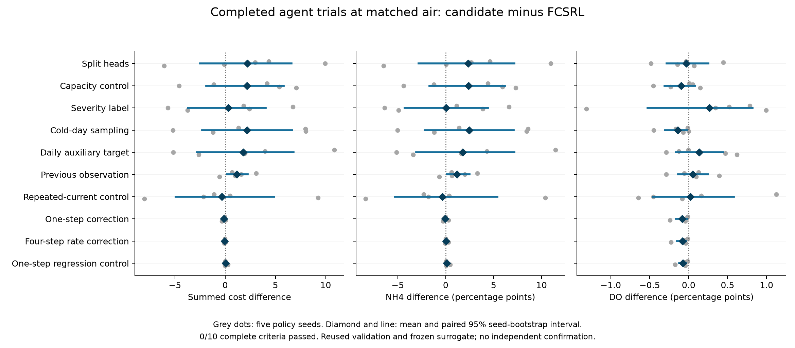

# Completed fixed-environment agent trials

All completed registered reports are included, including capacity/repeated-current controls and failures. These are exploratory reused-validation comparisons, not a ranking or independent confirmation.

All methods use policy seeds0..4 and401280 transitions per seed, the same frozen e40 environment, final checkpoints and actual air matched within1 percent for each seed. Baseline air/cost/NH4/DO values and freeze identities agree across every report.

| Candidate | Cost mean | NH4 percent | DO percent | Cost difference95 interval | NH4 difference95 interval | DO difference95 interval | Complete criterion |
| --- | --- | --- | --- | --- | --- | --- | --- |
| [Split heads](../experiments/e43/split_comparison.json) | 24.681125 | 25.570263 | 0.409868 | [-2.498250,6.593250] | [-2.818684,7.153158] | [-0.281842,0.254211] | Fail |
| [Capacity control](../experiments/e43/capacity_comparison.json) | 24.651500 | 25.606184 | 0.342763 | [-1.900625,5.827500] | [-1.693553,6.165658] | [-0.307105,0.081447] | Fail |
| [Severity label](../experiments/e45/comparison.json) | 22.771375 | 23.266316 | 0.703553 | [-3.697000,4.032250] | [-4.289474,4.404737] | [-0.526184,0.821711] | Fail |
| [Cold-day sampling](../experiments/e46/comparison.json) | 24.650000 | 25.649211 | 0.298158 | [-2.295875,6.667625] | [-2.206184,7.087237] | [-0.302500,-0.019211] | Fail |
| [Daily auxiliary target](../experiments/e48/comparison.json) | 24.266875 | 24.971711 | 0.572368 | [-2.824750,6.787250] | [-3.092237,7.160395] | [-0.166053,0.440526] | Fail |
| [Previous observation](../experiments/e54/history_comparison.json) | 23.627375 | 24.378289 | 0.492632 | [0.174750,2.239000] | [0.099342,2.490395] | [-0.133947,0.250395] | Fail |
| [Repeated-current control](../experiments/e54/repeated_comparison.json) | 22.150750 | 22.857368 | 0.459211 | [-4.941375,4.892500] | [-5.312237,5.402763] | [-0.455789,0.578816] | Fail |
| [One-step correction](../experiments/e55/comparison.json) | 22.323750 | 23.141184 | 0.357500 | [-0.250625,-0.030125] | [-0.215000,0.110526] | [-0.163947,-0.022368] | Fail |
| [Four-step rate correction](../experiments/e56/h4_comparison.json) | 22.422125 | 23.242500 | 0.359737 | [-0.103375,0.011875] | [-0.054474,0.156447] | [-0.151974,-0.028289] | Fail |
| [One-step regression control](../experiments/e56/h1_comparison.json) | 22.503000 | 23.321053 | 0.366316 | [-0.043750,0.163750] | [0.016842,0.291184] | [-0.123158,-0.031579] | Fail |

Differences are candidate minus its paired FCSRL reference; negative quality differences favor the candidate. NH4/DO intervals use percentage points. Cost is the95-step sum of the two violation indicators, not electricity or money. The complete criterion requires cost and NH4 upper endpoints below zero, DO upper endpoint at most zero and all five air matches.

Intervals use10000 paired policy-seed resamples. Model members, noise draws, dates and supervised classifier seeds are not independent policy seeds. Shared references correlate the trials. An interval crossing zero proves neither improvement nor equivalence. Multiple reused-validation comparisons are not multiplicity-adjusted independent evidence.

Native metrics, all air-only queries, sample SDs and seed values remain in the linked full reports/artifact indexes. The plot does not replace their source/checkpoint/replay guards. The e47 PPO diagnostic is documented separately because it is not a new FCSRL extension.

Pending registered reports: none. No partial seed or smoke outcome is inserted as a complete result.

## Report checksums

- Split heads, e43/split_comparison.json, SHA256 618e04395966032581489656f6438606525ecb9b8969064438f229a4c334771b
- Capacity control, e43/capacity_comparison.json, SHA256 5ac7afbbd497b256dfdbac0b00316279a5b32bcbd9f3ea5cf92b27808b073b63
- Severity label, e45/comparison.json, SHA256 d6facf91e860d9749bde7ff32487e738d5b2a1313825dd9e35254e9419c16c1d
- Cold-day sampling, e46/comparison.json, SHA256 9b1203449f1ba821e18e9eea740efb11bd806e2bcf6dfbd05df1a160beeda285
- Daily auxiliary target, e48/comparison.json, SHA256 32e80e0afa21b4c13dd40d02998744e4d113f4f5e52ae47c56b52aa144747fa7
- Previous observation, e54/history_comparison.json, SHA256 9febcb63de23fb4182b5e1f7866d0a3681bb4cdb50ca17df382a60a198c255a0
- Repeated-current control, e54/repeated_comparison.json, SHA256 f6e372eac3df65d5fd18781df1318dc726c9766021ff42faaa39183041e8afe8
- One-step correction, e55/comparison.json, SHA256 de7705e507d53c9ca7f451268b0b3dddd3609b9fb69085a3a110412cfa8f81de
- Four-step rate correction, e56/h4_comparison.json, SHA256 94b95c0c31ae9e32ac8083027d98587326436ab337c4dcd6535ad925bcce997f
- One-step regression control, e56/h1_comparison.json, SHA256 9051a5c3ec9dee75279a2e5395580a32e23db4edbf312c2a01d85cf1d122efbc

Regenerate with Lee/analysis/plot_all_agent_trials.py. All inputs are compact generated summaries; no source observations, stochastic banks or final test metrics are read.
