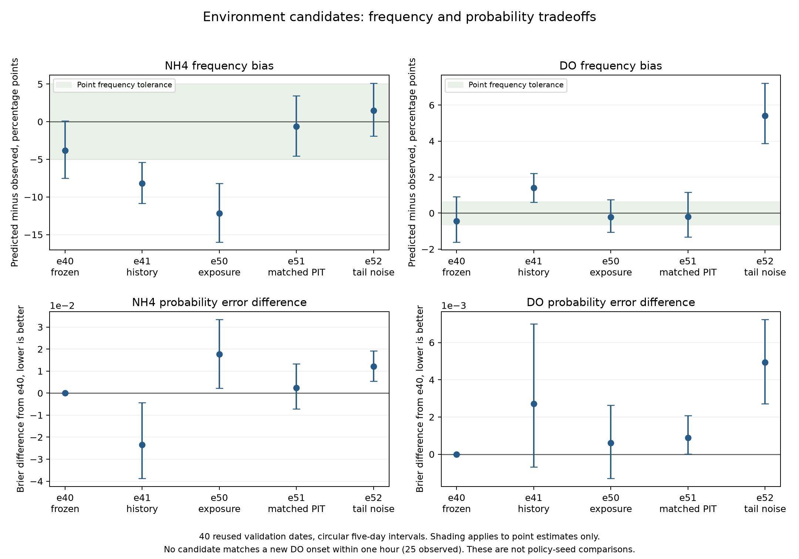

# Audited environment tradeoffs

This table compares environment forecasts only. All models use the same40 reused validation dates.
No policy result or final test observation enters this summary. Smaller MAE or closer frequency alone
does not establish a complete safety-prediction improvement.

| Model | Normalized MAE | NH4 predicted percent | DO predicted percent | NH4 Brier | DO Brier | NH4 onsets within1h | DO onsets within1h | Original point gate |
| --- | --- | --- | --- | --- | --- | --- | --- | --- |
| [e40](../experiments/e40/summary.json) | 0.775476 | 13.499342 | 0.721053 | 0.126486 | 0.013327 | 3/89 | 0/25 | pass |
| [e41](../experiments/e41/summary.json) | 0.772093 | 9.141447 | 2.555921 | 0.103089 | 0.016038 | 7/89 | 0/25 | fail |
| [e50](../experiments/e50/summary.json) | 0.706653 | 5.117763 | 0.946053 | 0.144188 | 0.013936 | 2/89 | 0/25 | fail |
| [e51](../experiments/e51/summary.json) | 0.796044 | 16.686842 | 0.963816 | 0.128883 | 0.014217 | 10/89 | 0/25 | pass |
| [e52](../experiments/e52/summary.json) | 0.843997 | 18.790789 | 6.565789 | 0.138671 | 0.018257 | 7/89 | 0/25 | fail |

Actual NH4/DO frequency is17.315789/1.157895 percent. The original joint point gate
also checks errors, member agreement and common-noise action ordering. It is not a population
calibration guarantee or a DO-onset criterion.

Intervals describe date variation, with model/noise draws averaged within dates. Models and draws
are not independent policy seeds. Repeated validation and multiple hypotheses remain exploratory.
e40 stays frozen for agent comparisons; e51 is a partial frequency/timing change and e52 fails.
No single candidate establishes accurate rare DO onset prediction. Full audits, source provenance
and artifact locations remain in each experiment folder.

Regenerate with plot_safety_tradeoffs.py using only committed compact reports; raw data are not needed.
