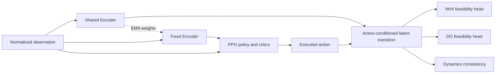

# DARROW 기법 설명과 비교 범위

이 문서는 개인 작업의 설명 자료다. 공통 프로토콜이나 논문 담당 절을 변경하지 않는다.
현재 구현의 성능 판정은 e42, e43의 정식 학습과 e44 평가가 끝난 뒤 한다.

## 세 부분을 구분한다

1. 원본 FCSRL은 상태 표현을 배우면서 동역학 일관성과 feasibility 예측을 함께 학습한다.
   원본 커밋은 d882b91054d52c7a63a18a21f7db67bbbed82b63, 라이선스는 Apache-2.0이다.
2. DARROW 적용은 처리장 기록으로 학습한 대리 환경, 공기량 행동, NH4/DO 비용,
   PPO와 PID 학습 설정을 연결한다. 원 논문의 모든 실험 설정을 재현한 것은 아니다.
3. e43 확장은 기존 표현망을 유지하고, feasibility 감독을 NH4와 DO로 나눈다.
   환경 모델 개선과 이 에이전트 확장의 효과를 같은 결과라고 부르지 않는다.

## 환경 모델과 정책은 다른 모델이다

e40 환경 모델은 현재 상태, 유입 조건, 현재와 직전 구간별 공기량으로 다음 상태를
예측한다. 다섯 앙상블 구성원 각각에 NH4/DO 조건부 분위수와 NO3 중앙값 모델이 있다.
학습 내부 기록으로 만든 PIT 경로를 사용해 하루 동안 연속된 확률적 반응을 생성한다.
선택된 상태 혼합 계수는.5, 경로 길이는95 스텝이다. e42에서 가중치, 경로 은행,
입력 파일과 추론 코드의 해시를 고정한다. 에이전트 비교 중 환경을 다시 맞추지 않는다.

정책은 관측11개를 받아 총 공기량을 결정한다. 환경 모델의 예측 상태로 다음 관측과
보상, 비용을 만든다. 따라서 에이전트 학습의 비용 라벨은 대리 환경에서 계산한 값이다.
실측 미래 수질을 에이전트의 정답으로 넣는 것이 아니다. 반면 환경 검증은 기록된
공기량을 재생한 예측과 실제 관측 수질을 비교한다.

공기량 단위는 데이터 해석에 따라 m3/h로 쓴다. 하루 지표는95개 전이,23.75시간의
공기량 합이다. 전력량 kWh를 측정한 결과가 아니다. NH4>4와 DO 최댓값>2는 이 연구의
실험 기준이며, 현장 전체의 안전이나 법적 방류 기준을 검증한 결과가 아니다.

## 원래 감독과 분리 감독

매 스텝 비용은 cN=1[NH4>4], cD=1[maxDO>2], 합계 c=cN+cD다.
기본 FCSRL 적용의 feasibility head는 합계 비용의 할인된 max 재귀를 배운다.
즉시 비용이1이면 NH4만 위반한 경우와 DO만 위반한 경우에 같은 합계 라벨을 받는다.
그렇다고 정책에서 두 상황의 정보가 전부 사라진다는 뜻은 아니다. 원래 관측과
동역학 학습에도 수질 구분 정보가 있다. 합계 비용 문제에 원래 감독은 타당하다.

e43은 공유 상태 Encoder와 행동을 받는 잠재 전이 모델 뒤에 head를 두 개 둔다.
각 head에 Fk(t)=max(ck(t),.9 Fk(t+1)) 형태의 기존 재귀를 따로 적용한다.
시간 제한으로 하루가 끝나면 초기화 전 마지막 상태의 예측값으로 이어 붙이고,
다음 날 초기화 상태로 잘못 연결하지 않는다. 실제 종료 신호의 마스크도 유지한다.

두 feasibility 분포 손실의 평균을 사용해 총 가중치를1로 유지한다.
동역학 일관성 가중치는.5다. Actor, 보상/비용 critic, PID, 관측, 보상,
합계 비용과 하루 한도12는 바꾸지 않는다. 두 head가 Actor에 새 관측을 주거나
행동을 직접 차단하는 방식도 아니다. 다른 표현을 배우는 것이 가설의 핵심이다.

## 공정한 비교

추가 신경망 크기의 영향을 구분하려고, 두 head가 모두 합계 비용을 배우는 비교군을 둔다.
분리 감독과 이 비교군은 초기 가중치가 모두 같다. 두 번째 head만 독립적으로 초기화하되
부모 정책의 난수 상태를 복원해, 원래 Actor와 공통 파라미터의 초기값을 맞춘다.
동일한 복제 head 두 개를 같은 라벨로 학습해 추가 용량을 사용하지 못하는 비교는 피한다.

각 방법은 정책 seed0부터4,401280 전이와 마지막 정책으로 비교한다.
앙상블 구성원5개나 검증 경로8개를 정책 seed가 늘어난 것으로 세지 않는다.
원래 모델과 개선 모델에 같은 기본 FCSRL을 학습하고 양쪽 환경에서 교차 평가해,
환경을 바꾼 효과를 에이전트 확장 효과와 분리한다.

기본 정책의 원래 공기량을 기준으로 후보 행동에 상수 offset을 더하는 별도 평가도 한다.
offset 선택기는 평균 공기량만 받고 NH4, DO, 비용은 보지 않는다.
이렇게 조정한 정책과 원래 정책의 결과를 함께 보고한다. 공기량 차이가1% 이내인
5개 seed 쌍에서 비용과 NH4 감소를 확인하고, DO가 악화되지 않는지도 따로 판단한다.
이 평가는 조정하지 않은 정책 자체가 더 우수하다는 주장과 구분한다.

## 현재 증거의 한계

e40은 미리 정한 환경 점추정 기준과 독립 재계산을 통과했다. 그러나 검증 구간은
여러 번 사용한 탐색용 자료이며, 드문 DO 위반의 발생 시점 예측은 여전히 약하다.
수질에 대한 공기량의 반응 방향에는 구조적 사전 가정을 사용했다. 관측 자료의
예측 정확도가 개입 행동의 실제 처리장 효과를 입증하지는 않는다.
최종 test41은 팀의 최종 비교를 위해 보존한다.

자세한 정의와 재현 근거는 [환경 결과](../experiments/e40/results.md),
[고정 환경과 기준선](../experiments/e42/README.md),
[확장과 용량 비교군](../experiments/e43/README.md),
[공기량 일치 평가](../experiments/e44/README.md),
[출처 해석](DARROW_SOURCE_REVIEW_20261112.md)에 있다.
