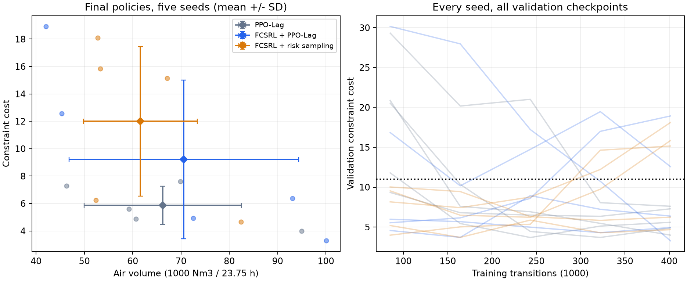
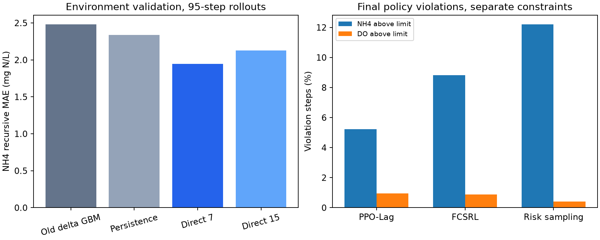

# 환경 보완과 확장 실험 결론

환경 모델의 평균 예측 오차는 줄였지만, 이번 에이전트 확장은 개선 기준을
충족하지 못했다. 공기를 덜 쓰는 대신 NH4 위반이 늘어난 평균 결과다.

## 실행한 비교

Lee/e14에서 환경 모델을 검증하고 후보 두 개를 학습했다. 하루 연속 예측의
정규화 오차를 기준으로 direct 7 후보를 선택했다. 기존 모델보다 전체 오차는
약 13퍼센트, NH4 오차는 약 22퍼센트 줄었다. 환경 선택 근거와 남은 문제는
../e14/results.md, 수치는 ../e14/summary.json에 있다.

이 환경을 고정한 뒤 PPO-Lag, 기본 FCSRL과 PPO-Lag의 결합, 위험 날짜를
더 자주 연습시키는 확장을 비교했다. 각 방법은 seed 0부터 4까지, 각각
401,280 전이를 학습했다. 총 15개 실행, 6,019,200 전이가 완료됐다.
새 환경에서 학습 구간의 기록 운전을 재생해 비용 한도를 11로 정했다.
검증 구간은 40일과 환경 모델 구성원 5개, 총 200개 에피소드다.
팀의 최종 평가 구간은 평가하거나 튜닝에 사용하지 않았다.

## 최종 정책의 검증 결과

| Method | Air (Nm3 / 23.75 h) | Cost | NH4 violation (%) | DO violation (%) |
| --- | --- | --- | --- | --- |
| PPO-Lag | 66,222 | 5.870 | 5.22 | 0.96 |
| FCSRL + PPO-Lag | 70,594 | 9.218 | 8.81 | 0.89 |
| FCSRL + risk sampling | 61,615 | 12.000 | 12.21 | 0.42 |

표는 seed 5개의 평균이다. 표준편차, 각 seed 값과 선택된 체크포인트의
보조 결과는 summary.json에 모두 보존했다. 공기량은 전기 사용량이 아니다.

확장은 기본 FCSRL보다 공기량이 평균 12.72퍼센트 적지만 NH4 위반이
3.40퍼센트포인트 높고 비용은 2.782 높다. 비용 차이의 seed 짝별 bootstrap
95퍼센트 구간은 -3.494부터 9.058, NH4 위반 차이는 -3.77부터 10.56이다.
두 구간 모두 0을 포함한다. 개선을 입증하지 못했으며, 통계적으로 악화가
확정됐다고 주장하는 것도 적절하지 않다. 사전 판정 기준은 충족하지 못했다.
PPO-Lag의 평균 점수가 낮다는 사실만으로 알고리즘의 일반적 우열을 주장하지 않는다.

## 다른 모델에서도 확인했는가

학습을 다시 하거나 정책을 조정하지 않고 다른 환경 모델에서 평가했다.

| Evaluation model | FCSRL NH4 violation (%) | Extension NH4 violation (%) |
| --- | --- | --- |
| Selected direct 7 | 8.81 | 12.21 |
| Old delta GBM | 17.52 | 25.90 |
| Alternative direct 15 | 12.62 | 19.00 |

세 모델 모두에서 확장의 평균 NH4 위반이 높다. 절대 점수도 모델에 따라
많이 달라진다. 세 모델은 같은 관측 데이터와 가정에 의존하므로 독립적인
실제 공정 검증을 대신하지 않는다. 전체 값은 cross_model.json에 있다.

기본 정책에 고정 공기량 편향을 더하는 추가 비교도 했다. 비교한 기본 정책의
평균 공기량 범위는 65,147부터 82,537이고, 확장은 61,615로 범위 밖이다.
범위 밖으로 외삽하지 않았으므로 같은 공기량에서 비용이 더 낮다는 결론은
내리지 않는다. 이는 재학습한 Pareto 곡선도 아니다. air_sweep.json에 모든
점을 기록했고, 편향 0에서 저장된 기본 정책의 점수가 재현됨을 확인했다.

## 남은 핵심 문제

환경 모델의 평균 오차 감소가 안전 예측의 정확성을 뜻하지 않았다. 선택한
모델은 기록 운전의 NH4 위반을 과대 예측하고 DO 위반을 과소 예측한다.
공기량을 늘리는 하루 연속 예측에서 DO3가 줄어드는 반응도 남아 있다.
따라서 다음 우선순위는 에이전트 설정을 더 탐색하는 것보다 NH4와 DO의
장기 예측 및 위반 빈도를 검증하고 보완하는 일이다.

이번 결과는 개인 탐색 실험이다. 공통 PROTOCOL v1이나 팀의 공식 채택
결과를 바꾸지 않았다. 원래 FCSRL 코드도 수정하지 않았다.

## 재현과 확인

실행 명령은 README.md, 실행 커밋과 소스 및 모델 해시는 summary.json,
패키지 버전은 runtime.json에 있다. 빠른 환경 계산은 기존 계산과 검증 입력
전체 및 추가 변형 입력에서 일치했다. 모델을 저장한 뒤 다시 불러왔을 때의
점수 재현도 확인했다. 관련 검증 JSON을 함께 보존했다.

중단된 첫 실행은 비교에서 제외했다. Windows 파일 잠금 재시도를 추가한
뒤 전체를 처음부터 실행했으며, PPO 재실행은 중단 전 공통 학습 기록과
seed 5개 모두에서 정확히 일치했다. 원본 데이터는 Git이나 공유 모델
첨부에 넣지 않는다. 모델과 로그 묶음의 목록 및 체크섬은 artifacts.json에 있다.
