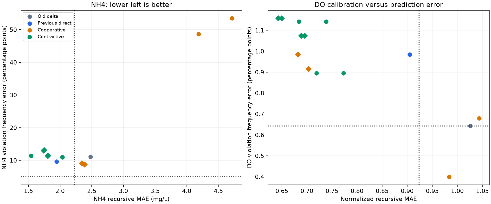

# Lee/e17 results

The fixed contractive family improves concentration prediction but still
fails the unchanged safety adoption gate. No new agent is trained on it.
All five members' fast predictions match sklearn at checked tolerance and
the initial-state contraction test passes for every prespecified combination.
Every raw and calibrated candidate is retained in summary.json.

| Model | Normalized recursive MAE | NH4 MAE | NH4 violation (%) | DO violation (%) |
| --- | --- | --- | --- | --- |
| Old delta GBM | 1.0261 | 2.4823 | 28.48 | 1.80 |
| n95_d20 | 0.6840 | 1.5396 | 5.90 | 0.02 |
| n95_d20_cal | 0.6427 | 1.7459 | 4.16 | 0.00 |
| n95_d80 | 0.7190 | 1.5396 | 5.90 | 0.26 |
| n95_d80_cal | 0.6885 | 1.7373 | 4.25 | 0.08 |
| n99_d20 | 0.7382 | 2.0359 | 28.27 | 0.02 |
| n99_d20_cal | 0.6497 | 1.8098 | 5.79 | 0.00 |
| n99_d80 | 0.7732 | 2.0359 | 28.27 | 0.26 |
| n99_d80_cal | 0.6959 | 1.8047 | 5.86 | 0.08 |

Actual transition frequencies are NH4 17.32 percent and DO 1.16 percent.
The candidate selected solely on inner data is n95_d20_cal. It improves
NH4 MAE by 29.7 percent and normalized MAE by 37.4 percent, but underpredicts
NH4 frequency by 13.15 percentage points and DO by 1.16 points. No structural
member satisfies both calibration tolerances. Accurate mean concentration
is insufficient for simulation of rare safety events.

This motivates a prospective probabilistic innovation comparison in e18.
It changes the predictive distribution, uses proper distribution scoring on
inner training calibration dates, and retains the original adoption gate.
Neither policy parameters nor development labels are used to fit innovations.
No test observation is evaluated.



## Provenance and reproduction

Execution commit 10d5b76. Runtime and chronological fit/calibration/development
partitions follow e16. No source FCSRL changes. Full optimization traces and
model files are local at results/e17_contractive. Their exact checksums and
paths are preserved in summary.json. Optimization was budget-limited and
is not claimed to have converged to a global optimum.

```powershell
$env:OMP_NUM_THREADS='1'
$env:OPENBLAS_NUM_THREADS='1'
$env:MKL_NUM_THREADS='1'
python Threemool/Lee/experiments/e17/contractive.py --data kaggle_data/darrow_15min.pkl --old kaggle_data/darrow_surrogate_gbm.pkl --out results/e17_contractive
```

Use a fresh output directory for a rerun. Original source observations are
not committed. Model members and innovation paths are not policy training seeds.
