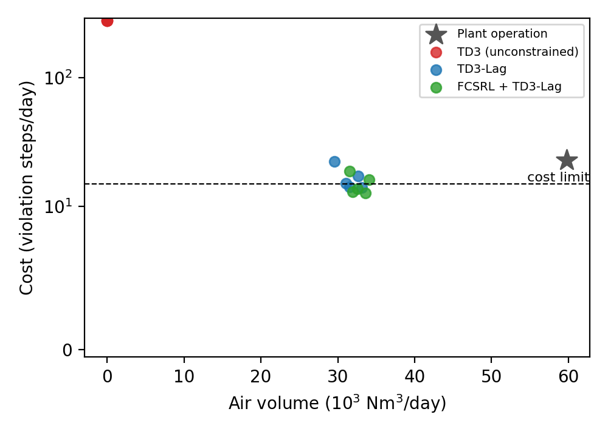
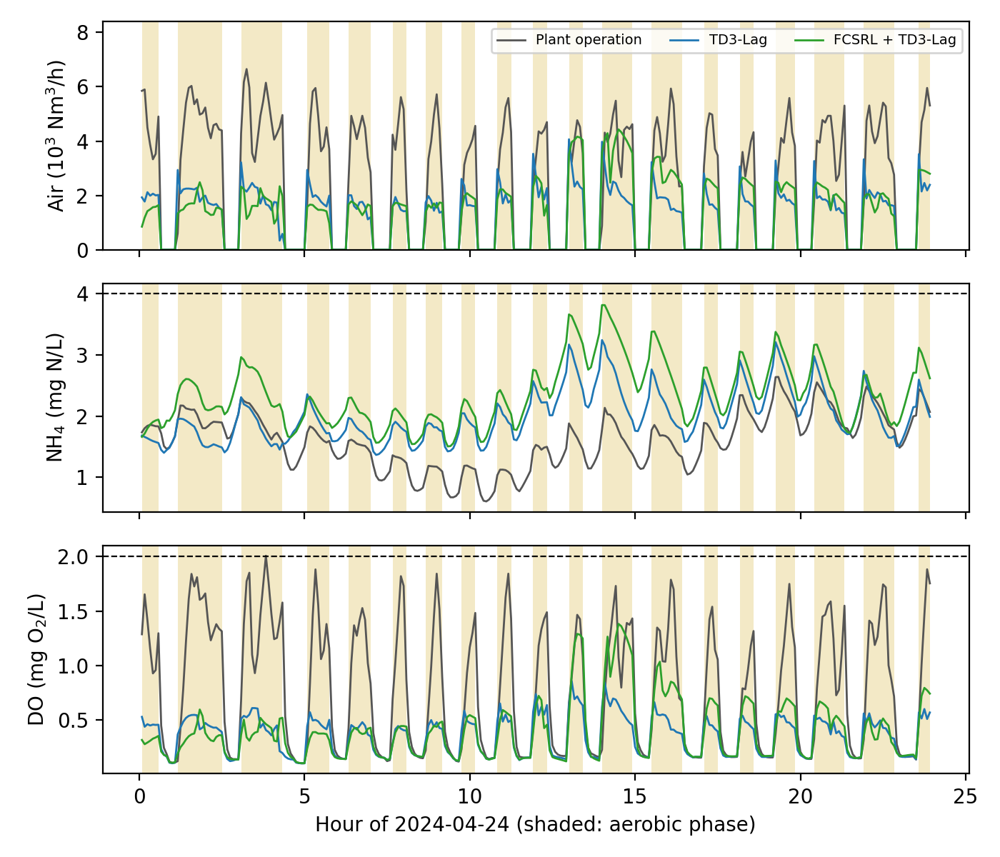

# Yoo/e02 FCSRL 의 폭기 제어 적용

수행계획서의 "기법 적용과 확장" 단계다. Yoo/e01 에서 재현한 FCSRL + TD3 Lag 를 실제 하수처리장 폭기조 데이터로 만든 Safe RL 환경에 적용하고, 표현 학습을 뺀 TD3 Lag, 제약이 없는 TD3, 실제 운전 기록과 비교한다.

## 가설과 기준 대비 바꾼 요소

- 가설: 실현 가능성(feasibility) 표현을 학습하는 FCSRL 은 같은 신경망의 TD3 Lag 보다 같은 에너지에서 NH4 와 DO 제약을 더 잘 지킨다. 두 방법 모두 실제 운전보다 공기량을 줄이면서 제약 위반을 늘리지 않는다
- 원본 대비 바꾼 요소: 환경(폭기 제어), 비용 한도(10 에서 15), 병렬 환경마다 다른 seed (Yoo/e01 에서 찾은 원본 문제 수정). 신경망과 학습 하이퍼파라미터는 원본 `TD3Repr_Lag.yaml` 그대로다

## 데이터

| 항목 | 내용 |
| --- | --- |
| 데이터셋 | Kaggle `jueyetao/wastewater-treatment-dataset` (https://www.kaggle.com/datasets/jueyetao/wastewater-treatment-dataset) |
| 원출처 | Hansen, Rani, Ortiz Arroyo, Durdevic, "Time Series Dataset for Modeling and Forecasting of N2O in Wastewater Treatment", Mendeley Data v1, 2024, DOI 10.17632/xmbxhscgpr.1 |
| 라이선스 | CC BY 4.0 (출처 표기 필요) |
| 처리장 | 덴마크 Avedøre 하수처리장, 생물반응조 3번 계열 1번 폭기조 (교대 운전, 호기와 무산소 단계 반복) |
| 기간 | 2022-06-12 ~ 2024-06-11, 1분 간격 기록 906,815 행 |
| 내려받은 날 | 2026-11-05 (Kaggle 공개 API, 인증 없이) |
| 체크섬 (sha256) | `dl.zip` 2058148f18c521bd920a70074c8513d472b1fb408c315fe3336cb00741c2e5ec, `aved_raw.csv` b57bc042a394d84da9fc9620aae5b90f029885dbafa14d3ce6ed437a0b005a2e |
| 위치 | `Yoo/data/avedore/` (Git 제외) |

```bash
mkdir -p Yoo/data/avedore && cd Yoo/data/avedore
curl -L -o dl.zip https://www.kaggle.com/api/v1/datasets/download/jueyetao/wastewater-treatment-dataset
unzip dl.zip
```

### 전처리와 분할 (`Yoo/code/wwtp/prep.py`)

- 쓰는 열: 폭기조 1번의 NH4, DO(O2), 공기량, 공정 단계, 수온, 처리장 유입량
- 품질 플래그가 0 이 아닌 값은 버리고, 5분 평균으로 묶은 뒤 15분 이하 빈칸만 선형 보간한다
- 호기 단계(공정 단계 2)가 아닐 때 공기량은 0 으로 둔다 (실제 운전과 같다)
- 현지 시각 하루 288 스텝이 모두 채워진 날만 쓴다. NO3 는 검증 구간 결측이 많아 상태에서 뺐다

| 구간 | 기간 | 쓰는 날 |
| --- | --- | --- |
| 학습 (train) | 2022-09-15 ~ 2023-12-31 | 330일 |
| 검증 (val) | 2024-01-01 ~ 2024-02-29 | 43일 |
| 평가 (test) | 2024-03-01 ~ 2024-06-10 | 60일 |

2022-09 이전은 공기량 기록이 없어 뺐다. 검증 구간은 epoch 마다의 시험과 모델 선택에만, 평가 구간은 최종 결과에만 쓴다.

## 환경 (`Yoo/code/wwtp/env.py`)

| 항목 | 정의 |
| --- | --- |
| 에피소드 | 실제 운전 하루, 5분 x 287 스텝. 유입량, 수온, 공정 단계는 그날 기록을 재생한다 |
| 상태 (11차원) | NH4, DO, 공정 단계 원핫 3개, 수온, 유입량, 시각 sin 과 cos, 현재 단계 경과 시간, 직전 공기량 |
| 행동 | 폭기조 공기량 0 ~ 8000 Nm3/h. 호기 단계가 아니면 무시하고 0 |
| 보상 | -(공기량 / 8000). 공기량을 송풍기 에너지의 대용치로 쓴다 |
| 비용 | 스텝마다 NH4 > 4.0 mg N/L 이면 1, DO > 2.0 mg O2/L 이면 1 |
| 비용 한도 | 하루 15 (287 스텝의 약 5%). 실제 운전 기록을 이 환경에서 재생하면 하루 22.9 다 |
| 상태 전이 | 데이터로 학습한 대리 모델 (아래). 에피소드마다 앙상블 구성원 5개 중 하나를 무작위로 고른다 |

DO 상한은 과포기를 막는 제약이다. 호기 단계에서 DO 가 너무 높으면 이어지는 무산소 단계의 탈질을 방해하고 에너지를 낭비한다. 실제 운전의 호기 단계 DO 95% 분위수가 1.93 이라 2.0 으로 정했다. NH4 한도 4.0 은 실제 운전의 약 87% 분위수다.

### 대리 모델 (`Yoo/code/wwtp/surrogate.py`)

공기량이 DO 만 직접 바꾸고 NH4 는 DO 를 거쳐서만 공기량의 영향을 받도록 구조를 나눴다. 실제 운전에서는 부하가 클 때 공기를 많이 넣기 때문에, NH4 모델이 공기량을 직접 보면 "공기량이 많을수록 NH4 가 높다" 는 거꾸로 된 관계를 배울 수 있다.

- DO 모델: `do[t+1] - do[t] = f(do[t], 공기량[t], 단계, 수온, nh4[t], 유입량, 시각)`
- NH4 모델: `nh4[t+1] - nh4[t] = g(nh4[t], do[t], do[t+1], 단계, 수온, 유입량, 시각)`
- 각각 은닉층 64 x 2 의 MLP 5개 앙상블, 학습 구간으로 학습하고 검증 구간으로 조기 종료

검증 (실제 공기량을 넣고 하루를 open loop 로 굴린 결과, `surrogate_report.json`):

| 지표 | 검증 구간 | 평가 구간 |
| --- | --- | --- |
| 1 스텝 R2 (DO 변화량) | 0.57 | 0.34 |
| 1 스텝 R2 (NH4 변화량) | 0.11 | 0.11 |
| 하루 open loop NH4 RMSE (mg/L) | 1.36 | 1.02 |
| 같은 지표, 첫 값 유지 기준선 | 1.62 | 1.55 |
| 하루 open loop DO RMSE (mg/L) | 0.31 | 0.40 |
| 일평균 NH4 상관계수 (모델 대 실측) | 0.61 | 0.73 |
| 일평균 NH4 (모델 / 실측) | 2.04 / 2.72 | 1.45 / 1.63 |

공기량 배율에 대한 반응 (평가 구간 60일 x 구성원 5개, `sensitivity.json`):

| 실제 공기량 대비 배율 | 0 | 0.25 | 0.5 | 0.75 | 1.0 | 1.25 | 1.5 | 2.0 |
| --- | --- | --- | --- | --- | --- | --- | --- | --- |
| NH4 위반 (%) | 96.4 | 91.0 | 34.4 | 8.5 | 5.4 | 3.6 | 2.7 | 2.2 |
| DO 위반 (%) | 0.0 | 0.0 | 0.0 | 0.0 | 2.6 | 15.3 | 30.1 | 42.8 |

공기를 줄이면 NH4 위반이, 늘리면 DO 위반이 늘어난다. 두 제약 사이에서 에너지를 줄이는 문제가 성립한다.

## 비교 방법과 학습 조건

| 방법 | 내용 |
| --- | --- |
| 실제 운전 | 그날 기록된 공기량을 그대로 넣는다 (처리장의 DO 설정값 제어) |
| TD3 (제약 없음) | 아래 TD3 Lag 에서 Lagrangian 상한을 0 으로 막음. 에너지만 줄인다 |
| TD3 Lag | FCSRL 과 같은 신경망에서 표현 학습(encoder 학습)만 끈 것. encoder 는 초기값으로 고정 |
| FCSRL + TD3 Lag | 원본 그대로 |

| 항목 | 값 |
| --- | --- |
| 설정 | `Yoo/code/wwtp/td3_wwtp.yaml` (원본 `TD3Repr_Lag.yaml` 에서 env 와 비용 한도만 바꿈) |
| 학습량 | 25 epoch x 2500 gradient step, 약 2M 환경 스텝 (원본과 같음) |
| seed | 0, 1, 2, 3, 4 |
| 모델 선택 | epoch 마다 검증 구간 10 에피소드. 원본 트레이너 규칙(비용 한도 안에서 보상 최대)으로 최고 epoch 를 고른다 |
| 최종 평가 | 고른 모델로 평가 구간 60일 x 앙상블 구성원 5개 = 300 에피소드, 탐색 잡음 없음 |
| 원본 코드 | `czp16/FCSRL` 커밋 d882b91 을 수정 없이 라이브러리로 부른다 |
| 장치 | RTX 3090 x2, 동시 4개 실행 (실행 하나 약 47분, 전체 약 3시간 15분) |

## 결과

실행: 2026-11-05 20:46 ~ 2026-11-06 00:00, 15개 실행 모두 정상 종료 (td3 seed 0 은 아래 "실행 중 고친 점" 의 수정 뒤 다시 돌렸다). 전체 표는 `results.md`, seed 별 지표는 `run_metrics.json`.

평가 구간 300 에피소드, seed 5개 평균 ± 표준편차 (val 기준 최고 epoch 모델):

| 방법 | 공기량 (Nm3/일) | 실제 운전 대비 | NH4 위반 (%) | DO 위반 (%) | 비용 (/일, 한도 15) | 한도 만족 날 (%) |
| --- | --- | --- | --- | --- | --- | --- |
| 실제 운전 | 59811 | 기준 | 5.41 | 2.58 | 22.9 | 77.0 |
| TD3 (제약 없음) | 0 ± 0 | -100% | 96.38 ± 0.00 | 0.00 ± 0.00 | 276.6 ± 0.0 | 0.0 ± 0.0 |
| TD3 Lag | 31592 ± 1254 | -47% | 5.69 ± 1.17 | 0.12 ± 0.07 | 16.7 ± 3.2 | 82.0 ± 3.6 |
| FCSRL + TD3 Lag | 32745 ± 968 | -45% | 4.84 ± 0.51 | 0.36 ± 0.34 | 14.9 ± 2.3 | 83.5 ± 2.2 |

마지막 epoch 모델로 재면 TD3 Lag 는 공기량 31731, 비용 14.8 ± 1.5, FCSRL 은 공기량 32916, 비용 14.3 ± 1.1 이다.





해석:

1. 두 제약 강화학습 방법 모두 대리 모델 위에서 실제 운전 공기량을 약 45% 줄이면서 하루 비용을 실제 운전(22.9)보다 낮췄다. 하루 궤적 그림을 보면 정책은 호기 단계 DO 를 실제 운전(최고 1.5 ~ 2)보다 훨씬 낮은 0.5 안팎으로 유지하고, NH4 를 실제 운전보다 높지만 4.0 아래로 두는 쪽을 골랐다. 즉 절감은 "NH4 여유분을 써서 DO 설정값을 낮추는 것" 에서 나온다
2. 제약이 없는 TD3 는 5개 seed 모두 공기를 전혀 넣지 않는 정책으로 수렴했다 (NH4 위반 96%). 이 환경에서 비용 신호 없이는 의미 있는 제어가 나오지 않으며, 보상과 비용이 서로 맞서는 Safe RL 문제로 잘 정의되었음을 보여 준다
3. 가설 중 "FCSRL 이 TD3 Lag 보다 제약을 더 잘 지킨다" 는 이번 결과로 지지되지 않는다. FCSRL 이 평균 비용이 낮고(14.9 대 16.7) seed 사이 편차도 작지만, 공기량을 약 3.6% 더 쓰며 차이는 seed 편차 안이다 (seed 5개 Welch t 검정 p: 비용 0.40, 공기량 0.19, 마지막 epoch 모델은 비용 0.58). 평균 비용이 한도 15 안에 든 것은 FCSRL 뿐이지만 seed 별로 보면 두 방법 모두 한도를 넘는 seed 가 있다 (FCSRL 2개, TD3 Lag 3개)
4. 모델 선택이 불안정하다. 검증 10 에피소드로 고르다 보니 seed 0 은 두 방법 모두 4 epoch 모델이 뽑혔고 이 모델들의 평가 비용이 가장 높다 (18.8, 22.5). 마지막 epoch 모델이 평균과 편차 모두 더 낫다. Safety Gymnasium 과 달리 이 환경은 상태가 저차원(11차원)이고 정보가 거의 다 관측되므로, 표현 학습의 이점이 작게 나오는 것이 자연스러울 수 있다

### 실행 중 고친 점

- `--method td3` 를 처음에 PID 이득을 모두 0 으로 두는 방식으로 만들었더니 원본 `PIDLagrangianUpdater` 가 KI 로 나누는 부분에서 ZeroDivisionError 로 멈췄다. 이득은 그대로 두고 `init_lagrg = 0`, `max_lambda = 0` 으로 lambda 를 0 에 묶는 방식으로 고쳐 seed 0 을 다시 돌렸다. 학습 로그에서 lambda 가 끝까지 0 인 것을 확인했다

## 한계

- 대리 모델 위의 결과다. 대리 모델은 평가 구간 일평균 NH4 를 실측보다 약 0.2 (검증 구간은 0.7) 낮게 예측한다. 실제 운전 기록을 재생했을 때 NH4 위반률도 대리 모델은 5.4% 인데 실측은 8.3% 다. 그래서 절감률은 실제보다 낙관적일 수 있다
- 대리 모델은 운전 기록 범위 안에서만 믿을 수 있다. 공기량 상한을 기록의 99% 분위수 근처(8000)로 묶었지만, 학습된 정책이 기록에 드문 공기량 시간 패턴을 쓰면 오차가 커질 수 있다
- 공정 단계(호기, 무산소 전환 시각)는 기록을 따르고 정책이 바꾸지 못한다. 실제 처리장에서 큰 절감은 단계 길이 조절에서 나올 수도 있다
- 에너지는 공기량 합(Nm3/일)으로 쟀다. 송풍기 효율 곡선이 없어 kWh 로 바꾸지 않았다
- 폭기조 하나만 다룬다. 같은 송풍기를 쓰는 다른 조와의 상호작용은 없다
- 정책은 호기 단계 내내 DO 를 0.5 안팎으로 유지한다. 낮은 DO 자체는 운전 기록에도 있지만(학습 구간 호기 단계의 18% 가 평균 DO 0.7 미만), 대리 모델의 NH4 1 스텝 R2 가 0.11 로 낮아 공기를 줄였을 때 NH4 가 얼마나 오르는지를 충분히 배우지 못했을 수 있다. Yoo/e03 에서 성질이 다른 대리 모델(GBM)을 만들어 보니 같은 공기량 감소에 대한 NH4 반응이 MLP 와 크게 달랐다. 또 낮은 DO 는 N2O 배출을 늘릴 수 있는데 (이 데이터셋의 원래 주제) 이번 환경은 N2O 를 보지 않는다
- seed 5개, 검증 10 에피소드로는 FCSRL 과 TD3 Lag 의 작은 차이를 가리기 어렵다

## 재현 방법

```bash
# 환경: Yoo/e01 의 venv 에 pandas, scikit-learn 추가
uv pip install pandas scikit-learn
PY=/home/jio/fcsrl_src/.venv/bin/python
R=/home/jio/fcsrl_src/results/e02

$PY Yoo/code/wwtp/prep.py --raw Yoo/data/avedore/aved_raw.csv --out Yoo/data/avedore/aved_5min.pkl
$PY Yoo/code/wwtp/surrogate.py --data Yoo/data/avedore/aved_5min.pkl --out $R/surrogate --device cuda:1
cd Yoo/code/wwtp
$PY evaluate.py historical --data ../../data/avedore/aved_5min.pkl --surrogate $R/surrogate/surrogate.json --out $R/runs/historical
$PY evaluate.py sensitivity --data ../../data/avedore/aved_5min.pkl --surrogate $R/surrogate/surrogate.json --out $R/runs/historical
cd ../../experiments/e02
$PY run_e02.py --surrogate $R/surrogate/surrogate.json --out $R/runs --jobs 4
$PY ../../code/wwtp/evaluate.py summarize --runs $R/runs --out results.md
$PY ../../code/wwtp/plot.py --runs $R/runs --surrogate $R/surrogate/surrogate.json --out figures
```

이 폴더의 `surrogate.json` 은 실험에 쓴 대리 모델 가중치다. GPU 학습은 실행마다 조금씩 달라지므로, 같은 결과를 보려면 다시 학습하지 말고 이 파일을 쓴다.
