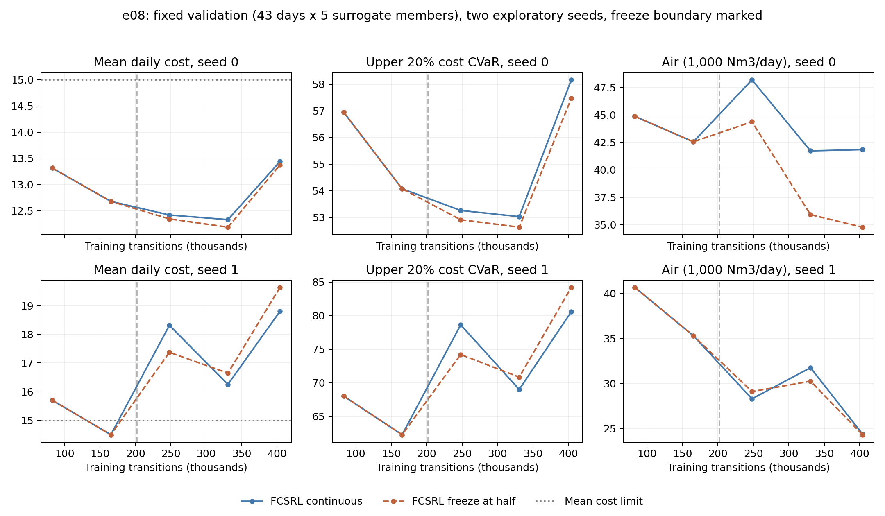

# Yoo/e08 학습한 표현의 중간 고정 대조

2026-11-06 18:10 KST에 실행 커밋 `68680d5da23392cd12c99a640f68a1c78d007b7b`로 4개를 시작했다. 18:16:53 KST에 4개 모두 정상 종료했고 집계와 저장 모델 재평가도 완료했다. 남은 실행은 없다.

## 가설과 사전 고정 조건

e07에서 encoder만 바꿔도 같은 정책망의 행동과 비용이 달라졌다. 그 효과가 실제 학습 과정에서도 나타나는지 확인한다. 원본 FCSRL의 feasibility 및 dynamics 표현 손실, PPO-Lag, 환경과 비용 정의는 유지한다. CVaR 항이나 정책 KL 보정은 이 비교에 추가하지 않는다.

| 비교군 | 처음 22회 갱신 | 나머지 22회 갱신 |
| --- | --- | --- |
| continuous | 원본 표현 학습 및 EMA | 원본 표현 학습 및 EMA 계속 |
| freeze_half | continuous와 동일 | encoder, target encoder 및 표현 보조망 가중치 고정 |

총 44회 중 절반인 22회 직후(202,048전이)에 고정한다. e07에서 검증으로 선택한 encoder 시점을 재사용하지 않는다. 이후 평가 결과에 따라 경계를 바꾸지 않는다. 두 비교군 모두 처음부터 다시 학습하고 고정 직전의 모든 저장 가중치, 관측 정규화 및 난수 상태가 일치하는지 확인한다.

정책망과 보상 및 비용 가치망은 후반부에도 학습한다. 관측 정규화도 기존처럼 계속 갱신한다. 따라서 입력 변환까지 완전히 고정하는 비교는 아니며, 표현망 가중치의 갱신 여부만 바꾼다. 처음부터 무작위 표현을 고정한 e05와 다른 대조다. 이 고정 자체를 최종 확장 기법으로 채택하지 않는다.

## 학습 및 평가

- seed 0, 1, 비교군 2개로 총 4개. 실행마다 404,096전이, 44회 갱신. CPU 1 thread씩 4개 병렬.
- 원본 FCSRL `czp16/FCSRL`의 Apache 2.0 커밋 `d882b91054d52c7a63a18a21f7db67bbbed82b63`. 수정 없이 원본 `PPOLagReprAgent.train_encoder`를 사용한다. e05와 같은 표현 구조, 손실 가중치 및 EMA다.
- 데이터 `/home/jio/사물/Yoo/data/avedore/aved_5min.pkl`, MLP `/home/jio/fcsrl_src/results/e02/surrogate/surrogate.json`. 학습 330일, 검증 43일. test는 사용하지 않는다.
- 검증 43일 x MLP 구성원 5개를 같은 순서로 5회 평가한다. 평균 비용 15 이하인 시점 중 최고 보상으로 선택하고, 만족 시점이 없으면 최소 비용 시점을 실패 표시와 함께 남긴다.
- 주요 비교는 마지막 정책의 비용과 공기량이며 중간 선택 정책, CVaR20과 seed별 변화도 보고한다. 고정 후의 변화가 한 seed에서만 좋으면 일관된 개선으로 주장하지 않는다. 공기량을 늘려 비용을 줄였는지도 함께 본다.
- 비용은 5분마다 `1[NH4 > 4] + 1[DO > 2]`를 더한 하루 합이다. reward는 음의 정규화 공기량, 공기량 단위는 Nm3/일이다. 평균 한도 15와 PID (0.02, 0.005, 0.01), 승수 상한 20을 유지한다.
- gamma 0.99, GAE 0.95, actor 학습률 0.0003, critic 0.001, PPO clip 0.2, 10 epoch, minibatch 512, KL 0.02, gradient norm 0.5. 초기 logstd -0.5, 환경 8개, horizon 1148.
- Python 3.10.19, torch 2.14.1+cu130, numpy 1.23.5, gymnasium 0.28.1. 기존 venv와 설치를 유지한다.

팀 공통 PROTOCOL 합의 전 개인 탐색 실험이다. e07에서 확인한 대리 모델의 실제 수질 과소예측은 해결되지 않았다. 여기의 차이를 실제 공정 안전성 개선으로 해석하지 않는다. 모델을 동시에 바꾸면 표현 고정의 효과를 분리할 수 없어 이번 비교에서는 유지한다.

## 코드와 검증

`train_ppo.py`는 e05 수집 및 PPO 계산을 유지하고, `scheduled_agent.py`가 지정 시점 이후 원래 구현의 `frozen` 분기를 사용한다. 고정 후 모든 표현 모듈의 SHA256이 유지되는지 매 갱신 확인한다. 경계 체크포인트는 두 비교군 모두 저장한다. checkpoint는 평가용이며 optimizer와 환경 상태를 포함한 학습 재시작 기능은 아니다.

단위 검증은 경계 전 기존 구현과 모든 가중치 및 갱신 지표 일치, 경계 후 표현 고정과 정책 학습 지속, 저장 및 복원, 잘못된 경계 거부를 확인한다. 실제 데이터의 짧은 실행은 2회 갱신 중 1회 뒤 고정해 경계를 통과하도록 구성한다. 이 짧은 실행의 성능으로 경계를 선택하지 않는다.

```bash
export PYTHONPATH=/home/jio/fcsrl_src/FCSRL
/home/jio/fcsrl_src/.venv/bin/python -m unittest discover -s Yoo/experiments/e08 -p 'test_*.py'
/home/jio/fcsrl_src/.venv/bin/python Yoo/experiments/e08/run_pilot.py \
  --data /home/jio/사물/Yoo/data/avedore/aved_5min.pkl \
  --model /home/jio/fcsrl_src/results/e02/surrogate/surrogate.json \
  --out /home/jio/fcsrl_src/results/e08/pilot
```

입력과 소스 SHA256, 실행 커밋과 명령은 runtime `manifest.json`에 기록한다. 전체 로그와 모델은 `/home/jio/fcsrl_src/results/e08/pilot`에 보존하고 Git에는 작은 결과와 재현 스크립트만 넣는다.

## 결과와 판정

**표현 갱신을 중단하는 것만으로 후반 검증 제약 이탈이 해결되지는 않았다.** 두 seed의 마지막 정책을 비교했다.

| seed | 계속 학습 비용 | 중간 고정 비용 | 계속 학습 공기량 (Nm3/일) | 중간 고정 공기량 (Nm3/일) |
| --- | --- | --- | --- | --- |
| 0 | 13.437 | 13.372 | 41,850 | 34,779 |
| 1 | 18.800 | 19.633 | 24,400 | 24,332 |

seed 0은 비슷한 비용으로 공기량이 줄었지만 seed 1의 비용은 더 높았다. 마지막 정책 평균 비용은 16.119에서 16.502로 높아졌고, 한도 만족 seed는 1/2로 같다. 선택 정책의 평균 공기량은 38,527에서 35,049로 줄고 평균 비용은 13.414에서 13.937로 높아졌다. seed 1의 선택 정책은 두 군 모두 고정 전 같은 epoch 2이므로, 고정군의 선택 성능에 이 seed를 개선 사례로 세면 안 된다.

경계 전 두 군의 모든 저장 가중치, 관측 정규화, PyTorch 난수 상태, 학습 로그와 PID 기록이 같았다. 고정군의 모든 표현 모듈은 경계 이후 마지막까지 같았고, 계속 학습한 군은 e06의 마지막 가중치와 정규화까지 정확히 재현했다. 선택 및 마지막 모델 8개의 복원 평가도 기록과 정확히 일치했다.

### 남은 문제

마지막 정책을 같은 결정적 행동으로 train과 val에 다시 평가했다.

| seed 1 | 학습 평균 비용 | 검증 평균 비용 | 학습 CVaR20 | 검증 CVaR20 |
| --- | --- | --- | --- | --- |
| 계속 표현 학습 | 11.982 | 18.800 | 52.852 | 80.581 |
| 중간부터 고정 | 9.564 | 19.633 | 41.176 | 84.209 |

학습 비용과 CVaR가 개선돼도 검증은 개선되지 않았다. 또한 중간 고정 seed 1의 학습 비용을 검증의 초기 NH4 두 집단 비율로 재가중하면 14.442로, 실제 검증 비용 19.633과 5.190이 남는다. 따라서 초기 NH4가 높은 날의 비율 차이만으로 현재 격차 전체를 설명하지 않는다. 이는 기술적인 분해이며 인과효과 추정은 아니다.

검증의 구성원 0 비용은 중간 고정 시 52.95에서 59.72로 늘었다. 구성원별 비용 변화가 같지 않으므로 특정 구성원을 빼거나 검증 결과에 맞춰 샘플을 바꿔 개선을 만들지 않는다. e07에서 확인한 대리 모델의 장시간 수질 과소예측과 함께 점검해야 한다. 원본 학습 중 확률적 수집 비용과 이번 결정적 전수 평가 비용도 구분한다.

### 다음 단계의 우선순위

이 결과는 e07의 encoder 교체가 행동을 바꾼다는 관찰을 부정하지 않는다. 다만 22회 이후의 가중치 변화가 후반 제약 이탈의 유일한 원인이라는 가설은 지지하지 않는다. 더 이른 시점의 표현 변화, 계속 갱신되는 정규화 및 정책 학습의 영향은 남는다. KL 보정의 효과 자체를 시험한 것은 아니다.

현재 근거만으로 KL 보정을 추가하거나 고정 시점을 검증에 맞춰 다시 고르는 실험은 시작하지 않는다. 먼저 대리 모델의 장기 재생과 초기 NH4 집단 내부의 train 및 val 차이, 대리 모델 구성원별 실패 조건을 점검하는 쪽으로 우선순위를 수정한다. FCSRL 표현 손실과 PPO라는 큰 구조는 유지한다. 개선을 확인한 확장이나 실제 공정 안전성을 주장하지 않는다.

[전체 결과와 seed 편차](results.md), [학습 및 검증 재평가](train_val_final.json), [초기 상태 구성비 분해](initial_mix_decomposition.json). 실행 커밋과 해시는 [launch.json](launch.json), 완료 검증은 [summary.json](summary.json)에 있다.



집계는 `summarize.py`, 그림은 `plot.py`에 `--runs /home/jio/fcsrl_src/results/e08/pilot --out Yoo/experiments/e08`을 전달해 재생성한다. 그림의 출력 경로는 `Yoo/experiments/e08/figures`로 지정한다. `postreview.py`는 위 학습 실행과 같은 data, model 인수 및 runs, out 인수를 받아 train과 val의 마지막 정책을 재평가한다.
