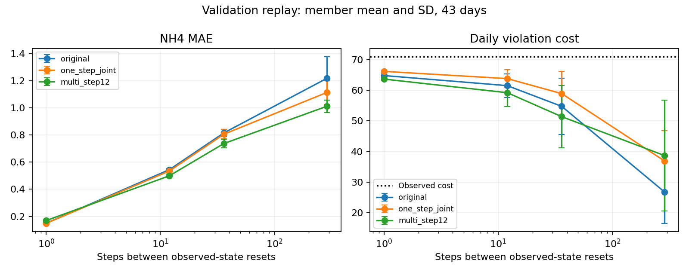

# Yoo/e09 모델 보정 대조 결과

실행 커밋 `2fedaa00a891e9176fb0af067066dfff044d712f`. 종료 `2026-11-06T09:37:46.852126+00:00` (UTC).

원본 모델과 같은 구조의 구성원 5개를 각각 300회 추가 갱신했다. 값은 구성원 평균 ± 표준편차(ddof=0)이며 독립 학습 seed 편차가 아니다. 한 스텝과 12스텝 군은 같은 창과 샘플 순서를 사용했다. 자세한 [설정과 한계](README.md)를 따른다.

비용은 NH4 > 4 및 DO > 2인 5분 전이를 하루 287개에 걸쳐 합산한다. 이 표는 정책 성능이 아니라 실제 공기량 재생의 정확도이며, 예측 비용을 실측에 가깝게 맞추는 것이 목적이다.

## 검증 전체 43일

| 방법 | 재시작 간격 (스텝) | NH4 MAE | DO MAE | 예측 비용 | 실측 비용 | 날짜별 비용 MAE |
| --- | --- | --- | --- | --- | --- | --- |
| 기존 모델 | 1 | 0.150 ± 0.001 | 0.181 ± 0.004 | 64.791 ± 0.495 | 70.953 | 6.879 ± 0.336 |
| 기존 모델 | 12 | 0.545 ± 0.008 | 0.226 ± 0.008 | 61.512 ± 3.890 | 70.953 | 16.409 ± 2.793 |
| 기존 모델 | 36 | 0.816 ± 0.027 | 0.231 ± 0.008 | 54.758 ± 9.128 | 70.953 | 27.386 ± 4.880 |
| 기존 모델 | 287 | 1.218 ± 0.160 | 0.234 ± 0.009 | 26.791 ± 10.228 | 70.953 | 54.209 ± 3.904 |
| 한 스텝 결합 추가 학습 | 1 | 0.149 ± 0.001 | 0.183 ± 0.002 | 66.167 ± 0.251 | 70.953 | 6.005 ± 0.291 |
| 한 스텝 결합 추가 학습 | 12 | 0.535 ± 0.006 | 0.230 ± 0.003 | 63.805 ± 2.916 | 70.953 | 16.730 ± 2.040 |
| 한 스텝 결합 추가 학습 | 36 | 0.806 ± 0.035 | 0.236 ± 0.003 | 58.912 ± 7.278 | 70.953 | 28.330 ± 1.638 |
| 한 스텝 결합 추가 학습 | 287 | 1.114 ± 0.087 | 0.238 ± 0.003 | 36.916 ± 9.852 | 70.953 | 54.893 ± 1.781 |
| 12스텝 결합 추가 학습 | 1 | 0.169 ± 0.002 | 0.189 ± 0.001 | 63.647 ± 0.398 | 70.953 | 7.698 ± 0.376 |
| 12스텝 결합 추가 학습 | 12 | 0.500 ± 0.013 | 0.211 ± 0.004 | 59.209 ± 4.545 | 70.953 | 14.581 ± 3.404 |
| 12스텝 결합 추가 학습 | 36 | 0.738 ± 0.031 | 0.215 ± 0.004 | 51.395 ± 10.219 | 70.953 | 27.605 ± 5.400 |
| 12스텝 결합 추가 학습 | 287 | 1.012 ± 0.047 | 0.218 ± 0.004 | 38.688 ± 18.105 | 70.953 | 55.028 ± 2.855 |

## 검증 저온 15일

| 방법 | 재시작 간격 (스텝) | NH4 MAE | DO MAE | 예측 비용 | 실측 비용 | 날짜별 비용 MAE |
| --- | --- | --- | --- | --- | --- | --- |
| 기존 모델 | 1 | 0.125 ± 0.001 | 0.160 ± 0.004 | 67.147 ± 0.459 | 72.400 | 5.440 ± 0.476 |
| 기존 모델 | 12 | 0.429 ± 0.009 | 0.202 ± 0.010 | 63.720 ± 4.385 | 72.400 | 15.480 ± 3.124 |
| 기존 모델 | 36 | 0.671 ± 0.043 | 0.207 ± 0.011 | 56.947 ± 10.057 | 72.400 | 29.747 ± 5.387 |
| 기존 모델 | 287 | 1.205 ± 0.413 | 0.212 ± 0.016 | 35.400 ± 19.702 | 72.400 | 53.133 ± 4.405 |
| 한 스텝 결합 추가 학습 | 1 | 0.126 ± 0.002 | 0.162 ± 0.003 | 68.267 ± 0.283 | 72.400 | 5.173 ± 0.209 |
| 한 스텝 결합 추가 학습 | 12 | 0.437 ± 0.013 | 0.207 ± 0.005 | 68.387 ± 3.606 | 72.400 | 16.067 ± 2.215 |
| 한 스텝 결합 추가 학습 | 36 | 0.693 ± 0.054 | 0.213 ± 0.005 | 68.320 ± 7.951 | 72.400 | 29.360 ± 1.356 |
| 한 스텝 결합 추가 학습 | 287 | 1.083 ± 0.157 | 0.218 ± 0.005 | 65.453 ± 22.026 | 72.400 | 53.507 ± 7.069 |
| 12스텝 결합 추가 학습 | 1 | 0.145 ± 0.004 | 0.168 ± 0.002 | 66.600 ± 0.283 | 72.400 | 5.933 ± 0.270 |
| 12스텝 결합 추가 학습 | 12 | 0.434 ± 0.019 | 0.193 ± 0.006 | 66.160 ± 4.862 | 72.400 | 10.933 ± 3.298 |
| 12스텝 결합 추가 학습 | 36 | 0.678 ± 0.049 | 0.198 ± 0.007 | 62.600 ± 10.931 | 72.400 | 26.307 ± 3.301 |
| 12스텝 결합 추가 학습 | 287 | 1.057 ± 0.139 | 0.203 ± 0.006 | 65.693 ± 29.806 | 72.400 | 57.613 ± 4.987 |

## 검증 수온 범위 내 28일

| 방법 | 재시작 간격 (스텝) | NH4 MAE | DO MAE | 예측 비용 | 실측 비용 | 날짜별 비용 MAE |
| --- | --- | --- | --- | --- | --- | --- |
| 기존 모델 | 1 | 0.163 ± 0.001 | 0.192 ± 0.005 | 63.529 ± 0.597 | 70.179 | 7.650 ± 0.312 |
| 기존 모델 | 12 | 0.607 ± 0.014 | 0.239 ± 0.007 | 60.329 ± 3.793 | 70.179 | 16.907 ± 2.659 |
| 기존 모델 | 36 | 0.893 ± 0.026 | 0.244 ± 0.007 | 53.586 ± 8.881 | 70.179 | 26.121 ± 4.662 |
| 기존 모델 | 287 | 1.225 ± 0.125 | 0.246 ± 0.007 | 22.179 ± 6.151 | 70.179 | 54.786 ± 3.871 |
| 한 스텝 결합 추가 학습 | 1 | 0.161 ± 0.001 | 0.194 ± 0.002 | 65.043 ± 0.311 | 70.179 | 6.450 ± 0.358 |
| 한 스텝 결합 추가 학습 | 12 | 0.588 ± 0.006 | 0.243 ± 0.003 | 61.350 ± 2.616 | 70.179 | 17.086 ± 1.994 |
| 한 스텝 결합 추가 학습 | 36 | 0.867 ± 0.025 | 0.248 ± 0.003 | 53.871 ± 7.023 | 70.179 | 27.779 ± 2.563 |
| 한 스텝 결합 추가 학습 | 287 | 1.130 ± 0.053 | 0.249 ± 0.003 | 21.629 ± 3.696 | 70.179 | 55.636 ± 2.658 |
| 12스텝 결합 추가 학습 | 1 | 0.182 ± 0.002 | 0.200 ± 0.001 | 62.064 ± 0.493 | 70.179 | 8.643 ± 0.457 |
| 12스텝 결합 추가 학습 | 12 | 0.535 ± 0.014 | 0.221 ± 0.004 | 55.486 ± 4.519 | 70.179 | 16.536 ± 3.505 |
| 12스텝 결합 추가 학습 | 36 | 0.770 ± 0.026 | 0.224 ± 0.004 | 45.393 ± 9.949 | 70.179 | 28.300 ± 7.004 |
| 12스텝 결합 추가 학습 | 287 | 0.988 ± 0.026 | 0.226 ± 0.003 | 24.221 ± 12.042 | 70.179 | 53.643 ± 5.953 |

## 학습 전체 330일

| 방법 | 재시작 간격 (스텝) | NH4 MAE | DO MAE | 예측 비용 | 실측 비용 | 날짜별 비용 MAE |
| --- | --- | --- | --- | --- | --- | --- |
| 기존 모델 | 1 | 0.186 ± 0.001 | 0.158 ± 0.003 | 39.042 ± 0.169 | 45.958 | 7.112 ± 0.143 |
| 기존 모델 | 12 | 0.581 ± 0.010 | 0.196 ± 0.003 | 31.878 ± 1.010 | 45.958 | 15.073 ± 0.976 |
| 기존 모델 | 36 | 0.749 ± 0.011 | 0.201 ± 0.003 | 30.332 ± 3.656 | 45.958 | 21.165 ± 1.704 |
| 기존 모델 | 287 | 1.340 ± 0.160 | 0.206 ± 0.003 | 39.644 ± 17.743 | 45.958 | 51.913 ± 9.744 |
| 한 스텝 결합 추가 학습 | 1 | 0.183 ± 0.001 | 0.157 ± 0.002 | 39.349 ± 0.077 | 45.958 | 6.903 ± 0.065 |
| 한 스텝 결합 추가 학습 | 12 | 0.563 ± 0.006 | 0.194 ± 0.002 | 31.336 ± 0.654 | 45.958 | 15.698 ± 0.544 |
| 한 스텝 결합 추가 학습 | 36 | 0.713 ± 0.004 | 0.198 ± 0.002 | 27.055 ± 1.761 | 45.958 | 22.216 ± 0.930 |
| 한 스텝 결합 추가 학습 | 287 | 1.108 ± 0.041 | 0.201 ± 0.002 | 22.566 ± 4.678 | 45.958 | 41.802 ± 2.006 |
| 12스텝 결합 추가 학습 | 1 | 0.201 ± 0.001 | 0.169 ± 0.002 | 39.138 ± 0.090 | 45.958 | 7.160 ± 0.045 |
| 12스텝 결합 추가 학습 | 12 | 0.504 ± 0.006 | 0.193 ± 0.000 | 31.244 ± 1.475 | 45.958 | 15.334 ± 1.393 |
| 12스텝 결합 추가 학습 | 36 | 0.662 ± 0.005 | 0.195 ± 0.000 | 26.782 ± 3.685 | 45.958 | 22.410 ± 2.409 |
| 12스텝 결합 추가 학습 | 287 | 0.962 ± 0.025 | 0.196 ± 0.000 | 23.621 ± 8.186 | 45.958 | 37.355 ± 0.616 |

## 검사

- 기존 numpy 및 PyTorch의 12스텝 예측: 구성원 5개 모두 일치.
- 두 학습군의 날짜와 창 샘플 해시: 모든 구성원 쌍에서 일치.
- 모든 loss와 gradient 유한. 저장 모델 numpy 추론과 학습망 출력 일치.
- 같은 날짜 안의 연속 5분 자료만 사용. val로 gradient 또는 checkpoint 선택을 하지 않았고 test 미사용.

