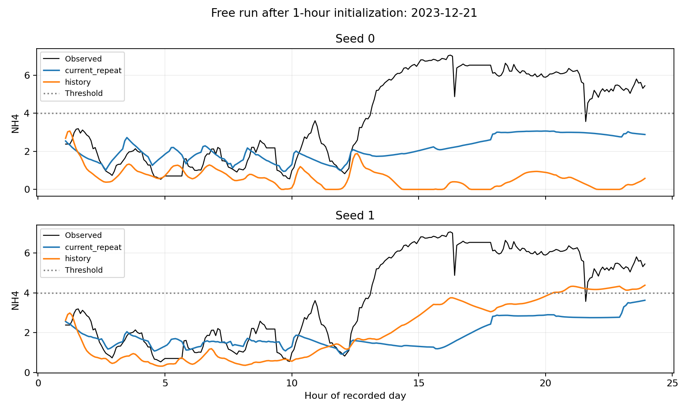

# Yoo/e10 결과

실행 커밋 `701335953b74b2ff91ffdea3cd8e81385df35d97`. 종료 `2026-11-06T09:54:06.682784+00:00` (UTC).

## 기존 모델의 위반 사건 재현

val 43일, 287전이, 구성원 5개 평균이다. 실제 NH4 위반 시작 137개 중 15분 이내 예측 시작과 일대일 매칭되는 수를 집계했다. 시작 경계에서 진행 중인 사건은 제외했다. 이 표는 기존 모델 진단이며 아래 새 모델 내부 holdout과 구간이 다르다.

| 모델 | NH4 위반 스텝 recall | precision | 시작 매칭 수 | 시작 F1 | 최장 관측 위반 길이 MAE (분) |
| --- | --- | --- | --- | --- | --- |
| original | 20.19% | 70.35% | 4.4/137 | 0.055 | 118.23 |
| e09_multistep | 31.82% | 56.87% | 18.2/137 | 0.183 | 131.98 |

## 새 모델 내부 holdout

2023-10-16부터 2023-12-31의 완전한 66일이다. 각 날짜 00:00부터 01:00까지 관측값으로 초기화한 뒤 275전이를 평가한다. 평균 한도 15를 만족하는 정책을 평가하는 실험이 아니다. seed 2개를 각각 제시한다.

| 입력 | seed | 재시작 간격 | NH4 MAE | DO MAE | 예측 비용 | 실측 비용 | 날짜별 비용 MAE | NH4 시작 F1 | 최장 위반 길이 MAE (분) |
| --- | --- | --- | --- | --- | --- | --- | --- | --- | --- |
| current_repeat | 0 | 1 | 0.302 | 0.182 | 42.86 | 45.00 | 5.23 | 0.863 | 6.82 |
| current_repeat | 0 | 12 | 0.721 | 0.226 | 40.32 | 45.00 | 11.98 | 0.343 | 27.20 |
| current_repeat | 0 | 275 | 1.584 | 0.237 | 70.27 | 45.00 | 57.70 | 0.158 | 165.15 |
| history | 0 | 1 | 0.253 | 0.154 | 42.17 | 45.00 | 4.53 | 0.853 | 5.76 |
| history | 0 | 12 | 0.668 | 0.219 | 43.06 | 45.00 | 10.36 | 0.477 | 25.61 |
| history | 0 | 275 | 1.464 | 0.263 | 29.32 | 45.00 | 36.38 | 0.155 | 103.41 |
| current_repeat | 1 | 1 | 0.297 | 0.179 | 42.89 | 45.00 | 5.29 | 0.875 | 5.61 |
| current_repeat | 1 | 12 | 0.691 | 0.231 | 38.80 | 45.00 | 13.08 | 0.373 | 26.36 |
| current_repeat | 1 | 275 | 1.496 | 0.245 | 38.82 | 45.00 | 47.55 | 0.113 | 154.39 |
| history | 1 | 1 | 0.246 | 0.147 | 41.91 | 45.00 | 4.45 | 0.865 | 5.45 |
| history | 1 | 12 | 0.626 | 0.214 | 40.56 | 45.00 | 11.59 | 0.490 | 26.59 |
| history | 1 | 275 | 1.309 | 0.262 | 16.80 | 45.00 | 34.29 | 0.103 | 63.64 |

## 사전 진행 기준

통과: `False`. 평균 연속 예측 비용 MAE 변화는 32.85% 감소다. 음수는 악화를 뜻한다.

| seed | 비용 MAE 개선 | 시작 F1 유지 | 최장 위반 길이 MAE 유지 | DO MAE 악화 5% 이내 | 한 스텝 NH4 MAE 악화 5% 이내 |
| --- | --- | --- | --- | --- | --- |
| 0 | True | False | True | False | True |
| 1 | True | False | True | False | True |

진행 기준은 통계적 유의성 검정이 아니다. 외부 val과 test에는 새 모델을 평가하지 않았다. 세부 사건의 누락, 매칭 수와 지속시간 오차 및 학습 구간 결과는 [JSON](trial_summary.json)에 보존했다.

## 예측 예시

내부 holdout에서 실측 NH4의 최장 위반 구간이 가장 긴 날짜를 선택했다. 동률이면 먼저 나온 날짜다. 후보에 유리한 날짜나 seed를 골라 제시하지 않고 두 seed를 함께 그린다.

