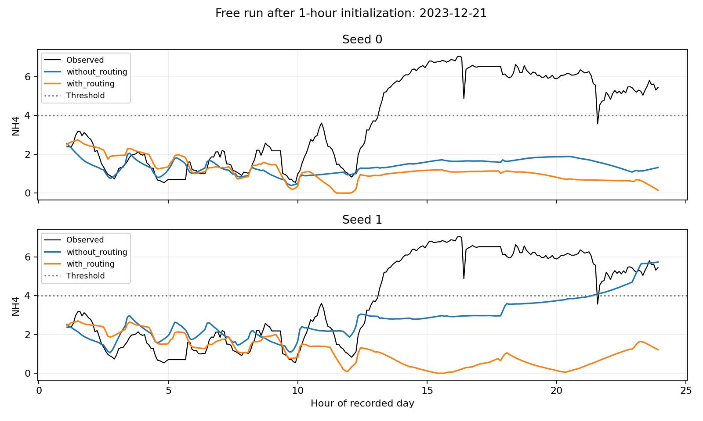

# Yoo/e11 결과

실행 커밋 `0a97165790bb199efd7266a9d723e994e619c296`. 종료 `2026-11-06T10:05:14.536799+00:00` (UTC).

새 모델 seed 0, 1을 각각 제시한다. 내부 시간 분할과 275전이 평가이며 기존 287전이 정책 성능과 섞지 않는다. e10 뒤 내부 holdout을 재사용한 탐색 결과다. 학습과 내부 판정에는 바깥 val과 test를 사용하지 않았다. 실제 공기량 및 운전 경로를 고정한 재생이므로 새 제어 정책의 인과 효과 검증이 아니다.

내부 통과 뒤 설정과 가중치를 고정하여 기존 val 43일에서 한 번 확인했다. 실행 커밋 `1b41a7400314b282c5cd8c500cf517de29adcf08`, 종료 `2026-11-06T10:06:54.311066+00:00` (UTC). 기존에 관찰한 검증 자료이므로 독립적인 새 평가 자료는 아니다. test는 사용하지 않았다.

## inner_holdout

| 입력 | seed | 재시작 간격 | NH4 MAE | DO MAE | 예측 비용 | 실측 비용 | 비용 MAE | NH4 recall | 시작 F1 | 최장 구간 MAE (분) |
| --- | --- | --- | --- | --- | --- | --- | --- | --- | --- | --- |
| without_routing | 0 | 1 | 0.298 | 0.177 | 42.88 | 45.00 | 5.33 | 88.9% | 0.858 | 6.67 |
| without_routing | 0 | 12 | 0.715 | 0.225 | 40.18 | 45.00 | 13.73 | 66.4% | 0.355 | 27.42 |
| without_routing | 0 | 275 | 1.664 | 0.240 | 46.85 | 45.00 | 54.55 | 24.5% | 0.069 | 170.45 |
| with_routing | 0 | 1 | 0.276 | 0.177 | 42.58 | 45.00 | 5.45 | 89.1% | 0.876 | 5.45 |
| with_routing | 0 | 12 | 0.625 | 0.223 | 38.15 | 45.00 | 13.09 | 68.2% | 0.417 | 22.88 |
| with_routing | 0 | 275 | 1.397 | 0.232 | 27.79 | 45.00 | 40.76 | 24.8% | 0.109 | 118.79 |
| without_routing | 1 | 1 | 0.305 | 0.178 | 42.53 | 45.00 | 4.92 | 89.3% | 0.874 | 5.91 |
| without_routing | 1 | 12 | 0.742 | 0.226 | 44.92 | 45.00 | 10.77 | 71.1% | 0.355 | 28.41 |
| without_routing | 1 | 275 | 1.766 | 0.234 | 84.02 | 45.00 | 61.02 | 54.1% | 0.138 | 245.23 |
| with_routing | 1 | 1 | 0.276 | 0.178 | 42.39 | 45.00 | 5.21 | 89.2% | 0.897 | 4.39 |
| with_routing | 1 | 12 | 0.623 | 0.221 | 39.67 | 45.00 | 11.30 | 71.0% | 0.423 | 23.33 |
| with_routing | 1 | 275 | 1.278 | 0.228 | 41.61 | 45.00 | 44.09 | 35.4% | 0.162 | 132.20 |

## fit

| 입력 | seed | 재시작 간격 | NH4 MAE | DO MAE | 예측 비용 | 실측 비용 | 비용 MAE | NH4 recall | 시작 F1 | 최장 구간 MAE (분) |
| --- | --- | --- | --- | --- | --- | --- | --- | --- | --- | --- |
| without_routing | 0 | 1 | 0.154 | 0.144 | 37.11 | 43.37 | 6.54 | 90.4% | 0.884 | 4.51 |
| without_routing | 0 | 12 | 0.512 | 0.175 | 30.74 | 43.37 | 13.45 | 64.8% | 0.406 | 22.70 |
| without_routing | 0 | 275 | 1.390 | 0.188 | 38.75 | 43.37 | 47.24 | 27.4% | 0.115 | 148.12 |
| with_routing | 0 | 1 | 0.145 | 0.141 | 37.82 | 43.37 | 6.01 | 91.4% | 0.905 | 3.17 |
| with_routing | 0 | 12 | 0.441 | 0.169 | 30.58 | 43.37 | 13.32 | 66.9% | 0.441 | 22.45 |
| with_routing | 0 | 275 | 1.221 | 0.179 | 24.23 | 43.37 | 34.15 | 27.9% | 0.118 | 81.98 |
| without_routing | 1 | 1 | 0.154 | 0.146 | 37.16 | 43.37 | 6.51 | 90.9% | 0.894 | 3.61 |
| without_routing | 1 | 12 | 0.503 | 0.179 | 33.00 | 43.37 | 11.91 | 67.9% | 0.431 | 21.43 |
| without_routing | 1 | 275 | 1.593 | 0.195 | 71.52 | 43.37 | 54.66 | 56.4% | 0.128 | 197.49 |
| with_routing | 1 | 1 | 0.145 | 0.141 | 37.38 | 43.37 | 6.36 | 91.6% | 0.912 | 3.50 |
| with_routing | 1 | 12 | 0.444 | 0.169 | 30.94 | 43.37 | 12.92 | 68.4% | 0.472 | 24.26 |
| with_routing | 1 | 275 | 1.095 | 0.179 | 31.33 | 43.37 | 35.63 | 33.8% | 0.189 | 84.43 |

## val

| 입력 | seed | 재시작 간격 | NH4 MAE | DO MAE | 예측 비용 | 실측 비용 | 비용 MAE | NH4 recall | 시작 F1 | 최장 구간 MAE (분) |
| --- | --- | --- | --- | --- | --- | --- | --- | --- | --- | --- |
| without_routing | 0 | 1 | 0.160 | 0.216 | 78.14 | 66.53 | 13.28 | 96.3% | 0.894 | 10.00 |
| without_routing | 0 | 12 | 0.506 | 0.245 | 75.79 | 66.53 | 17.49 | 76.6% | 0.321 | 30.81 |
| without_routing | 0 | 275 | 1.349 | 0.249 | 45.02 | 66.53 | 49.60 | 24.7% | 0.053 | 122.79 |
| with_routing | 0 | 1 | 0.147 | 0.220 | 78.19 | 66.53 | 13.51 | 96.0% | 0.911 | 5.47 |
| with_routing | 0 | 12 | 0.476 | 0.249 | 73.91 | 66.53 | 16.77 | 77.0% | 0.390 | 29.65 |
| with_routing | 0 | 275 | 1.786 | 0.249 | 30.00 | 66.53 | 47.84 | 15.3% | 0.070 | 98.26 |
| without_routing | 1 | 1 | 0.166 | 0.196 | 70.72 | 66.53 | 7.26 | 96.7% | 0.911 | 9.65 |
| without_routing | 1 | 12 | 0.517 | 0.230 | 76.40 | 66.53 | 16.98 | 81.4% | 0.418 | 34.88 |
| without_routing | 1 | 275 | 1.465 | 0.240 | 82.07 | 66.53 | 68.14 | 48.3% | 0.048 | 178.95 |
| with_routing | 1 | 1 | 0.152 | 0.208 | 75.09 | 66.53 | 12.19 | 95.6% | 0.900 | 6.16 |
| with_routing | 1 | 12 | 0.466 | 0.243 | 73.44 | 66.53 | 17.00 | 78.7% | 0.431 | 31.86 |
| with_routing | 1 | 275 | 1.259 | 0.250 | 43.07 | 66.53 | 48.44 | 23.5% | 0.091 | 103.72 |

## 내부 사전 기준

통과: `True`. 평균 비용 MAE 감소율 26.58%.

| seed | 비용 MAE 개선 | 시작 F1 유지 | 최장 구간 오차 유지 | DO 오차 악화 5% 이내 | 한 스텝 NH4 오차 악화 5% 이내 |
| --- | --- | --- | --- | --- | --- |
| 0 | True | True | True | True | True |
| 1 | True | True | True | True | True |

같은 진행 기준의 외부 val 통과: `True`. 평균 비용 MAE 감소율 18.23%.

진행 기준 통과가 실제 안전성 또는 모델 교체 승인은 아니다. NH4 위반 스텝 recall이 낮아지는 등 모든 지표가 개선된 것은 아니며 [최종 판정](README.md)을 함께 본다.

모든 loss 및 gradient 유한, 같은 초기 가중치와 batch 순서, 저장 복원 일치, 실제 학습망의 미래 실측값 비참조 검사를 통과했다.

## 예측 예시

e10과 같은 기준으로 실측 NH4의 가장 긴 위반 구간이 있는 날짜를 고르고 두 seed를 함께 제시한다.

