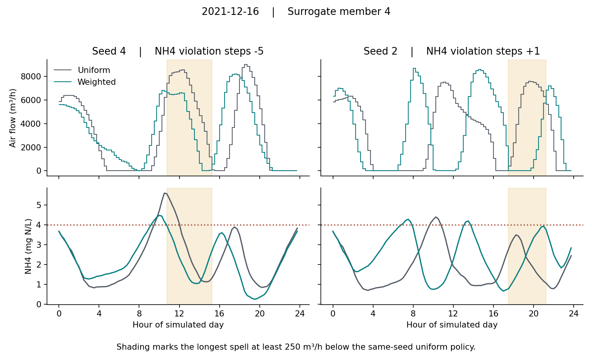

# e114 비슷한 하루 공기량을 아끼고도 NH4 결과가 갈린 겨울 경로

**감량 직전 NH4 농도와 감량 지속시간은 각각 어느 쪽에서 하루 위반이 늘었는지를 두 기간에 걸쳐 일관되게 설명하지 못했다.** e113의 균등 추출과 희귀일 두 배 추출로 학습한 FCSRL 정책을 같은 시드에서 비교했다. 각 시드가 자기 균등 정책보다 아낀 양을 계산한 뒤 같은 날짜와 대리 모델 구성원에서 절감량이 비슷한 서로 다른 시드를 짝지었다. 주 허용폭은 1,000 m³ 및 두 절감량 평균의 25% 이내다. 겨울 40일 중 조건을 만족한 20쌍에서 한 시드는 NH4 위반이 감소하고 다른 시드는 증가한 짝이 **10일, 11쌍**이었다. 이 중 개선 쪽 DO 위반도 늘지 않은 경우가 10쌍이었다. 전체 겨울 성적을 보고 주목한 seed 1 악화 대 0 또는 4 개선의 직접 매칭은 2쌍뿐이었다. [사전 설계](REFERENCES_AND_DESIGN.md), [매칭 분모](counts.csv)

| 11쌍, 날짜 동일 가중 | NH4 위반 감소 쪽 | NH4 위반 증가 쪽 |
| --- | ---: | ---: |
| 하루 절감량 (m³/23.75h) | 6,464 | 6,446 |
| 대표 감량 직전 NH4 (mg N/L) | 2.30 | 2.50 |
| 대표 감량 지속시간 (분) | 280 | 332 |
| 감량 구간 실제 평균 공급 (m³/h) | 2,800 | 2,528 |
| 시작 1시간 뒤 NH4 (mg N/L) | 2.13 | 2.75 |
| 시작 3시간 뒤 NH4 (mg N/L) | 2.60 | 2.98 |

대표 감량은 같은 시각 가중 정책이 자기 균등 정책보다 250 m³/h 이상 적게 공급한 가장 긴 연속 구간이다. 시작 시각은 시드별로 다를 수 있으며, 전일을 보고 구간을 골랐다. 공급 유량 자체가 직전 명령에서 내려간 사건만 세는 지표와는 정의가 다르다.

- 악화 쪽의 직전 NH4가 더 높았던 날짜는 전반 2/5일, 후반 2/5일이었다. 악화 쪽 감량 시간은 전반 평균 159분 길었지만 후반에는 54분 짧았다. 두 설명 모두 사전 반복 기준에 미달했다. [기간별 표](summary.csv)
- 균등 정책의 원래 하루 공기량까지 2,500 m³ 이내로 맞추자 반대 방향 짝은 3일 3쌍이었다. 그 안에서 악화 쪽 직전 NH4는 오히려 평균 1.29 mg N/L 낮았다. 절감량 허용폭을 500 m³로 좁히면 겨울 전반에는 반대 방향 짝이 없었다. 2,000 m³로 넓히면 전체 14일 20쌍이다. 짝과 모델 구성원은 날짜를 공유하므로 독립 실험 횟수로 쓰지 않는다. [모든 후보](pairs.csv)
- 대표 그림을 본 뒤 하루 NH4 위반 차이를 구간 전, 중, 후로 분해했다. 악화한 11개 짝의 해당 경로 중 5개는 대표 감량 전부터 위반 횟수가 자기 균등 대조보다 많았다. 대표 구간만 보고 하루 차이의 원인을 특정하기 어렵다. [사후 분해](phases.csv)

## 같은 날 절감량 차이가 가장 작은 짝

2021년 12월 16일, 대리 모델 구성원 4에서 seed 4와 2의 하루 절감량은 각각 1,805와 1,875 m³였다. 원래 균등 정책 공기량도 각각 79,079와 78,589 m³였다. seed 4의 대표 감량은 10시 45분부터 270분이었다. NH4는 시작 직전 3.97에서 3시간 후 1.03 mg N/L로 떨어졌고, 균등 대비 하루 위반이 5스텝 줄었다. seed 2는 17시 30분부터 225분이었고, 0.77에서 3.67 mg N/L로 올랐다. seed 2의 하루 위반은 1스텝 늘었지만 이 차이는 대표 감량 전에 발생했다. 두 정책의 DO 위반 횟수 차이는 모두 0이었다.



사례는 하루 절감량 차이가 가장 작은 반대 방향 쌍이라는 사전 규칙으로 선정했다. 그림의 음영은 각 시드의 대표 감량, 점선은 NH4 위반 기준 4 mg N/L다. 하루 위반은 각 정책 경로의 95개 스텝 종료 상태에서 계산한다. 이후 1시간, 3시간 값은 감량의 인과 효과 또는 현장 예측이 아니다. 이 분석은 관측한 모의 경로에 국한되며 새 운전 규칙의 성능을 검증하지 않았다.

## 검산과 재현

공통 v1.1 DARROW 대리 환경. e113의 두 조건, seed 0~4, 겨울 40일과 구성원 5개로 구성한 2,000개 정책 경로를 사용했다. 학습과 시험 구간 평가는 없었다. 설계 3e91d63, 주 실행 5fbb628, 사후 분해 설계 3da9fd4, 분해 구현 82b0847. 10개 경로 파일 및 초기 데이터 해시, e113 에피소드 순서와 공기량, NH4/DO 위반, 5개 시드별 평균을 검산했다. 별도 코드로 1,000개 균등/가중 짝에서 연속 구간의 처음과 길이, 원본 에피소드 표로부터 후보 및 반대 방향 쌍 식별자를 모두 재현했다. 두 번째 실행의 주 결과 파일은 최초 실행과 바이트 단위로 같았다. 원시 표와 그림 입력은 /home/jio/fcsrl_src/results/e114/verified 에 있다.

```sh
out=$(mktemp -d)
exp=Yoo/experiments/e114
/home/jio/fcsrl_src/.venv-skl191/bin/python "$exp/compare.py" "$out/run"
/home/jio/fcsrl_src/.venv/bin/python "$exp/plot.py" "$out/run" "$out/example.png"
```
