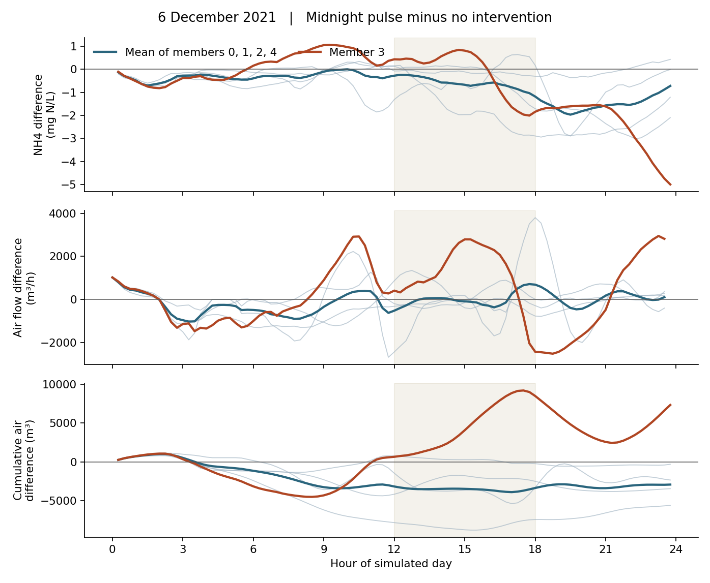

# e116 12월 6일 선제 증량 뒤 모델 3에서만 하루 공기가 늘어난 과정

**2021년 12월 6일 DARROW 모의 경로에서 모델 3도 자정 증량 후 06시까지는 공기를 3,161 m³ 아꼈다. 06~12시에 3,814 m³, 12~18시에 7,846 m³를 더 쓰면서 하루 차이가 +7,337 m³가 됐다.** 같은 첫 명령을 받은 모델 0, 1, 2, 4의 하루 차이는 평균 −2,930 m³였다. 모든 차이는 구성원별로 e113 seed 1 가중 정책을 그대로 실행한 경로를 기준으로 한다. 다른 네 모델의 무개입 총공기 평균은 모델 3보다 23,040 m³ 높아, 절대 공급 수준과 증량의 효과를 구분해야 한다. [경로 및 명령 분해 설계](REFERENCES_AND_DESIGN.md)

| 시간 | 모델 3 공기 변화 (m³) | 다른 네 모델 평균 (m³) | 모델 3 빼기 네 모델 평균 (m³) |
| --- | ---: | ---: | ---: |
| 00~06시 | −3,161 | −1,151 | −2,010 |
| 06~12시 | +3,814 | −2,027 | +5,841 |
| 12~18시 | +7,846 | −193 | +8,039 |
| 18~23시 45분 | −1,162 | +441 | −1,603 |
| 하루 | +7,337 | −2,930 | +10,267 |



## 수질과 후속 명령은 언제 갈렸나

모든 구성원이 같은 상태에서 첫 15분 유량을 1,020 m³/h 올렸다(부피 +255 m³). 그림의 얇은 선은 나머지 네 구성원의 개별 경로다. NH4와 누적 공기는 15분 종료 시각, 공기 명령은 시작 시각에 놓았다.

- 모델 3의 NH4 변화에서 다른 네 모델의 평균 변화를 뺀 절댓값이 0.1 mg N/L에 처음 닿은 시점은 01:45였다. 당시 차이는 −0.141 mg N/L로 모델 3의 NH4가 더 내려간 방향이었다. 명령 차이는 02:30에 처음 250 m³/h를 넘었고(−356 m³/h), 최대 구역 DO 효과 차이는 03:00에 처음 0.1 mg/L를 넘었다(−0.448 mg/L). 이 시각들은 차이의 크기를 읽는 기준이다.
- 06:00의 모델 3 NH4는 무개입 2.74, 증량 후 2.89 mg N/L로 부호가 바뀌었다. 이때 나머지 네 모델의 평균은 여전히 무개입보다 0.40 mg N/L 낮았다. 12:00에는 모델 3이 무개입보다 0.43 mg N/L 높았고, 네 모델 평균은 0.28 낮았다. 이후 시간대 명령 차이까지 더하면 12시에 모델 3의 누적 공기가 기준보다 653 m³ 많아졌다. [최초 차이 시각](onsets.csv), [15분별 원자료](paths.csv)

## 어떤 입력이 정책 명령 차이에 기여했나

같은 시각의 두 경로에서 NH4, NO3, 세 DO, 직전 공기 입력을 한 묶음씩 바꿔 16개 조합의 FCSRL 출력을 계산했다. 입력을 바꾸는 모든 순서의 평균으로 상호작용을 배분했다. 모델 3의 12~18시 추가 공기 7,846 m³ 중 **직전 공기량 입력에 배분된 양은 +6,074 m³**, NO3는 +1,088, DO는 +855, NH4는 −171이었다. 06~12시에는 NH4의 기여도 +2,742 m³였다. 같은 모델에서도 시간이 지나면서 입력별 방향이 달라졌다. 이는 입력이 주어진 시점의 명령에 기여한 양이며, 직전 공기량은 앞서 수질에 반응해 낸 명령도 담는다. 하루를 관통하는 독립적인 물리 원인이나 그 입력을 제거했을 때의 절감량을 뜻하지 않는다. [구성원별 입력 기여와 위반](blocks.csv)

## 후속 명령을 고정하면

모델 3에서 하루 NH4 위반은 무개입 26스텝이었다. 자정에 증량하고 FCSRL이 이후 관측에 맞춰 명령을 바꾸면 11스텝이었고, 자정에만 증량하고 이후에는 무개입 경로의 명령을 그대로 재생하면 **0스텝**이었다. 세 경우의 DO 위반은 모두 0이었다. 이 고정 경로는 자정 255 m³ 외의 추가 공급이 없으므로, 모델 3 안에서 적어도 이 날은 NH4 위반을 피하기 위해 오후에 그만큼 추가 폭기할 필요가 없었던 셈이다. 현장에서는 개입하지 않았을 때 나왔을 명령을 미리 알 수 없으므로 그대로 실행할 수 있는 규칙은 아니다.

같은 날 교체를 01:45에 한 보조 비교에서는 모델 3의 하루 공기가 오히려 1,482 m³ 줄었고 NH4 위반도 6스텝 줄었다. 이 시점에는 구성원마다 이미 다른 상태에 있었다. 이번 결과는 사전에 성적을 알고 선택한 한 날짜, 한 seed의 두 개입 시각에 한정된다. 조절이나 입력 제거를 새 정책으로 검증하지 않았다.

## 검산과 재현

v1.1 환경과 e113 최종 정책 2개를 불러 e115에서 고정한 10개 개입 경로와 e113 무개입 경로를 복원했다. 사전 설계 94fdc4d, 실행 acd63ea. 네 입력 묶음의 기여 합, 첫 명령 외 공급 고정, 시간대 합 및 위반 횟수를 검사했다. 가속 추론과 원 sklearn 추론에서 전체 경로, 시간대, 문턱 시각 CSV가 바이트 단위로 일치했다. 별도 코드로 저장된 15분 경로에서 하루 공기와 NH4/DO 위반 횟수를 다시 집계했다. 새 학습이나 시험 날짜 평가는 없었다. 서버 원시는 /home/jio/fcsrl_src/results/e116/main 및 /home/jio/fcsrl_src/results/e116/sklearn 이다.

```sh
exp=Yoo/experiments/e116
out=$(mktemp -d)
export PYTHONPATH=/home/jio/fcsrl_src/results/e113/accel-deps
export OPENBLAS_NUM_THREADS=1 OMP_NUM_THREADS=1 MKL_NUM_THREADS=1 OMP_WAIT_POLICY=PASSIVE
py=/home/jio/fcsrl_src/.venv-skl191/bin/python
"$py" "$exp/divergence.py" "$out/fast"
"$py" "$exp/divergence.py" "$out/original" --sklearn
/home/jio/fcsrl_src/.venv/bin/python "$exp/plot.py" "$out/fast/paths.csv" "$out/dec06.png"
```
