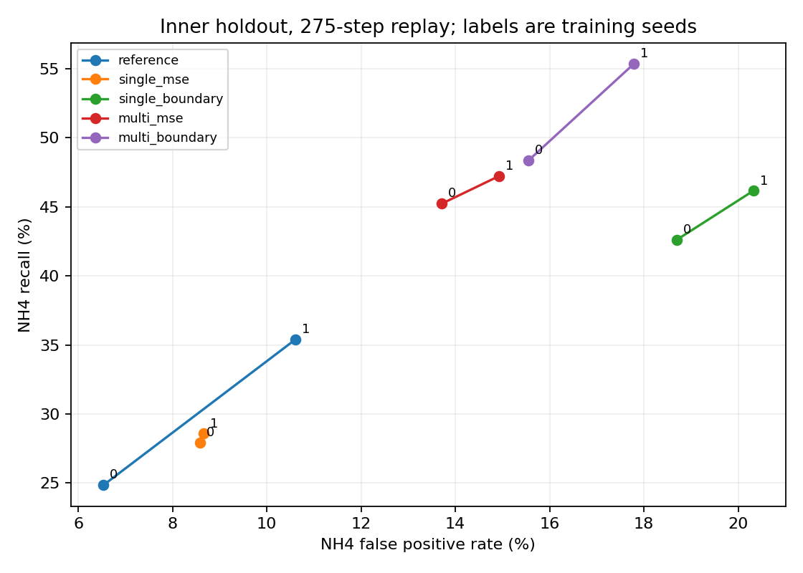

# Yoo/e12 결과

학습 실행 `58c8094a37d4b37480b80e18ca4d78114dd05001`, 종료 `2026-11-06T10:30:16.432195+00:00` (UTC).
원인 분리 실행 `59ab1d9355fd19283ab7d0ce2f0da22c9cfeb119`, 종료 `2026-11-06T10:30:49.777264+00:00` (UTC).

모든 비용은 초기 1시간 뒤 275전이에 대한 값이다. 기존 287전이 정책 성능 및 한도와 비교하지 않는다. 새 모델은 내부 holdout 66일까지만 평가했다. 기존 val 43일의 원인 분리는 e11 모델만 사용하며 test는 쓰지 않았다.

## 새 모델 내부 holdout의 연속 예측

| 군 | seed | 비용 MAE | NH4 MAE | NH4 recall | NH4 precision | NH4 FPR | DO MAE | DO recall | DO FPR |
| --- | --- | --- | --- | --- | --- | --- | --- | --- | --- |
| reference | 0 | 40.76 | 1.397 | 24.8% | 38.9% | 6.5% | 0.232 | 13.5% | 0.7% |
| single_mse | 0 | 43.29 | 1.355 | 27.9% | 35.2% | 8.6% | 0.231 | 13.8% | 0.8% |
| single_boundary | 0 | 57.76 | 1.588 | 42.6% | 27.6% | 18.7% | 0.234 | 16.8% | 1.0% |
| multi_mse | 0 | 39.52 | 1.254 | 45.2% | 35.5% | 13.7% | 0.217 | 13.5% | 0.5% |
| multi_boundary | 0 | 41.20 | 1.290 | 48.3% | 34.2% | 15.5% | 0.218 | 14.9% | 0.5% |
| reference | 1 | 44.09 | 1.278 | 35.4% | 35.8% | 10.6% | 0.228 | 13.0% | 0.7% |
| single_mse | 1 | 43.05 | 1.303 | 28.6% | 35.6% | 8.7% | 0.243 | 17.3% | 1.2% |
| single_boundary | 1 | 57.30 | 1.822 | 46.2% | 27.5% | 20.3% | 0.247 | 18.9% | 1.4% |
| multi_mse | 1 | 41.18 | 1.242 | 47.2% | 34.6% | 14.9% | 0.218 | 10.0% | 0.4% |
| multi_boundary | 1 | 44.21 | 1.292 | 55.3% | 34.2% | 17.8% | 0.219 | 12.2% | 0.4% |

FPR은 실제 비위반 중 잘못 위반으로 예측한 비율이다. precision은 예측 위반 중 실제 위반 비율이므로 분모가 다르다. 모든 단기 및 fit 결과, 시작 및 지속시간 지표는 JSON에 보존한다.

## 진행 기준

| 후보 | 시작 모델 대비 NH4 recall 변화 | single_mse 대비 변화 | screening | recall80/FPR10 |
| --- | --- | --- | --- | --- |
| single_boundary | +14.27%p | +16.13%p | False | False |
| multi_mse | +16.12%p | +17.98%p | False | False |
| multi_boundary | +21.73%p | +23.60%p | False | False |

주 후보 multi_boundary의 실패 항목:

- seed 0, reference 대비: nh4_precision_within_2pp, nh4_fpr_within_1pp, nh4_one_step_mae_within_5pct
- seed 0, single_mse 대비: nh4_fpr_within_1pp, nh4_one_step_mae_within_5pct
- seed 1, reference 대비: nh4_fpr_within_1pp, nh4_one_step_mae_within_5pct, do_recall_not_worse
- seed 1, single_mse 대비: nh4_fpr_within_1pp, do_recall_not_worse

## e11 분기 교차 진단

새 DO와 새 NH4는 e11 경로 입력 모델의 해당 분기다. 각 분기의 정규화와 경로 입력 유무까지 원래 모델대로 유지했다. 같은 두 분기를 조합한 결과는 원래 모델 출력과 정확히 같았다.

| 구간 | DO 분기 | NH4 분기 | NH4 recall 평균 | NH4 편향 평균 | NH4 FPR 평균 |
| --- | --- | --- | --- | --- | --- |
| inner_holdout | 기존 | 기존 | 39.29% | 0.494 | 20.04% |
| inner_holdout | 새 | 기존 | 28.08% | -0.354 | 8.25% |
| inner_holdout | 기존 | 새 | 32.81% | 0.088 | 11.10% |
| inner_holdout | 새 | 새 | 30.12% | -0.157 | 8.57% |
| val | 기존 | 기존 | 36.54% | -0.551 | 10.64% |
| val | 새 | 기존 | 31.26% | -0.638 | 8.41% |
| val | 기존 | 새 | 20.11% | -1.121 | 2.16% |
| val | 새 | 새 | 19.41% | -1.150 | 1.72% |

## 실측 상태 주입 진단

DO 주입은 현재 및 다음 DO를, NH4 주입은 현재 NH4를 실제 값으로 교체한다. 배포 가능한 예측 성과가 아니며 원인 진단이다.

| 대상 | 구간 | 실측 주입 | NH4 recall 평균 | NH4 FPR 평균 | NH4 편향 평균 |
| --- | --- | --- | --- | --- | --- |
| e11_with | val | none | 19.41% | 1.72% | -1.150 |
| e11_with | val | do | 77.88% | 36.55% | 0.894 |
| e11_with | val | nh4 | 94.22% | 1.08% | -0.022 |
| e11_with | val | both | 94.93% | 1.33% | 0.016 |
| e12_multi_boundary | inner_holdout | none | 51.85% | 16.67% | 0.775 |
| e12_multi_boundary | inner_holdout | do | 97.04% | 85.71% | 3.550 |
| e12_multi_boundary | inner_holdout | nh4 | 87.90% | 1.93% | 0.016 |
| e12_multi_boundary | inner_holdout | both | 88.67% | 2.41% | 0.086 |

