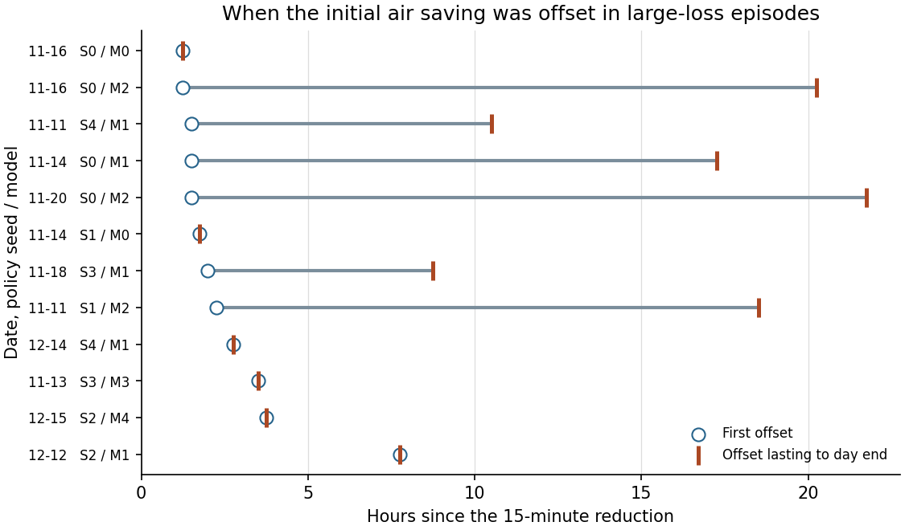

# e122 처음 아낀 공기는 언제 상쇄되며 미리 알아볼 수 있었나

**큰 손실 12건에서 최초 15분 절감량의 중앙값은 60 m³였고, 처음 절감분이 상쇄된 시각의 중앙값은 감량 시작 후 112.5분이었다. 그러나 하루 끝에 공기를 아낀 56건 중 31건도 중간에 절감분을 모두 썼다가 다시 절감했다.** NH4 상승 또는 후속 공기 명령 증가를 경보로 쓰면 두 신호 모두 큰 손실이 없었던 경로의 절반 이상에서도 울렸다. 사전에 정한 기준에서 두 경보 모두 후속 개입 후보로 올리지 않았다. [설계와 문헌](REFERENCES_AND_DESIGN.md), [판정](decision.json)

## 큰 손실과 순절감의 시간 차이

e121의 동일 예산 비교에서 수질 위험을 선별한 뒤 예상 절감량으로 선택한 100건이다. 동일 날짜, 정책 seed, 대리 모델에서 선제 증량만 한 경우와 거기에 15분 감량을 한 번 추가한 경우를 비교했다. 표는 감량 시작 이후 누적 공기 차이(감량 빼기 증량 단독)의 중앙값이다. 양수는 추가 사용, 음수는 절감이다. 괄호는 해당 시각까지 경로가 남은 사례 수다.

| 하루 결과 | 15분 (m³) | 1시간 (m³) | 3시간 (m³) | 6시간 (m³) | 하루 종료 (m³) |
| --- | ---: | ---: | ---: | ---: | ---: |
| 큰 손실 12건 | −60 (12) | −152 (12) | +274 (12) | +581 (12) | +5,110 (12) |
| 순절감 56건 | −62 (56) | −167 (55) | −142 (51) | −301 (48) | −937 (56) |
| 기타 32건 | −46 (32) | −121 (32) | −25 (32) | +151 (31) | +1,485 (32) |

큰 손실은 증량 단독보다 하루 공기를 3,227.26 m³ 초과 사용한 경우(e121의 가을 90분위수, 실제 판정에는 반올림 전 값 사용), 순절감은 0.05 m³ 초과 절약한 경우다. 큰 손실 12건의 첫 상쇄 시각은 75~465분, 가운데 50%는 90~176.25분이었다. 6건은 상쇄 뒤 다시 절감 상태로 돌아갔다. **그 뒤 당일 끝까지 다시 절감 상태로 돌아가지 않은 상쇄 시각**의 중앙값은 495분(8시간 15분)이었다. 각 사례는 15분 단위로 측정했으며 사례 간 중앙값과 사분위수는 그 사이에 올 수 있다. 순절감 56건 중 나머지 25건은 끝까지 절감 상태였다. 이 시각들은 감량하지 않은 모의 경로와 비교해야 구할 수 있다. [시드 및 기간별 분포와 시각별 관찰 수](timing.csv)



## 실제 감량 경로에서 먼저 알 수 있었나

감량 후 15~180분의 각 결정 시각에 두 신호를 별도로 검사했다. 신호에 사용하는 값은 그 시각까지 관측한 NH4와 계산한 다음 공기 명령이다. 감량하지 않은 경로의 공기는 경보의 선행 시간을 채점할 때만 사용했다.

| 신호 | 큰 손실 12건 중 첫 상쇄 전 포착 | 상쇄와 동시 또는 이후 경보 | 경보 없음 | 큰 손실이 아닌 88건 중 경보 | 순절감 56건 중 경보 |
| --- | ---: | ---: | ---: | ---: | ---: |
| 감량 직전보다 NH4가 0.1 mg N/L 이상 상승 | 6 | 1 | 5 | 49 (55.7%) | 29 |
| 감량 직전 원래 제안보다 다음 공기 명령이 250 m³/h 이상 증가 | 4 | 2 | 6 | 54 (61.4%) | 31 |

제때 잡은 사례에서만 보면 선행 시간 중앙값은 각각 67.5분, 172.5분이었다. 후자가 더 빨라 보이지만 분모는 각각 6건과 4건이다. 전반/후반의 NH4 선행 포착은 4/9와 2/3, 명령 증가는 2/9와 2/3이었다. 어느 신호도 양 기간 각각 큰 손실의 절반 초과 포착 및 비큰손실 경보율 25% 이하를 충족하지 못했다. 순절감 경로 5건은 당일 끝까지 남은 결정 시각이 3시간보다 짧았다. 경보를 실제 차단에 연결해 측정한 제어 효과는 없다. [경보 수와 분모](alarms.csv)

가을 문턱으로 선택한 보조 218건에서는 큰 손실 15건, 순절감 113건이었다. 큰 손실의 첫 상쇄 및 당일 종료까지 지속된 상쇄 중앙값은 각각 135분과 630분이었다. NH4 상승은 큰 손실 6/15를 제때 잡고 나머지 203건 중 128건에서 울렸다. 공기 명령 증가는 7/15와 141/203이었다. 두 선택 집합은 같은 시각의 감량 64건을 공유하며 같은 겨울 개발 날짜를 사용한다. 독립된 재현 표본으로 합산하지 않았다.

## 조건과 검산

Kaggle DARROW v1.1, e113의 FCSRL 가중 정책과 같은 seed의 균등 정책, e118 단발 감량, e121이 선택한 시점 및 감량 폭을 고정했다. 겨울 40일(2021년 11월 10일~12월 19일), 정책 seed 0~4, 대리 모델 5개다. 각 날짜의 95개 전이(23시간 45분) 안에서 분석했다. 공기 부피는 유량 × 0.25 h의 합이다. 기존 보상은 음의 정규화 공기 유량, 비용은 구간 뒤 NH4 >4 mg N/L 및 구역 최대 DO >2 mg/L의 지시함수 합이다. 이번 평가의 손실 집단은 하루 공기량으로 정의한다. 하루 종료 결과를 보고 나눈 두 집단의 중앙값 차이는 독립적인 손실 예측 성능이나 실제 공정 인과효과를 입증하지 않는다. [기존 후보와 정책](../e121/README.md)

설계 2492cf5, 실행 2eb3c77, 그림 16538ad. CPU, Python 3.11.14, sklearn 1.9.1, PyTorch 2.14.1. 모든 선택에서 첫 행동 전 경로, 관측, 첫 감량 부피 및 e121의 최종 부피 차이를 검산했다. 경보에 쓴 제안은 감량 후 정책이 해당 결정 관측에서 실제로 낸 명령이다. 경계를 두 번 지나는 작은 예를 검사한 뒤 전체 재생을 실행했다. 별도 집계로 15분 누적 곡선에서 첫 상쇄와 마지막 상쇄를 복원하고 경보 수를 다시 셌다. 서버 원시는 /home/jio/fcsrl_src/results/e122/main 에 있다. [체크섬](checksums.sha256)

```sh
exp=Yoo/experiments/e122
out=$(mktemp -d)/main
py=/home/jio/fcsrl_src/.venv-skl191/bin/python
export PYTHONPATH=/home/jio/fcsrl_src/results/e113/accel-deps
export OPENBLAS_NUM_THREADS=1 OMP_NUM_THREADS=1 MKL_NUM_THREADS=1 OMP_WAIT_POLICY=PASSIVE
"$py" "$exp/rebound.py" smoke "$out"
"$py" "$exp/rebound.py" replay "$out"
"$py" "$exp/rebound.py" report "$out" --tables "$out/tables"
/home/jio/fcsrl_src/.venv/bin/python "$exp/plot.py" "$out" "$out/offsets.png"
```
