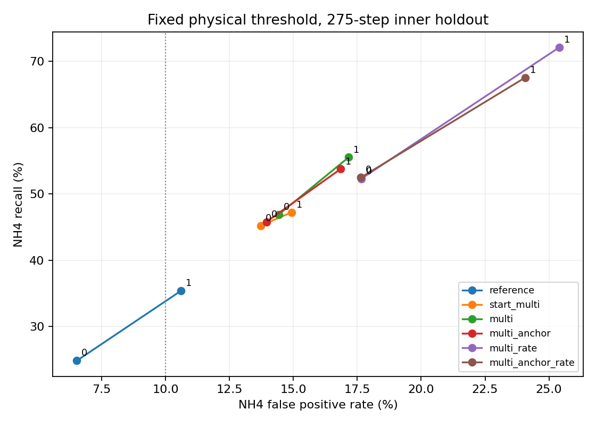

# Yoo/e13 결과

학습 실행 커밋 `78f90be556a25cc0b7aedc903ebc81b345735993`.
학습 시작 `2026-11-06T10:51:23.290289+00:00`, 완료 `2026-11-06T10:53:23.243108+00:00` (UTC).

263일 fit, 반복 관찰한 내부 holdout 66일, seed 2개. 외부 val과 test, RL 학습은 사용하지 않았다. 고정된 NH4 > 4, DO > 2 기준으로 초기 1시간 이후 275전이를 평가한다. 비용은 두 위반 스텝 수의 합이며 기존 정책 한도 15와 비교하지 않는다.

## 고정 기준에서 seed 평균

| 군 | NH4 recall | NH4 FPR | NH4 편향 | NH4 MAE | 한 스텝 NH4 MAE | DO recall | DO FPR | 비용 MAE |
| --- | --- | --- | --- | --- | --- | --- | --- | --- |
| reference | 30.12% | 8.57% | -0.157 | 1.338 | 0.276 | 13.24% | 0.71% | 42.42 |
| start_multi | 46.23% | 14.32% | +0.683 | 1.248 | 0.293 | 11.76% | 0.43% | 40.35 |
| multi | 51.21% | 15.79% | +0.742 | 1.261 | 0.298 | 12.70% | 0.50% | 39.88 |
| multi_anchor | 49.79% | 15.40% | +0.736 | 1.268 | 0.294 | 15.95% | 0.81% | 40.20 |
| multi_rate | 62.21% | 21.53% | +0.948 | 1.366 | 0.300 | 15.00% | 0.55% | 49.04 |
| multi_anchor_rate | 60.04% | 20.86% | +0.925 | 1.364 | 0.295 | 15.54% | 0.74% | 49.61 |

## seed별 고정 기준

| 군 | seed | NH4 recall | NH4 FPR | 한 스텝 NH4 MAE |
| --- | --- | --- | --- | --- |
| reference | 0 | 24.85% | 6.53% | 0.276 |
| single_mse | 0 | 27.92% | 8.58% | 0.279 |
| start_multi | 0 | 45.23% | 13.72% | 0.293 |
| multi | 0 | 46.88% | 14.42% | 0.296 |
| multi_anchor | 0 | 45.81% | 13.95% | 0.293 |
| multi_rate | 0 | 52.31% | 17.66% | 0.297 |
| multi_anchor_rate | 0 | 52.50% | 17.65% | 0.294 |
| reference | 1 | 35.38% | 10.60% | 0.276 |
| single_mse | 1 | 28.58% | 8.66% | 0.281 |
| start_multi | 1 | 47.23% | 14.93% | 0.293 |
| multi | 1 | 55.54% | 17.16% | 0.301 |
| multi_anchor | 1 | 53.77% | 16.85% | 0.294 |
| multi_rate | 1 | 72.12% | 25.40% | 0.303 |
| multi_anchor_rate | 1 | 67.58% | 24.07% | 0.296 |

## 사전 gate

| 군 | e12 screening | recall80/FPR10 | tradeoff 개선 |
| --- | --- | --- | --- |
| multi | False | False | 대조군 |
| multi_anchor | False | False | False |
| multi_rate | False | False | False |
| multi_anchor_rate | False | False | False |

주 후보 multi_anchor_rate의 screening 실패 항목:

- seed 0, reference: cost_mae_within_5pct, nh4_precision_within_2pp, nh4_fpr_within_1pp, nh4_one_step_mae_within_5pct
- seed 0, single_mse: nh4_precision_within_2pp, nh4_fpr_within_1pp, nh4_one_step_mae_within_5pct
- seed 1, reference: cost_mae_within_5pct, longest_run_mae_within_5pct, nh4_precision_within_2pp, nh4_fpr_within_1pp, nh4_mae_within_5pct, nh4_one_step_mae_within_5pct
- seed 1, single_mse: cost_mae_within_5pct, longest_run_mae_within_5pct, nh4_precision_within_2pp, nh4_fpr_within_1pp, nh4_mae_within_5pct, nh4_one_step_mae_within_5pct, do_recall_not_worse

## 같은 FPR에서 비교한 구분 능력

같은 holdout에서 판정 기준을 사후에 움직인 ROC 진단이다. 해당 농도 기준을 환경에 적용하거나 보정을 수행하지 않았으며 독립 검증 성능으로 보고하지 않는다.

| 군 | NH4 ROC AUC | FPR 10% 이하에서 NH4 recall |
| --- | --- | --- |
| reference | 0.639 | 31.87% |
| start_multi | 0.784 | 37.67% |
| multi | 0.786 | 39.46% |
| multi_anchor | 0.782 | 39.63% |
| multi_rate | 0.797 | 39.58% |
| multi_anchor_rate | 0.790 | 40.65% |

## 예측 경과 시간에 따른 NH4 편향

| 군 | 1~36스텝 | 37~144스텝 | 145~275스텝 |
| --- | --- | --- | --- |
| reference | +0.030 | +0.121 | -0.438 |
| start_multi | +0.256 | +0.772 | +0.728 |
| multi | +0.288 | +0.785 | +0.832 |
| multi_anchor | +0.284 | +0.772 | +0.830 |
| multi_rate | +0.361 | +0.963 | +1.097 |
| multi_anchor_rate | +0.350 | +0.934 | +1.076 |

## 학습 창과 하루 재생의 차이

| 군 | seed | 마지막 창 NH4 FPR | fit 36 재시작 FPR | fit 275 연속 FPR | holdout 275 연속 FPR | 최종 NH4 lambda |
| --- | --- | --- | --- | --- | --- | --- |
| multi_rate | 0 | 2.33% | 2.91% | 5.83% | 17.66% | 0.000 |
| multi_anchor_rate | 0 | 2.71% | 2.91% | 6.17% | 17.65% | 0.000 |
| multi_rate | 1 | 3.42% | 4.05% | 9.16% | 25.40% | 0.000 |
| multi_anchor_rate | 1 | 3.70% | 3.66% | 8.86% | 24.07% | 0.000 |

## 평균에 가려진 조건별 거짓경보

주 후보 multi_anchor_rate의 seed 평균이다. 수온 구간은 fit의 3분위 경계로 고정했다. 표본 수는 한 seed의 평가 전이 수이고 FPR의 분모는 그중 실제 비위반 수다.

| 조건 | fit 전이 수 | fit NH4 FPR | holdout 전이 수 | holdout NH4 FPR |
| --- | --- | --- | --- | --- |
| all | 72325 | 7.51% | 18150 | 20.86% |
| temp_0 | 24107 | 13.95% | 4825 | 34.23% |
| temp_1 | 24108 | 6.90% | 13325 | 16.28% |
| temp_2 | 24110 | 2.63% | 0 | 해당 없음 |
| phase_0 | 2932 | 30.81% | 1514 | 47.43% |
| phase_1 | 29377 | 3.23% | 6383 | 8.23% |
| phase_2 | 40016 | 10.01% | 10253 | 26.56% |

온도 3구간 x 운전 단계 3구간에서 fit FPR을 holdout 비위반 구성 비율로 재가중했다. 실제 모델을 보정하거나 재학습하지 않았다. 구성 비율 변화와 같은 구간 안의 차이를 나눈 기술적 분해이며 인과 분해가 아니다.

| 군 | 원래 fit FPR | 재가중 fit FPR | holdout FPR |
| --- | --- | --- | --- |
| start_multi | 5.18% | 6.74% | 14.32% |
| multi | 5.13% | 6.48% | 15.79% |
| multi_anchor_rate | 7.51% | 9.59% | 20.86% |

온도 및 운전 단계별 표본 수, TP/FP/FN/TN, bias, MAE는 diagnostics.json 및 condition_summary.json에 있다. 조건별 비교는 실측 운전의 관찰적 진단이며 실제 공정 인과 효과가 아니다.

