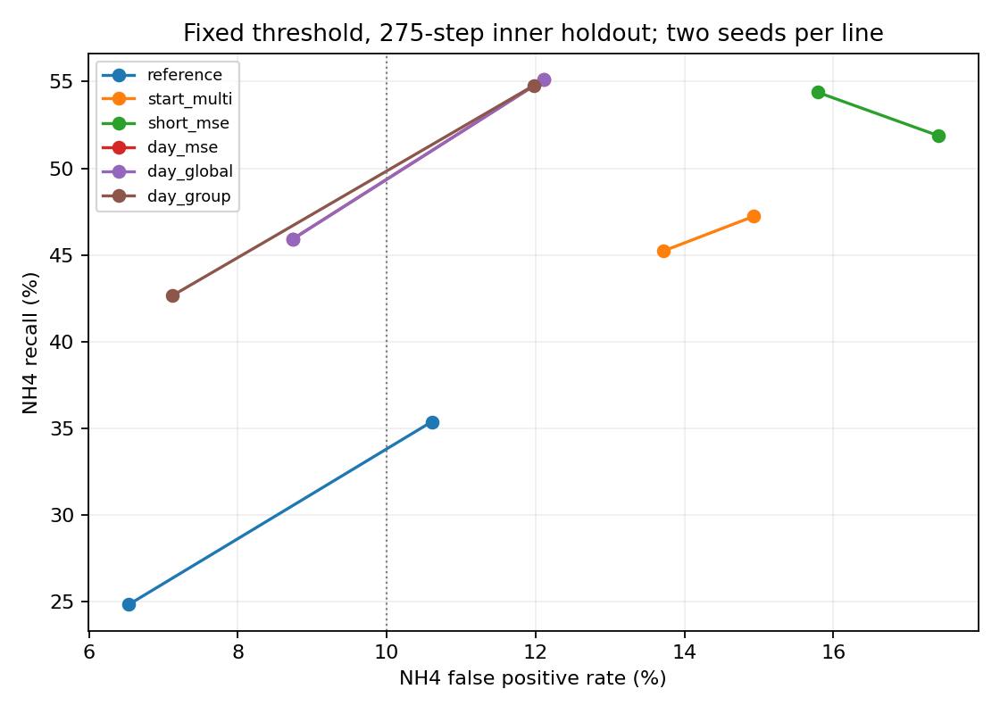

# Yoo/e14 결과

학습 실행 `90a4bdc93084c19be7c1f2eb001ad704727d8802`.
시작 `2026-11-06T12:50:15.175328+00:00`, 완료 `2026-11-06T13:00:33.453581+00:00` (UTC).

내부 holdout 66일, 초기 1시간 뒤 275전이, seed 2개 평균이다. 반복 관찰한 탐색 구간이며 외부 val, test, RL 학습은 사용하지 않았다. 고정된 물리 기준 NH4 > 4 및 DO > 2로 평가했다. 기존 287전이 정책 비용과 섞지 않는다.

## 고정 기준 성능

| 군 | NH4 recall | NH4 FPR | NH4 MAE | NH4 편향 | 한 스텝 NH4 MAE | DO recall | DO FPR | 비용 MAE |
| --- | --- | --- | --- | --- | --- | --- | --- | --- |
| reference | 30.12% | 8.57% | 1.338 | -0.157 | 0.276 | 13.24% | 0.71% | 42.42 |
| start_multi | 46.23% | 14.32% | 1.248 | +0.683 | 0.293 | 11.76% | 0.43% | 40.35 |
| short_mse | 53.13% | 16.60% | 1.311 | +0.829 | 0.294 | 16.08% | 0.72% | 41.36 |
| day_mse | 50.52% | 10.42% | 1.222 | +0.751 | 0.291 | 15.54% | 0.68% | 29.05 |
| day_global | 50.52% | 10.42% | 1.222 | +0.751 | 0.291 | 15.54% | 0.68% | 29.05 |
| day_group | 48.71% | 9.55% | 1.212 | +0.727 | 0.290 | 15.54% | 0.69% | 28.01 |

## seed별 결과

| 군 | seed | NH4 recall | NH4 FPR | NH4 MAE | DO recall | DO FPR |
| --- | --- | --- | --- | --- | --- | --- |
| reference | 0 | 24.85% | 6.53% | 1.397 | 13.51% | 0.69% |
| single_mse | 0 | 27.92% | 8.58% | 1.355 | 13.78% | 0.79% |
| start_multi | 0 | 45.23% | 13.72% | 1.254 | 13.51% | 0.46% |
| short_mse | 0 | 51.88% | 17.41% | 1.366 | 16.76% | 0.73% |
| day_mse | 0 | 45.92% | 8.74% | 1.211 | 17.57% | 0.65% |
| day_global | 0 | 45.92% | 8.74% | 1.211 | 17.57% | 0.65% |
| day_group | 0 | 42.65% | 7.12% | 1.190 | 17.84% | 0.69% |
| reference | 1 | 35.38% | 10.60% | 1.278 | 12.97% | 0.73% |
| single_mse | 1 | 28.58% | 8.66% | 1.303 | 17.30% | 1.24% |
| start_multi | 1 | 47.23% | 14.93% | 1.242 | 10.00% | 0.41% |
| short_mse | 1 | 54.38% | 15.79% | 1.257 | 15.41% | 0.72% |
| day_mse | 1 | 55.12% | 12.11% | 1.233 | 13.51% | 0.70% |
| day_global | 1 | 55.12% | 12.11% | 1.233 | 13.51% | 0.70% |
| day_group | 1 | 54.77% | 11.97% | 1.233 | 13.24% | 0.69% |

## 실제 현재 상태가 주어질 때와 자기 예측을 이어갈 때

한 스텝 재시작은 매번 실제 현재 농도를 사용하므로 배포 가능한 하루 예측 성능이 아니다. 입력 정보 부족과 누적 오차를 혼동하지 않기 위한 진단이며 미래 유입 정보의 충분성을 증명하지 않는다.

| 군 | 한 스텝 NH4 recall | 한 스텝 NH4 FPR | 하루 NH4 recall | 하루 NH4 FPR |
| --- | --- | --- | --- | --- |
| reference | 89.17% | 2.12% | 30.12% | 8.57% |
| start_multi | 89.63% | 2.46% | 46.23% | 14.32% |
| short_mse | 89.31% | 2.30% | 53.13% | 16.60% |
| day_mse | 89.31% | 2.25% | 50.52% | 10.42% |
| day_global | 89.31% | 2.25% | 50.52% | 10.42% |
| day_group | 89.37% | 2.24% | 48.71% | 9.55% |

## 사전 gate

| 군 | e12 screening | recall80/FPR10 | tradeoff |
| --- | --- | --- | --- |
| short_mse | False | False | 대조군 |
| day_mse | False | False | 대조군 |
| day_global | False | False | False |
| day_group | False | False | False |

주 후보의 screening 실패 항목:

- seed 0, reference: 없음
- seed 0, single_mse: 없음
- seed 1, reference: nh4_fpr_within_1pp, nh4_one_step_mae_within_5pct
- seed 1, single_mse: nh4_fpr_within_1pp, do_recall_not_worse

## 조건별 하루 FPR

| 군 | 조건 | fit NH4 FPR | holdout NH4 FPR | fit DO FPR | holdout DO FPR |
| --- | --- | --- | --- | --- | --- |
| start_multi | all | 5.18% | 14.32% | 0.15% | 0.43% |
| start_multi | phase_0 | 25.99% | 36.21% | 0.00% | 0.00% |
| start_multi | phase_1 | 2.23% | 4.98% | 0.00% | 0.00% |
| start_multi | phase_2 | 6.66% | 18.24% | 0.27% | 0.78% |
| start_multi | temp_lower | 9.56% | 24.02% | 0.37% | 1.59% |
| start_multi | temp_middle | 4.81% | 11.01% | 0.06% | 0.02% |
| start_multi | temp_upper | 1.83% | 해당 없음 | 0.03% | 해당 없음 |
| day_mse | all | 2.82% | 10.42% | 0.27% | 0.68% |
| day_mse | phase_0 | 10.27% | 15.49% | 0.00% | 0.00% |
| day_mse | phase_1 | 0.73% | 3.37% | 0.00% | 0.00% |
| day_mse | phase_2 | 4.24% | 14.97% | 0.50% | 1.22% |
| day_mse | temp_lower | 5.25% | 18.64% | 0.60% | 2.44% |
| day_mse | temp_middle | 1.93% | 7.61% | 0.11% | 0.04% |
| day_mse | temp_upper | 1.59% | 해당 없음 | 0.10% | 해당 없음 |
| day_global | all | 2.82% | 10.42% | 0.27% | 0.68% |
| day_global | phase_0 | 10.27% | 15.49% | 0.00% | 0.00% |
| day_global | phase_1 | 0.73% | 3.37% | 0.00% | 0.00% |
| day_global | phase_2 | 4.24% | 14.97% | 0.50% | 1.22% |
| day_global | temp_lower | 5.25% | 18.64% | 0.60% | 2.44% |
| day_global | temp_middle | 1.93% | 7.61% | 0.11% | 0.04% |
| day_global | temp_upper | 1.59% | 해당 없음 | 0.10% | 해당 없음 |
| day_group | all | 2.65% | 9.55% | 0.28% | 0.69% |
| day_group | phase_0 | 8.37% | 12.71% | 0.00% | 0.00% |
| day_group | phase_1 | 0.66% | 2.96% | 0.00% | 0.00% |
| day_group | phase_2 | 4.08% | 14.01% | 0.51% | 1.24% |
| day_group | temp_lower | 4.86% | 17.38% | 0.62% | 2.50% |
| day_group | temp_middle | 1.88% | 6.87% | 0.11% | 0.04% |
| day_group | temp_upper | 1.51% | 해당 없음 | 0.11% | 해당 없음 |

## 주 후보 승수와 유효 갱신 수

| seed | 조건 | NH4 lambda | DO lambda | NH4 유효 갱신 | DO 유효 갱신 |
| --- | --- | --- | --- | --- | --- |
| 0 | all | 0.000 | 0.000 | 300 | 300 |
| 0 | phase_0 | 0.790 | 0.000 | 186 | 246 |
| 0 | phase_1 | 0.000 | 0.000 | 300 | 300 |
| 0 | phase_2 | 0.000 | 0.000 | 300 | 300 |
| 0 | temp_lower | 0.000 | 0.000 | 298 | 298 |
| 0 | temp_middle | 0.000 | 0.000 | 300 | 300 |
| 0 | temp_upper | 0.000 | 0.000 | 300 | 300 |
| 1 | all | 0.000 | 0.000 | 300 | 300 |
| 1 | phase_0 | 0.000 | 0.000 | 195 | 254 |
| 1 | phase_1 | 0.000 | 0.000 | 300 | 300 |
| 1 | phase_2 | 0.000 | 0.000 | 300 | 300 |
| 1 | temp_lower | 0.000 | 0.000 | 300 | 300 |
| 1 | temp_middle | 0.000 | 0.000 | 300 | 300 |
| 1 | temp_upper | 0.000 | 0.000 | 298 | 298 |

## 최적화 상태

gradient norm은 clip 전 값이다. 모든 군에 같은 norm 1 clip을 적용했다. 첫 50회와 마지막 50회 MSE는 서로 다른 표본 batch의 학습 지표로, 별도 검증 성능이나 수렴 보장이 아니다.

| 군 | seed | gradient clip 비율 | 최대 lambda | 초기 50회 MSE | 마지막 50회 MSE |
| --- | --- | --- | --- | --- | --- |
| short_mse | 0 | 99.7% | 0.000 | 0.237 | 0.247 |
| day_mse | 0 | 100.0% | 0.000 | 0.405 | 0.379 |
| day_global | 0 | 100.0% | 0.000 | 0.405 | 0.379 |
| day_group | 0 | 100.0% | 3.659 | 0.405 | 0.379 |
| short_mse | 1 | 100.0% | 0.000 | 0.239 | 0.230 |
| day_mse | 1 | 100.0% | 0.000 | 0.409 | 0.336 |
| day_global | 1 | 100.0% | 0.000 | 0.409 | 0.336 |
| day_group | 1 | 100.0% | 3.422 | 0.409 | 0.335 |

day_global은 두 seed 모두 전체 FPR 제약이 학습 내내 비활성이었다. day_mse와 모든 가중치 및 정규화 buffer가 정확히 같음을 확인했다. FN proxy가 없으므로 제약이 비활성일 때 기본 MSE 학습으로 돌아간다.

## 같은 FPR에서의 구분 능력 진단

동일 holdout에서 판정 기준을 사후 이동한 진단이며 환경 기준을 변경하지 않았다. 독립 검증이나 배포 성능이 아니다.

| 군 | NH4 ROC AUC | FPR 10% 이하에서 NH4 recall |
| --- | --- | --- |
| reference | 0.639 | 31.87% |
| start_multi | 0.784 | 37.67% |
| short_mse | 0.790 | 40.02% |
| day_mse | 0.824 | 50.10% |
| day_global | 0.824 | 50.10% |
| day_group | 0.823 | 50.65% |

## 예측 경과 시간별 NH4 편향

| 군 | 1~36스텝 | 37~144스텝 | 145~275스텝 |
| --- | --- | --- | --- |
| reference | +0.030 | +0.121 | -0.438 |
| start_multi | +0.256 | +0.772 | +0.728 |
| short_mse | +0.309 | +0.861 | +0.945 |
| day_mse | +0.253 | +0.783 | +0.861 |
| day_global | +0.253 | +0.783 | +0.861 |
| day_group | +0.246 | +0.768 | +0.827 |

그림의 선은 같은 군의 seed 0과 1을 연결한다. 임계값을 움직인 ROC 곡선이 아니다. 집단별 TP/FP/FN/TN과 표본 수, bias, MAE는 diagnostics.json에 보존했다.
