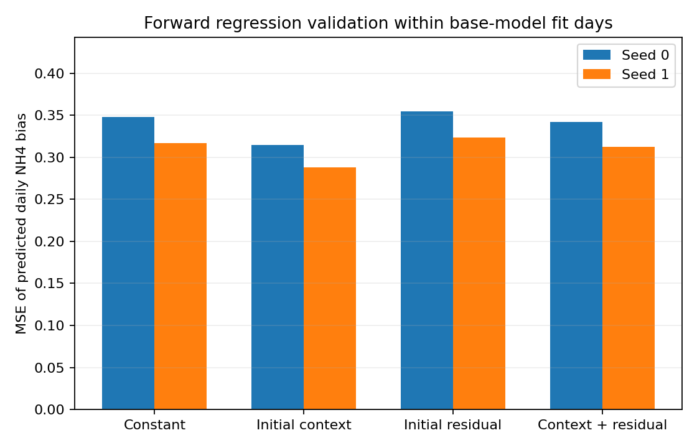

# Yoo/e15 초기 오차 예측력 검사 결과

실행 `1d181fe65570dea690600948f347eb52270af2f6`.
시작 `2026-11-06T13:17:32.459370+00:00`, 완료 `2026-11-06T13:17:32.918601+00:00` (UTC).

기반 모델은 e14 day_mse seed 0, 1로 고정했다. fit 263일 안의 회귀 시간 분할 3개, 날짜 단위 확인 예측 129개를 집계했다. 기반 모델은 fit 전체를 이미 학습했으므로 전체 시스템의 독립 검증으로 부르지 않는다. 내부 holdout 66일, 외부 val, test는 사용하지 않았다.

## 이후 NH4 평균 편향을 예측하는 MSE

목표는 01:05부터 23:55까지 모델 예측 농도와 실측 농도의 차이를 평균한 값이다. 아래 값은 그 평균 편향을 예측한 회귀 오차다. 수질 예측 MAE나 거짓양성률이 아니다.

| 회귀 입력 | seed 0 MSE | seed 1 MSE |
| --- | --- | --- |
| 평균 편향만 | 0.3482 | 0.3167 |
| 초기 조건 6개 | 0.3150 | 0.2884 |
| 초기 평균 잔차 2개 | 0.3545 | 0.3235 |
| 초기 조건 및 잔차 | 0.3422 | 0.3123 |

## 초기 조건 대비 잔차의 추가 효과

| seed | 비교 기준 | MSE 감소율 | 더 나은 분할 수 | 진행 기준 |
| --- | --- | --- | --- | --- |
| 0 | 평균 편향만 | +1.73% | 1/3 | False |
| 0 | 초기 조건 6개 | -8.62% | 0/3 | False |
| 1 | 평균 편향만 | +1.37% | 1/3 | False |
| 1 | 초기 조건 6개 | -8.31% | 0/3 | False |

감소율이 음수이면 오차가 증가했다는 뜻이다. 기준은 두 seed 각각에서 평균 편향 및 초기 조건 양쪽 대비 MSE 5% 이상 감소, 세 분할 중 두 개 이상 개선이다.

## 시간 분할별 MSE

| seed | 분할 | 회귀 학습 날짜 수 | 확인 날짜 수 | 평균만 | 초기 조건 | 초기 잔차 | 조건 및 잔차 |
| --- | --- | --- | --- | --- | --- | --- | --- |
| 0 | 1 | 131 | 43 | 0.4818 | 0.4751 | 0.5030 | 0.5372 |
| 0 | 2 | 175 | 43 | 0.3616 | 0.2199 | 0.3393 | 0.2362 |
| 0 | 3 | 219 | 43 | 0.2012 | 0.2502 | 0.2211 | 0.2532 |
| 1 | 1 | 131 | 43 | 0.4709 | 0.4832 | 0.4576 | 0.5144 |
| 1 | 2 | 175 | 43 | 0.3075 | 0.1810 | 0.3073 | 0.2171 |
| 1 | 3 | 219 | 43 | 0.1716 | 0.2009 | 0.2055 | 0.2055 |

## 판정

사전 진행 기준 통과: **False**.

초기 평균 잔차를 더한 선형 회귀는 두 seed의 세 분할 모두 초기 조건만 사용한 회귀보다 나빴다. 이 입력 구성의 편향 보정기를 추가할 근거를 확보하지 못했다. 사전 계획대로 보정기 학습 및 내부 holdout 평가를 진행하지 않았다. 기반 모델과 FCSRL + PPO는 유지했다.

이 결과는 초기 12전이 평균 잔차 2개와 고정 ridge 회귀에 대한 것이다. 모든 시간 이력, 비선형 추정기, 실제 센서 피드백이 무효라는 뜻은 아니다. 초기 조건만 쓰는 회귀의 이득을 근거로 사후에 주 후보를 바꾸지 않았다.

