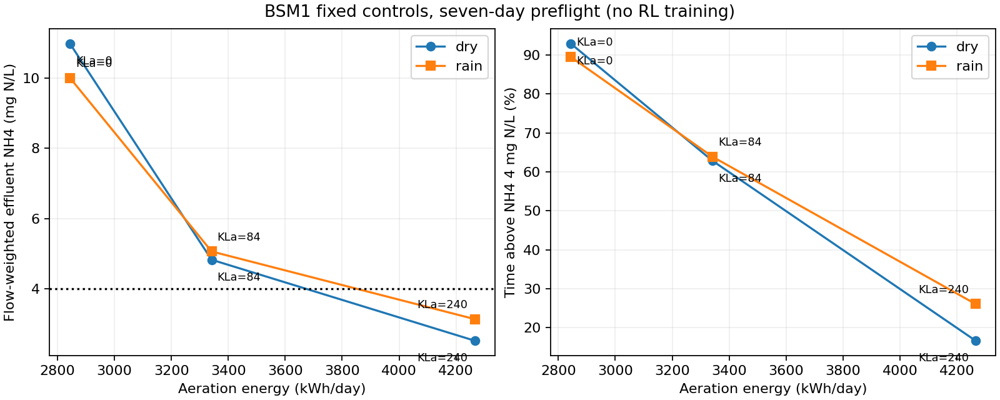

# e16 연결 검사 결과

안정화 및 환경 검사를 완료했다. 아래는 학습 정책이 아닌 고정 KLa 제어 결과다. 각 시나리오에서 같은 초기 상태로 7일을 연속 계산했으며 seed 평균이 아니다.

| 날씨 | KLa5 (day^-1) | 폭기 (kWh/day) | 유량 가중 NH4 (mg N/L) | NH4 초과 시간 (%) | DO5 평균 (mg/L) |
| --- | --- | --- | --- | --- | --- |
| dry | 0 | 2843.7 | 10.973 | 92.94 | 0.032 |
| dry | 84 | 3341.4 | 4.831 | 62.86 | 0.822 |
| dry | 240 | 4265.6 | 2.530 | 16.67 | 3.764 |
| rain | 0 | 2843.7 | 10.000 | 89.52 | 0.046 |
| rain | 84 | 3341.4 | 5.067 | 63.90 | 0.877 |
| rain | 240 | 4265.6 | 3.144 | 26.08 | 3.854 |

실행 코드 커밋: `a8ed1be5269bfd7b46db2b49ebe98c6ce3bfa0a1`. 전체 사전 검사 117.5초.

- MATLAB 상수 유입 정상상태 기준 통과. 21개 방류 값의 최대 절대 차이 8.61e-08.
- reset 재현성, 인스턴스 간 독립성, 잘못된 행동 거부, 시간 경계, 직접 upstream 적분과의 일치, 에너지 적분 및 비용 집계 검사 통과.
- 기존 PPO, FCSRL+PPO, FCSRL+PPO+CVaR 각각 12전이 추론 및 유한 출력 확인. 최적화 갱신은 0회다.
- 1분 대비 30초 적분의 동일 시각 NH4 MAE 0.0217 mg N/L, DO5 MAE 0.0039 mg/L. 건기 기본 제어 한 조건만 검사했다.
- 고정 제어 측정 처리량은 약 266전이/초다. 40만 전이는 환경 계산만 약 25.0분이다. 정책 추론, 역전파, 검증, 병렬 실행 간 경합은 포함하지 않은 외삽으로 학습 종료 시각이 아니다.

## 해석

폭기량 증가에 따른 NH4 감소와 에너지 증가를 확인했다. 최대 고정 폭기에서 유량 가중 NH4는 건기와 우기 모두 4 미만이지만, 순간 초과율은 각각 약 17%, 26%다. 평균 기준 만족과 모든 시점 만족은 다르다. 이 결과는 다른 제어로 초과율을 더 낮출 수 없다는 증명이 아니다.

5% 초과 시간 예산을 그대로 본 학습에 사용하는 근거는 없다. 후속 비용 정의는 BSM의 평균 수질 기준과 일치시키고, 초과 시간과 상위 꼬리 위험은 별도 지표로 유지해야 한다. 임계 농도 4 mg N/L를 결과에 맞춰 바꾸지 않는다.

기존 대리 모델의 FPR이나 탐지율을 개선한 결과가 아니다. 이번 환경에서의 기법 개선, 실제 공정 적용성, 전체 BSM 기준 충족도 아직 검증하지 않았다.

