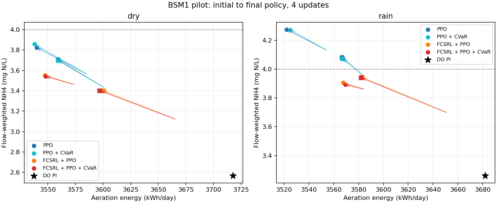

# e17 제한된 학습 시험 결과

4조건 x seed 2개, 각 23,040전이와 4회 갱신이다. 아래 평균과 표준편차는 seed 두 개의 값이며 독립 최종 test나 수렴 결과가 아니다. 각 정책을 14일 연속 운전하고 후반 7일을 집계했다.

## dry

| 방법 | 폭기 kWh/day | NH4 유량 가중 평균 mg N/L | NH4 초과 시간 % | 일별 NH4 CVaR20 |
| --- | --- | --- | --- | --- |
| fixed84 | 3341.387 | 4.831 | 62.857 | 6.052 |
| fixed240 | 4265.600 | 2.308 | 15.595 | 2.986 |
| do_pi | 3717.760 | 2.567 | 16.895 | 3.279 |
| PPO | 3549.665 ± 9.746 | 3.765 ± 0.059 | 49.633 ± 2.738 | 4.870 ± 0.063 |
| PPO + CVaR | 3548.592 ± 10.762 | 3.778 ± 0.082 | 49.950 ± 3.552 | 4.884 ± 0.091 |
| FCSRL + PPO | 3573.855 ± 26.472 | 3.476 ± 0.076 | 40.268 ± 2.212 | 4.525 ± 0.057 |
| FCSRL + PPO + CVaR | 3572.517 ± 24.491 | 3.472 ± 0.070 | 40.114 ± 1.959 | 4.517 ± 0.048 |

| 방법 | seed | 초기 NH4 | 마지막 NH4 | 초기 폭기 | 마지막 폭기 |
| --- | --- | --- | --- | --- | --- |
| PPO | 0 | 3.561 | 3.824 | 3585.9 | 3539.9 |
| PPO | 1 | 3.428 | 3.705 | 3601.5 | 3559.4 |
| PPO + CVaR | 0 | 3.561 | 3.859 | 3585.9 | 3537.8 |
| PPO + CVaR | 1 | 3.428 | 3.696 | 3601.5 | 3559.4 |
| FCSRL + PPO | 0 | 3.460 | 3.552 | 3574.5 | 3547.4 |
| FCSRL + PPO | 1 | 3.119 | 3.400 | 3666.2 | 3600.3 |
| FCSRL + PPO + CVaR | 0 | 3.460 | 3.542 | 3574.5 | 3548.0 |
| FCSRL + PPO + CVaR | 1 | 3.119 | 3.401 | 3666.2 | 3597.0 |

## rain

| 방법 | 폭기 kWh/day | NH4 유량 가중 평균 mg N/L | NH4 초과 시간 % | 일별 NH4 CVaR20 |
| --- | --- | --- | --- | --- |
| fixed84 | 3341.387 | 5.067 | 63.899 | 6.713 |
| fixed240 | 4265.600 | 2.912 | 22.758 | 3.431 |
| do_pi | 3681.981 | 3.261 | 28.244 | 3.862 |
| PPO | 3544.412 ± 22.378 | 4.177 ± 0.096 | 51.582 ± 2.217 | 5.528 ± 0.054 |
| PPO + CVaR | 3546.272 ± 21.089 | 4.171 ± 0.101 | 51.478 ± 2.282 | 5.532 ± 0.080 |
| FCSRL + PPO | 3575.198 ± 7.698 | 3.924 ± 0.019 | 47.302 ± 0.933 | 5.122 ± 0.097 |
| FCSRL + PPO + CVaR | 3575.741 ± 6.402 | 3.916 ± 0.023 | 47.227 ± 0.918 | 5.116 ± 0.112 |

| 방법 | seed | 초기 NH4 | 마지막 NH4 | 초기 폭기 | 마지막 폭기 |
| --- | --- | --- | --- | --- | --- |
| PPO | 0 | 4.128 | 4.273 | 3555.0 | 3522.0 |
| PPO | 1 | 3.955 | 4.080 | 3583.8 | 3566.8 |
| PPO + CVaR | 0 | 4.128 | 4.272 | 3555.0 | 3525.2 |
| PPO + CVaR | 1 | 3.955 | 4.071 | 3583.8 | 3567.4 |
| FCSRL + PPO | 0 | 3.858 | 3.905 | 3585.3 | 3567.5 |
| FCSRL + PPO | 1 | 3.696 | 3.943 | 3651.7 | 3582.9 |
| FCSRL + PPO + CVaR | 0 | 3.858 | 3.892 | 3585.3 | 3569.3 |
| FCSRL + PPO + CVaR | 1 | 3.696 | 3.939 | 3651.7 | 3582.1 |

## 수치와 실행 검사

| 방법 | seed | 최종 lambda | 최대 전체 갱신 KL | 평균 경사 clipping % | 최대 행동 clipping % | feasibility 구간 이탈 % |
| --- | --- | --- | --- | --- | --- | --- |
| PPO | 0 | 0.0924 | 0.0106 | 79.69 | 0.05 | 0.00 |
| PPO + CVaR | 0 | 0.0940 | 0.0099 | 79.69 | 0.05 | 0.00 |
| FCSRL + PPO | 0 | 0.0756 | 0.0111 | 91.77 | 0.02 | 0.00 |
| FCSRL + PPO + CVaR | 0 | 0.0740 | 0.0148 | 92.19 | 0.02 | 0.00 |
| PPO | 1 | 0.0195 | 0.0118 | 77.29 | 0.02 | 0.00 |
| PPO + CVaR | 1 | 0.0189 | 0.0106 | 76.98 | 0.02 | 0.00 |
| FCSRL + PPO | 1 | 0.0000 | 0.0149 | 88.23 | 0.02 | 0.00 |
| FCSRL + PPO + CVaR | 1 | 0.0000 | 0.0113 | 89.17 | 0.02 | 0.00 |

경사 clipping은 actor, critic, encoder 호출을 합친 비율이다. 특정 모듈의 불안정성을 단독으로 뜻하지 않는다. 모든 실행에서 실제 정책 파라미터 변화가 있었고 원본 소스와 준비 상태가 유지됐는지 확인했다.

실행 커밋 `f2a6da4f836fdb9c7a9f20a3d205a03e042d873b`. 시작 2026-11-07T08:57:58.359608+00:00, 완료 2026-11-07T09:05:38.906407+00:00. 상세 초기 및 마지막 일별 지표와 원본 기준 제어는 summary.json에 있다.

