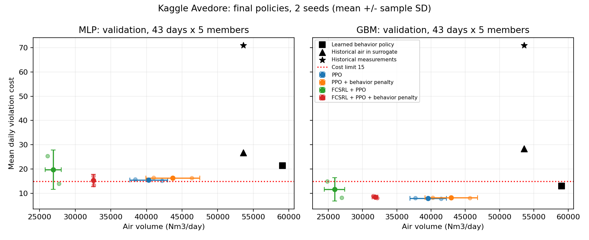

# Yoo/e23: 수행계획서의 Kaggle 데이터로 본 실험 복귀

## 데이터와 목적

사용자가 2026-11-09 "캐글 데이터로 실험해야지"라고 지시했다. 본 실험은 계획서 6절의 Kaggle 폐수처리 공정 자료로 진행한다. e16~e22 BSM1은 별도의 보조 검증으로 남기며 BSM1 잔차 정책 학습은 진행하지 않는다.

- 데이터: Kaggle `jueyetao/wastewater-treatment-dataset`. 덴마크 Avedore 처리장 실제 운전 기록. 원출처 Mendeley Data v1, DOI `10.17632/xmbxhscgpr.1`, CC BY 4.0.
- 원자료: `/home/jio/사물/Yoo/data/avedore/aved_raw.csv`, SHA256 `b57bc042a394d84da9fc9620aae5b90f029885dbafa14d3ce6ed437a0b005a2e`.
- 전처리: 기존 e02의 품질 필터와 5분 평균. `aved_5min.pkl` SHA256 `3a01d5995e49d3b4f3fd42240a4579d1be991629ef70243435422f797d789315`.
- 기존 날짜 분할: train 330일(2022-09-15~2023-12-31), val 43일(2024-01~02), test 60일(2024-03~06). 이번 시험은 train과 val만 사용한다. pickle 안에 test가 함께 저장되어 있지만 해당 날짜 관측을 선택하거나 학습 및 평가에 사용하지 않는다.
- 학습 환경: 기존 e02 MLP 앙상블 5개, `/home/jio/fcsrl_src/results/e02/surrogate/surrogate.json`. 모델 SHA256 `d25dbe3ea1a8e33b17f0a2d0f11a5983fe6c4a6d81a1d0db851b530386658117`.
- 교차 평가: 기존 e03 GBM 앙상블 5개, `/home/jio/fcsrl_src/results/e03/surrogate_gbm/surrogate_gbm.pkl`. 같은 자료로 만든 다른 대리 모델이므로 실측 검증으로 부르지 않는다.

기존 e09~e15에서 확인한 대리 모델 오차는 남아 있다. 이번 질문은 기록 정책에서 출발하고 그 행동에서 멀어지는 것을 벌점으로 주면, FCSRL의 모델 내 절약과 수질 제약 사이의 균형이 달라지는가다. 새 환경 모델을 채택하거나 BSM으로 대체하지 않는다.

## 원본 기법과 확장 후보

원본 FCSRL `d882b91054d52c7a63a18a21f7db67bbbed82b63`, Apache-2.0의 `PPOLagReprAgent.train_encoder`를 기존 `ppo_fcsrl.py`에서 그대로 호출한다. 동역학 및 feasibility 손실, max 재귀, 할인율 0.9, EMA 구조는 유지한다. PPO는 기존 안정화 구현을 사용한다. 세부 원본 대비 차이는 e05 기록을 따른다.

운전 기록에 가까운 정책을 선호하는 발상은 [Behavior Regularized Offline RL](https://arxiv.org/abs/1911.11361), [저자 구현](https://github.com/google-research/google-research/tree/master/behavior_regularized_offline_rl)과 연결된다. 여기서는 행동 평균과의 제곱 차이를 대리 환경의 보상에 넣는 작은 적용 확장이다. BRAC 재현, 엄밀한 행동 분포 제약, 새로운 일반 알고리즘이라고 주장하지 않는다.

## 비교 조건 (학습 결과를 보기 전에 고정)

| 방법 | FCSRL 표현 학습 | 기록 행동 차이 벌점 beta |
| --- | --- | --- |
| ppo | 없음 | 0 |
| fcsrl | 원본 손실 유지 | 0 |
| ppo_anchor | 없음 | 1 |
| fcsrl_anchor | 원본 손실 유지 | 1 |

모든 군이 같은 운전 기록 정책에서 시작한다. 4조건 x seed 0, 1, 목표 200,000전이(실제 202,048), 22회 갱신이다. 5개 seed 본 실행 또는 수렴 결과로 부르지 않는다.

1. train의 앞 264일에서 현재 관측 11개와 실제 현재 공기량으로 64 x 2 tanh MLP 기록 정책을 40 epoch 학습한다(seed 2300). 현재 공기량은 입력에 없고 직전 공기량만 포함한다. 뒤 66일은 모방 오차 확인용이며 그 오차로 epoch를 선택하지 않는다. 환경 MLP 자체는 기존 train 330일을 사용했으므로 환경 전체의 독립 holdout은 아니다.
2. 정규화는 앞 264일에서 정해 고정한다. 기록 정책도 고정한다. PPO 및 FCSRL 정책 평균은 `기록 정책 평균 + 학습하는 보정망 출력`이며 보정망 마지막 층은 0으로 초기화한다.
3. 초기 log std=-1.6, 정규화 행동의 표준편차 약 0.202, 공기량 약 808 Nm3/h로 네 군이 같다. 행동 확률은 자르기 전 정규 행동으로 계산하고 FCSRL 전이 학습에는 잘린 실행 행동을 준다.
4. 호기 단계에서 학습 보상은 `기존 보상 - beta * (실행 행동 - 기록 정책 행동)^2`다. 행동 범위는 [-1, 1]. 비호기 단계는 실행 공기량 0이므로 추가 벌점도 0이다. beta=1은 비용이 없고 현재 보상만 볼 때 기록 정책보다 약 1000 Nm3/h 낮은 공기량을 선호하는 규모다. 이는 전체 동적 정책의 해를 보장하는 계산은 아니다.
5. 공통 환경은 하루 287전이, 공기량 0~8000 Nm3/h, NH4 > 4 및 DO > 2 지시함수 합, 하루 비용 한도 15다. 보상은 기존 공기량 대용치이며 kWh가 아니다. PID, gamma, GAE, 가치망 척도 1, 학습률, 하루 truncation 처리는 e05와 같다. 이전의 임의 초기 정책 및 정규화 갱신과 달라 네 군 내부의 대조로 해석한다.
6. 검증은 2회, val 43일 x 구성원 5개. 중간 선택은 기존 한도 15 안에서 최고 보상, 만족 모델이 없으면 최소 비용이다. 주 비교는 같은 202,048전이 후 마지막 정책이며 MLP와 GBM 양쪽에서 원래 공기량 보상, NH4 및 DO 위반을 보고한다. 정규화 벌점을 더한 보상을 원래 reward와 섞지 않는다.

## 사전 판정과 제한

FCSRL 확장 후보가 두 대리 모델에서 모두 (1) 두 seed 비용 15 이하, (2) 기본 FCSRL보다 평균 공기량 감소, (3) 평균 비용 증가 없음이면 다음 단계 후보로 남긴다. 하나라도 실패하면 개선 성공으로 채택하지 않는다. PPO의 같은 벌점 대조로 FCSRL 고유 효과와 일반 행동 정규화 효과를 구분한다. seed 2개로 유의성을 주장하지 않는다.

실제 운전의 측정 비용, 기록 공기량을 MLP 및 GBM으로 재생한 비용, 기록 정책의 비용도 함께 보고한다. 대리 환경이 실제 기록을 잘못 재현하는 한계를 숨기지 않는다. 실제 기록과 다른 행동을 선택한 뒤 관측된 미래 수질을 정답처럼 넣지 않는다. 기록 정책과의 거리 감소만으로 데이터 지지 영역이나 반사실적 정확성이 확보되었다고 주장하지 않는다.

## 실행

Python 3.10.19, 기존 torch 2.14.1+cu130, CPU 스레드 1개씩 4개 프로세스. 패키지 재설치 없음. 모델과 로그는 `/home/jio/fcsrl_src/results/e23/`. 원자료와 기존 모델 해시 일치, 초기 정책 일치, 벌점 단위, 원시 행동 확률, 기록 정책 고정, 저장 복원, 순차 및 배치 평가 일치를 학습 전에 확인한다.

```bash
export OMP_NUM_THREADS=1 OPENBLAS_NUM_THREADS=1 MKL_NUM_THREADS=1
PY=/home/jio/fcsrl_src/.venv/bin/python
DATA=/home/jio/사물/Yoo/data/avedore/aved_5min.pkl
MODEL=/home/jio/fcsrl_src/results/e02/surrogate/surrogate.json
GBM=/home/jio/fcsrl_src/results/e03/surrogate_gbm/surrogate_gbm.pkl
OUT=/home/jio/fcsrl_src/results/e23
$PY Yoo/experiments/e23/behavior.py --data "$DATA" --model "$MODEL" \
  --raw /home/jio/사물/Yoo/data/avedore/aved_raw.csv --out "$OUT/prepared"
$PY Yoo/experiments/e23/verify.py --data "$DATA" --model "$MODEL" --prepared "$OUT/prepared" --out "$OUT/verification.json"
$PY Yoo/experiments/e23/review.py references --data "$DATA" --model "$MODEL" --gbm "$GBM" \
  --prepared "$OUT/prepared" --out "$OUT/references.json"
$PY Yoo/experiments/e23/run.py --data "$DATA" --model "$MODEL" --gbm "$GBM" --prepared "$OUT/prepared" --out "$OUT/pilot"
$PY Yoo/experiments/e23/review.py report --root "$OUT" --out Yoo/experiments/e23
```

집계 스크립트는 root/pilot/runs의 결과를 사용한다. 실행 커밋, 명령과 코드 및 입력 해시는 pilot/manifest.json에 남긴다. BC 준비 입력 해시는 prepared/preparation.json에 남긴다.

## 상태

기록 정책 학습과 사전 검증 완료. 원자료 및 전처리와 기존 MLP 해시가 일치했다. 기록 정책의 확인 구간 공기량 MAE는 747.5 Nm3/h이며 직전 공기량을 그대로 쓰는 기준은 881.7이다. 이 모방 오차는 정책 성능이나 수질 정확도가 아니다.

4조건 초기 정책 일치, 현재 공기량과 미래 공기량의 입력 비참조, 벌점 단위와 비호기 마스크, 원시 행동 확률, FCSRL 실제 갱신, 기록 정책 및 정규화 고정, 체크포인트 복원을 통과했다. 배치와 순차 평가의 공기량 차이는 0.000026 Nm3/일, 비용은 같았다. [검증 기록](verification.json), [기록 정책 학습](preparation.json).

기록 정책의 val 비용은 MLP 21.39, GBM 13.06으로 모델 간 차이가 이미 있다. 이를 실제 안전 정책으로 전제하지 않는다. 사전 조건대로 Kaggle 정책 8개를 모두 실행했다. BSM1 실험은 추가하지 않았다.


## 완료 결과

2026-11-09 12:46:27~12:54:19 KST, 8개 모두 exit code 0. 실행 커밋 `7e45122c47972fe8490d6f9ffce00bbc1275b064`. 각 202,048전이, 22회 갱신, 합계 1,616,384전이다. 마지막 정책과 중간 검증 선택은 구분한다. 아래는 마지막 정책의 seed 2개 평균이다.

| 방법 | MLP 공기량 Nm3/일 | MLP 비용 | GBM 공기량 Nm3/일 | GBM 비용 |
| --- | --- | --- | --- | --- |
| PPO | 40,320 | 15.47 | 39,574 | 7.91 |
| FCSRL + PPO | 26,896 | 19.72 | 25,910 | 11.59 |
| PPO + 행동 벌점 | 43,685 | 16.36 | 42,948 | 8.17 |
| FCSRL + PPO + 행동 벌점 | 32,569 | 15.28 | 31,824 | 8.48 |

- FCSRL 행동 벌점은 두 seed, 두 모델 모두 비용을 낮췄지만 공기량을 늘렸다. MLP 평균 비용 19.72→15.28, 공기량 26,896→32,569다. 절약을 덜 하며 비용을 줄인 결과이며 Pareto 개선으로 해석하지 않는다.
- MLP에서 기본 및 벌점 FCSRL의 한도 만족 seed는 모두 1/2다. 벌점 seed 0의 비용은 17.08로 한도 15를 넘는다. 사전 후보 기준은 불합격이며 seed 확대나 성공 후보 채택은 하지 않았다.
- PPO에서는 벌점이 두 seed 모두 비용과 공기량을 높였다. 행동 정규화가 일반적으로 수질을 개선한다는 결론을 내리지 않는다.
- 기록 정책과의 공기량 차이는 네 seed 쌍 모두 작아졌지만, 이는 같은 생성 상태에서 기록 정책이 내는 행동과의 거리다. 실제 기록의 조건부 행동 분포 안에 있다는 보증은 아니다.
- 실제 공기량을 재생한 비용은 MLP 26.79, GBM 28.39지만 실제 측정 비용은 70.95다. 모델 편향이 여전히 크므로 두 모델에서 낮은 비용이 나와도 실제 처리장 안전성으로 보고하지 않는다. Kaggle 실험을 유지하며 이 한계를 명시한다.

[전체 seed 결과와 편차](results.md), [요약 및 원래 reward](summary.json), [실행 명령과 해시](launch.json), [종료 검증](postcheck.json).



## 종료 검증과 후속 범위

8개 모두 초기 기록 정책 가중치와 정규화가 끝까지 불변이다. 입력과 학습 소스 해시, 벌점을 뺀 학습 보상 계산, 22회 갱신과 202,048전이, val 43일 x 구성원 5개 중복 없는 평가를 통과했다. 저장 직전 MLP 마지막 평가와 별도 교차 평가의 MLP 값이 정확히 일치했다. 최대 lambda는 약 2.013으로 상한 20 포화가 없다.

```bash
$PY Yoo/experiments/e23/postcheck.py --root "$OUT" --repo /home/jio/사물 --out "$OUT/postcheck.json"
$PY Yoo/experiments/e23/plot.py --summary Yoo/experiments/e23/summary.json --out Yoo/experiments/e23/figures/e23_tradeoff.png
```

현재 실행 중인 학습은 없다. FCSRL 적용과 행동 정규화 확장 후보를 원래 Kaggle 자료에서 시험했으며 개선 성공으로 채택하지 않았다. 추가 연구도 Kaggle 기반으로 한정한다. 모델 오차가 있다는 이유로 다시 BSM1으로 본 실험을 옮기지 않는다. 다음 후보를 정할 때는 제약을 지킨 정책의 비교와 실측 재생 오차를 함께 확인해야 하며, beta만 늘리면 해결된다고 가정하지 않는다.
