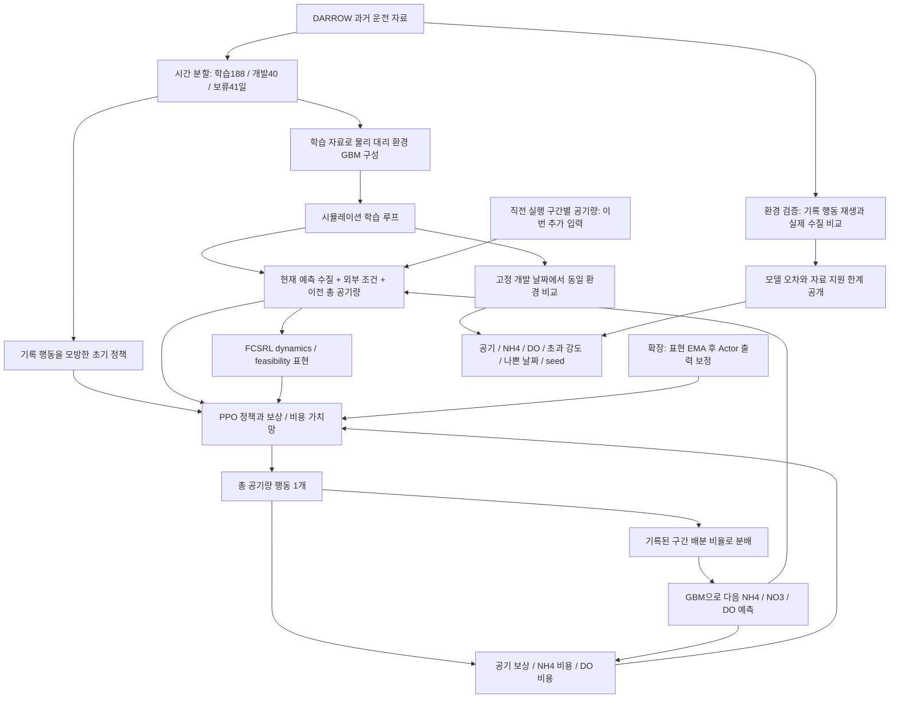

# e44: 전체 설계 검토와 과거 실행 정보 대조

2026-11-10. 사용자 요청은 전체 구조를 멀리서 검토하고 타당하면 실행하는 것이다. e43의 관측 추가를 정답으로 가정하지 않고, 연구의 질문과 증거가 연결되는지 먼저 검토했다.

## 큰 그림과 판단

현재 자료로 검증할 수 있는 것은 **DARROW로 만든 고정 모델 안에서 FCSRL 적용과 확장이 더 좋은 제어를 학습하는가**다. 실제 처리장에서 공기와 수질을 함께 개선한다는 주장은 아직 지지할 수 없다. 환경 신뢰도와 제어 알고리즘 효과는 서로 다른 검증 대상이다.



그림의 정책은15분마다 행동을 다시 선택한다. GBM은 첫 실측 수질 이후95번 자기 예측한다. FCSRL의 표현 dynamics는 GBM 자체가 아니며, Actor 보정도 GBM 오류를 고치는 과정이 아니다. 보류41일은 이번 학습이나 평가에 사용하지 않는다.

| 연구 질문 | 필요한 비교 | 현재 가능한 결론 |
| --- | --- | --- |
| 공기와 수질이 함께 좋아지는가 | 동일 날짜/환경/조건에서 공기, NH4, DO 모두 보고 | 모델 내부 동시 개선 여부 |
| FCSRL이 유용한가 | 같은 입력의 PPO 대 FCSRL | 표현 학습을 포함한 적용 효과 |
| Actor 보정 확장이 유용한가 | 같은 입력의 FCSRL 대 FCSRL Actor | 표현 갱신 후 보정의 추가 효과 |
| 누락된 제어 정보가 문제인가 | 같은 알고리즘/용량에서 정보 유무만 변경 | 직전 구간 정보 추가의 효과 |
| 실제 공정에서도 안전한가 | 독립적인 반사실 검증/실제 운전 근거 | 현재 이 실험으로 답할 수 없음 |

### 실행하기로 한 이유

e30/e33/e36은 초기 모방 정책의 공기를 줄이는 것과 세 지표를 함께 개선하는 것이 다름을 보여 줬다. e38~e42 환경 모델 개선은 평균 오차/FPR/탐지율의 상충을 해결하지 못했다. 그 결과를 버리지 않되, 추가 분류/경계 탐색은 연구의 제어 목표와 멀어졌다.

e43은 실제 코드에서 정책에 없는 입력에 환경 전이가 의존함을 확인했다. 이미 실행한 구간별 명령은 제어기가 기억할 수 있다. 이를 추가하는 대조는 원 FCSRL을 유지하고, 추가 센서나 미래 정답 없이 정보 누락의 영향을 검사한다. 새로운 알고리즘으로 포장하지 않으며 관측 개선과 Actor 보정의 효과를 분리한다.

다만 현재 구간 배분은 기록된 같은 시각의 행동에서 계산되므로 의사결정 전에 가용하다는 근거가 부족하다. 이번에는 직전 실제 실행 구간 유량만 쓴다. 역사적 배분 일정이 대체 정책에서도 유지된다는 환경 가정은 그대로 남는다. 모델의 장기 오차도 그대로이므로 결과가 좋아도 그 범위는 모델 안이다.

큰 그림에서 목적의 차이도 남는다. 학습 문제는 공기 최소화에 NH4/DO 평균 제약을 두는 것이고, 사용자가 원하는 세 지표 동시 감소는 결과의 채택 기준이다. 제약 아래에서 비용을 끝없이 낮추는 세 목적 최적화와 동일하지 않다. DO 상한은 과폭기 억제에 가깝고 NH4 처리 요구와 충돌할 수 있으므로 모든 항목이 함께 개선될 여유가 없을 수도 있다. 이번에는 정보 보완으로 낭비와 위반을 함께 줄일 여지가 있는지만 검사한다. 비용 가중치를 다시 조정해 목표를 바꾸거나 공기 절감을 kWh 절감으로 바꾸어 설명하지 않는다.

이 대조는 개선의 보장이 아니라 큰 구조를 유지하면서 할 수 있는 제한된 검증이다. 관측, 환경 모델, 할인/종료, 비용 기준을 함께 바꾸는 대규모 재설계는 하지 않는다.

## 고정 설계

- 원자료: [Kaggle DARROW](https://www.kaggle.com/competitions/dynamic-modeling-of-wastewater-treatment-process/data). e30 준비 자료와 시간 분할 그대로.
- 환경: e35 `zone_fix/corrected_surrogate.pkl` 고정. e38~e42 후보는 미채택 상태 유지. 환경 재학습 없음.
- 방법3개: PPO, FCSRL, FCSRL Actor 보정. 원 FCSRL 표현 학습 호출과 EMA, e33 분리 비용/학습 방식 유지.
- 관측2개: `padded`는 원11개+0다섯 개, `previous`는 원11개+직전 구간 유량5개/9000. 두 군 모두16차원, 같은 seed의 모든 초기 가중치가 같음.
- 정규화: 원11개는 기존 frozen normalizer, 추가5개는9000으로 나눈 뒤 그대로. BC prior는 같은11개만 읽고 가중치 동결.
- 첫 스텝 추가5개는0. 원11개의 초기 총 유량은 기존 당일 첫 기록을 쓰는 가정이 남으며 두 군 동일. 이 가정을 해결했다고 주장하지 않음.
- 행동: 총 공기량0~9000 m³/h, 보상 `-Q/9000`. 95전이=23.75h, 부피 `.25*sum(Q)` m³. kWh 미측정.
- 비용: NH4>4, max(DO)>2의 각 초과 표본 수, 평균 한도6/6. 연구 조건이며 실제 법적 기준이 아님.
- seed0/1, 각66업데이트 x6080=401280전이. 총12개 새 정책. 기존 e33은 다른 환경에서 학습했으므로 기준군도 모두 다시 학습.
- 최종 체크포인트만 평가. 개발40일 x 모델5개=200경로, 각95전이. 모델5개를 독립 정책 seed로 세지 않음.
- CPU1스레드 작업2개씩, 기존 venv 사용. 다른 실험/torch 설치 변경 없음.

## 판정과 중단

먼저 전체 수집/갱신/복원 사전 검사를 통과해야 본 실행한다. 실패 시 이유를 기록하고 고친 뒤 다시 검사한다. 본 학습 중 NaN, 프로세스 실패가 있으면 나머지 실행도 중단하고 실패 상태를 저장한다.

모든 seed에서 공기/NH4/DO와 NH4 초과 적분, 날짜별 비용p95/최대, 제약 만족 여부를 보고한다. 입력 효과는 각 방법의 previous 대 padded, 확장 효과는 각 입력에서 Actor 대 기본 FCSRL이다. 지표별로 유리한 기준군을 바꾸지 않는다.

추가 검증 후보의 탐색 조건은 **두 seed 모두 세 주 지표 감소, NH4 초과 적분/최악 날짜 NH4 및 DO 비용 악화 없음, 후보 평균6/6 만족**이다. 그 조건을 통과해도2seed와 반복 개발 자료로 확증/채택하지 않는다. 부분 개선과 실패도 모두 저장한다. 미래 실측 상태 재주입이나 경계/한도 사후 조정은 없다. Actor 보정의 추가 연산은 제거하지 않고 train_log의 extra 시간/시도 수와 전체 경과 시간에 남긴다. 세 방법의 계산량이 같다고 주장하지 않는다.

목표 세 지표를 모두 낮추는 조건이 어려울 수 있고, 이미 매우 낮은 DO 비용 때문에 동시 개선 여지가 작을 수도 있다. 결과를 본 뒤 기준을 느슨하게 바꾸지 않고 어느 항목이 막혔는지 기록한다.

## 구현과 출처

`train.py`와 `run.py`는 같은 Yoo의 e33 코드(기반 커밋7b3b4b4)를 복사한 뒤 입력 차원, 환경 경로, 상세 평가/실행 행렬을 바꿨다. `command.py`는 기존 DualPPO/DualFCSRL/DualActor를 상속하므로 PPO 이점 결합, dynamics/feasibility 손실, PID, Actor 보정 코드를 새로 구현하지 않는다. 원 FCSRL 설치 커밋은d882b91054d52c7a63a18a21f7db67bbbed82b63, Apache-2.0이다.

공통 프로토콜v1의 원 환경/합산12 조건과 다른 Yoo 개인 탐색이다. 공통 평가 조건과 공식 채택을 변경하지 않는다. 이 연구의 주장은 FCSRL 적용/확장 검증이며 입력5개 추가 자체의 신규성을 주장하지 않는다.

## 재현 명령과 실행 상태

```bash
OMP_NUM_THREADS=1 OPENBLAS_NUM_THREADS=1 MKL_NUM_THREADS=1 OMP_WAIT_POLICY=PASSIVE \
/home/jio/fcsrl_src/.venv/bin/python Yoo/experiments/e44/preflight.py \
  --prepared /home/jio/fcsrl_src/results/e30/prepared \
  --corrected /home/jio/fcsrl_src/results/e35/zone_fix/corrected_surrogate.pkl \
  --out /home/jio/fcsrl_src/results/e44/preflight

OMP_NUM_THREADS=1 OPENBLAS_NUM_THREADS=1 MKL_NUM_THREADS=1 OMP_WAIT_POLICY=PASSIVE \
/home/jio/fcsrl_src/.venv/bin/python Yoo/experiments/e44/run.py \
  --prepared /home/jio/fcsrl_src/results/e30/prepared \
  --corrected /home/jio/fcsrl_src/results/e35/zone_fix/corrected_surrogate.pkl \
  --verification /home/jio/fcsrl_src/results/e44/preflight/verification.json \
  --out /home/jio/fcsrl_src/results/e44/main --jobs 2 --seeds 2 --updates 66
```

실행 커밋, 입력/코드 해시, 상태는 runtime manifest/status와 사전 검사 기록에 남긴다. 완료 시 `report.py`가 저장된 전체 수질/공기 경로를 독립 집계하여 JSON과 표를 자동 생성한다. 아직 최종 성과 수치는 없다.

사전 검사 완료: 실행8716654, 6조건 모두 통과. 조건별 전체 검사 시간은44.27/40.26/52.74/46.12/37.69/44.87초다. 이는 학습1회뿐 아니라 초기화, 저장/복원 및 train1일5모델 평가를 포함한다. 순수 학습 업데이트 시간으로 쓰지 않는다. [검사 원본](verification.json). 사전 검사 로그는 `/home/jio/fcsrl_src/results/e44/preflight.log`다. 본 실험은 이 검사 통과 후 시작한다.

본 실행 시작: 2026-11-10 20:25:33 KST, 커밋 `552b5ab`. 감독 PID 2491305, 작업2개씩 총12개를 실행한다. 시작 시 PPO padded/previous seed0 두 작업을 확인했다. 최종 결과는 아직 없다. 진행 상태는 `/home/jio/fcsrl_src/results/e44/main/status.json`, 각 작업의 `progress.json`과 tqdm 로그, 전체 로그 `/home/jio/fcsrl_src/results/e44/main.log`에서 확인한다. 완료 후 같은 runtime에 results.md/comparison.json이 생성된다.
