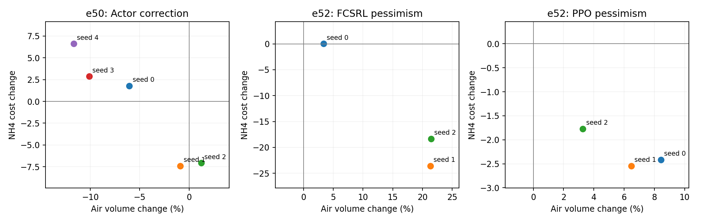
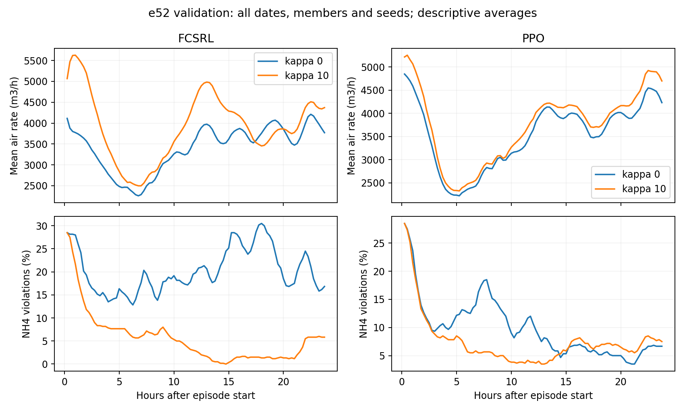

# e50, e52 고정 정책 사후 분석

새 학습 없이 최종 정책 27개를 각 실험의 원래 Python 환경에서 재평가했다. test는 평가하지 않았다. 공기량은 m3/23.75h, 비용은 95개 전이의 위반 횟수다. 날짜별 수치는 같은 날짜의 구성원 5개를 평균한다.

평균 공기량 변화는 평균의 비율로 수정했다. 두 실험의 사전 가설 판정은 수정 전후 동일하다. 이 분석은 기존 결과를 본 뒤 수행한 탐색이며 독립 확인 실험이 아니다.

## e50_actor

| seed | 공기량 변화 % | NH4 차이 | DO 차이 | 합산 비용 차이 | NH4 초과 적분 차이 | DO 초과 적분 차이 | 최악 날짜 NH4 차이 | 최악 날짜 DO 차이 |
| --- | --- | --- | --- | --- | --- | --- | --- | --- |
| 0 | -6.05 | +1.790 | +0.565 | +2.355 | +0.874 | +0.037 | +4.20 | -6.20 |
| 1 | -0.88 | -7.410 | -0.470 | -7.880 | -0.380 | -0.057 | +1.80 | -3.00 |
| 2 | +1.22 | -7.075 | +0.040 | -7.035 | -0.821 | -0.009 | +0.40 | +8.20 |
| 3 | -10.11 | +2.865 | -0.835 | +2.030 | +0.816 | -0.076 | +7.80 | -15.60 |
| 4 | -11.69 | +6.610 | -1.165 | +5.445 | +3.185 | -0.107 | +20.80 | -22.80 |

| 지표 | 기준 seed 평균 | 후보 seed 평균 |
| --- | --- | --- |
| air_m3 | 89684.8662 | 84545.3197 |
| nh4_cost | 9.4400 | 8.7960 |
| do_cost | 1.8980 | 1.5250 |
| cost | 11.3380 | 10.3210 |
| nh4_excess_mg_h_L | 4.4596 | 5.1945 |
| do_excess_mg_h_L | 0.1184 | 0.0761 |
| worst_day_nh4_cost | 49.7200 | 56.7200 |
| worst_day_do_cost | 29.9600 | 22.0800 |

평균 공기량 변화 -5.73%. 합산 비용 개선 seed 2/5.
seed 하나씩 제외한 평균 합산 비용 차이: -1.860, +0.699, +0.487, -1.779, -2.633.
seed 평균 후 날짜 40개 중 합산 비용 개선 33개, 공기량 개선 34개, 세 지표 모두 개선 11개.

## e52_fcsrl

| seed | 공기량 변화 % | NH4 차이 | DO 차이 | 합산 비용 차이 | NH4 초과 적분 차이 | DO 초과 적분 차이 | 최악 날짜 NH4 차이 | 최악 날짜 DO 차이 |
| --- | --- | --- | --- | --- | --- | --- | --- | --- |
| 0 | +3.38 | +0.015 | -0.435 | -0.420 | +0.099 | -0.046 | -0.20 | -1.00 |
| 1 | +21.32 | -23.595 | -0.615 | -24.210 | -3.416 | -0.095 | -5.60 | -4.20 |
| 2 | +21.42 | -18.345 | +0.025 | -18.320 | -4.121 | +0.047 | -15.40 | +1.40 |

| 지표 | 기준 seed 평균 | 후보 seed 평균 |
| --- | --- | --- |
| air_m3 | 81019.2622 | 93281.1251 |
| nh4_cost | 19.2333 | 5.2583 |
| do_cost | 1.0267 | 0.6850 |
| cost | 20.2600 | 5.9433 |
| nh4_excess_mg_h_L | 7.2592 | 4.7800 |
| do_excess_mg_h_L | 0.0799 | 0.0485 |
| worst_day_nh4_cost | 57.8000 | 50.7333 |
| worst_day_do_cost | 9.5333 | 8.2667 |

평균 공기량 변화 +15.13%. 합산 비용 개선 seed 3/3.
seed 하나씩 제외한 평균 합산 비용 차이: -21.265, -9.370, -12.315.
seed 평균 후 날짜 40개 중 합산 비용 개선 40개, 공기량 개선 0개, 세 지표 모두 개선 0개.

| 기준 정책의 행동 전 NH4 | 시간 비중 % | 양의 추가 공기량 비중 % | 순 추가 공기량 m3/episode |
| --- | --- | --- | --- |
| NH4_le_3 | 32.14 | 40.15 | +7421.3 |
| NH4_3_to_4 | 47.47 | 50.58 | +7275.3 |
| NH4_gt_4 | 20.38 | 9.27 | -2434.7 |

두 정책은 이후 상태가 달라진다. 같은 날짜, 구성원, 시각의 차이를 분해한 기술 통계다. 현재 NH4가 낮아도 미래 위반 예방에 공기가 필요할 수 있으므로 낭비나 인과 효과로 해석하지 않는다. 모델 간 SD는 실측 오차가 아니며 불확실성 보정의 타당성 검증을 대체하지 않는다.

## e52_ppo

| seed | 공기량 변화 % | NH4 차이 | DO 차이 | 합산 비용 차이 | NH4 초과 적분 차이 | DO 초과 적분 차이 | 최악 날짜 NH4 차이 | 최악 날짜 DO 차이 |
| --- | --- | --- | --- | --- | --- | --- | --- | --- |
| 0 | +8.42 | -2.415 | +0.130 | -2.285 | -0.226 | -0.000 | -0.60 | +0.00 |
| 1 | +6.47 | -2.545 | +0.450 | -2.095 | -0.001 | +0.083 | -1.20 | +1.00 |
| 2 | +3.27 | -1.770 | -0.445 | -2.215 | +1.429 | -0.027 | +7.20 | -4.60 |

| 지표 | 기준 seed 평균 | 후보 seed 평균 |
| --- | --- | --- |
| air_m3 | 84046.2356 | 89168.4838 |
| nh4_cost | 9.3433 | 7.1000 |
| do_cost | 1.3933 | 1.4383 |
| cost | 10.7367 | 8.5383 |
| nh4_excess_mg_h_L | 4.7184 | 5.1194 |
| do_excess_mg_h_L | 0.1159 | 0.1344 |
| worst_day_nh4_cost | 48.0000 | 49.8000 |
| worst_day_do_cost | 22.8667 | 21.6667 |

평균 공기량 변화 +6.09%. 합산 비용 개선 seed 3/3.
seed 하나씩 제외한 평균 합산 비용 차이: -2.155, -2.250, -2.190.
seed 평균 후 날짜 40개 중 합산 비용 개선 33개, 공기량 개선 1개, 세 지표 모두 개선 0개.

| 기준 정책의 행동 전 NH4 | 시간 비중 % | 양의 추가 공기량 비중 % | 순 추가 공기량 m3/episode |
| --- | --- | --- | --- |
| NH4_le_3 | 43.54 | 56.49 | +4511.3 |
| NH4_3_to_4 | 46.38 | 40.08 | +1766.1 |
| NH4_gt_4 | 10.08 | 3.43 | -1155.2 |

두 정책은 이후 상태가 달라진다. 같은 날짜, 구성원, 시각의 차이를 분해한 기술 통계다. 현재 NH4가 낮아도 미래 위반 예방에 공기가 필요할 수 있으므로 낭비나 인과 효과로 해석하지 않는다. 모델 간 SD는 실측 오차가 아니며 불확실성 보정의 타당성 검증을 대체하지 않는다.

## 그림

## 재현 검증

{"policy_evaluations": 27, "original_metric_checks": 210, "max_metric_absolute_errors": {"e50:air_m3": 0.0010590010933810845, "e50:cost": 0.0, "e50:nh4_viol_pct": 0.0, "e50:do_viol_pct": 0.0, "e50:days_within_limit_pct": 0.0, "e50:n_episodes": 0.0, "e52:air_m3": 0.0, "e52:nh4_cost": 0.0, "e52:do_cost": 0.0, "e52:nh4_excess_mg_h_L": 0.0, "e52:cost": 0.0, "e52:both_mean_limits": 0.0, "e52:both_limits_episode_pct": 0.0, "e52:n_episodes": 0.0, "e52:worst_day_nh4_cost": 0.0, "e52:worst_day_do_cost": 0.0}, "analysis_source_sha256": "8aba61ff3c11b9558feeca3e689aa2e1093bdfa25c79d71359577163df184490", "weight_updates": 0, "test_evaluated": false, "inputs_unchanged": true}

원본 체크포인트, 입력 데이터, 원 평가 결과 파일은 수정하지 않았다. 전체 시계열, 파일 해시, 재평가 상태는 `/home/jio/fcsrl_src/results/e50_e52_audit_20261112`에 있다. 원래 결과와 겹치는 지표는 rtol=1e-9, atol=1e-7로 검산했다. e50 공기량만 합산값 atol=0.001 m3를 허용했으며 위반 비용 허용오차는 완화하지 않았다.
