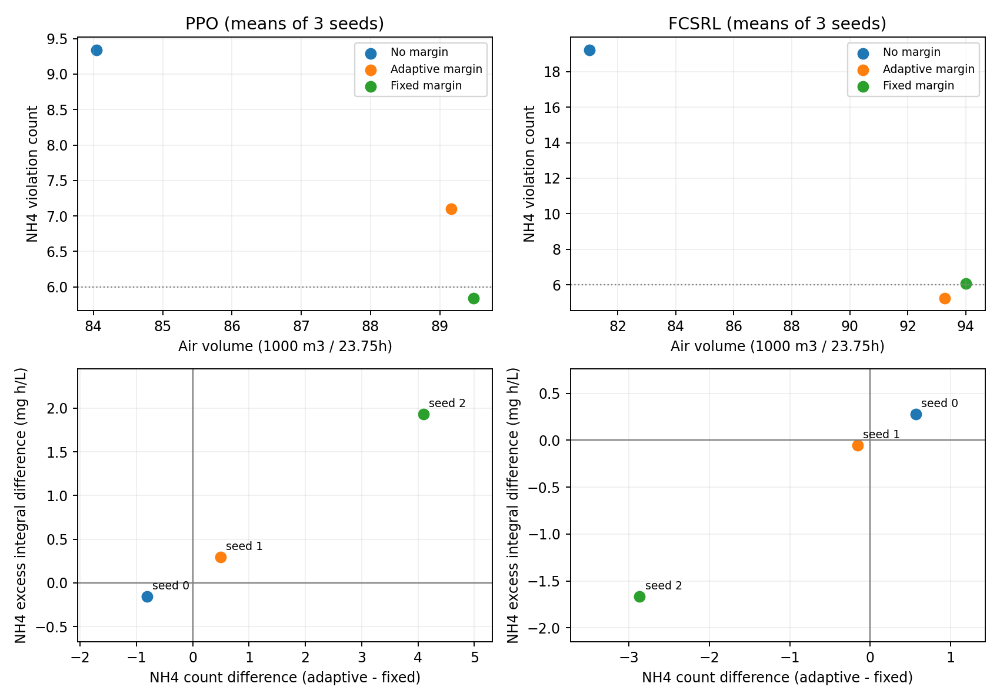
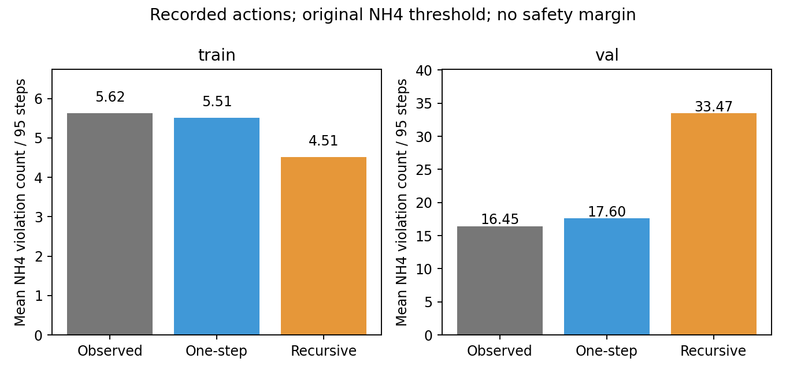

# e53 고정 여유 대조 검산

2026-11-12 22:06 KST에 완료했다. e53 기존 학습 완료 후 e52와 동일 조건으로 검증했다. FCSRL의 Encoder, dynamics, feasibility 학습, EMA, PPO, 제약 PID는 유지한다. 새 학습이나 추가 후보 탐색은 하지 않는다. 이 폴더는 클로드의 e53 작업 폴더를 수정하지 않는 별도 분석이다.

## 결과와 판단

[전체 표](results.md), [비교 JSON](comparison.json), [seed별 원 지표](per_seed.csv), [날짜별 차이](paired_dates.csv).

| FCSRL 검증 seed 평균 | 고정 여유 0.45 | 불확실성 여유 10 x SD |
| --- | --- | --- |
| 공기량 m3/23.75h | 94,010 | 93,281 |
| NH4 위반 횟수 | 6.077 | 5.258 |
| DO 위반 횟수 | 1.820 | 0.685 |
| NH4 초과 적분 mg h/L | 5.260 | 4.780 |
| DO 초과 적분 mg h/L | 0.282 | 0.048 |
| 최악 날짜 NH4 위반 횟수 | 53.20 | 50.73 |
| 최악 날짜 DO 위반 횟수 | 20.93 | 8.27 |
| NH4와 DO 평균 한도 모두 충족 | 2/3 seed | 2/3 seed |

FCSRL에서 불확실성 여유는 고정 여유 대비 공기량 -0.776%, NH4 -0.818, DO -1.135로 세 평균이 낮다. 사전 H1의 NH4 경로는 지지한다. PPO에서는 공기량 -0.358%에 NH4 +1.257, DO +0.032로 H1을 지지하지 않는다. 집계식 수정 전후 H1 판정은 동일하다.

FCSRL의 추가 이득은 아직 안정적인 결과가 아니다. seed 0은 NH4가 0.57 늘고, seed 1은 공기량이 9.03% 늘었다. seed 2를 제외하면 불확실성 여유의 평균 NH4 비용은 고정 여유보다 0.2075 높아진다. 최악 날짜 NH4는 3개 seed 모두 낮지만, NH4 초과 적분은 seed 0에서 악화한다. 평균 개선을 모든 seed의 개선이나 통계적 확증으로 쓰지 않는다.

여유가 없는 원 FCSRL 대비 불확실성 여유의 공기량 증가는 여전히 15.13%다. 따라서 고정 여유 대비 제한적인 이점과 원 기준 대비 전체 지표 동시 개선은 다른 주장이다. 불확실성 정보의 기여가 전혀 없다고 결론내리지는 않지만, 이 결과로 최종 채택하거나 실제 처리장 효율을 주장하지도 않는다.

새 정책 6개를 원래 환경에서 상세 재평가해 대조 가능한 원 지표 60개가 모두 정확히 일치했다. 입력 해시와 정책 지문도 유지됐다. [검산 기록](verification.json). 재평가 실행 커밋과 전체 입력 해시는 runtime manifest에 있다.



## 질문과 비교 범위

- 주 비교: 같은 방법, seed의 불확실성 여유(kappa 10)에서 고정 여유(delta 0.45)를 뺀 차이.
- 기준 정책: 여유 없음(kappa 0)도 함께 표시한다.
- 세 조건은 관측 padded 16개, e35 수정 GBM, scikit-learn 1.7.2, NH4와 DO 한도 각각 6, 학습 401,280 전이, 결정적 마지막 정책으로 같다.
- 검증 날짜 40개와 구성원 5개를 평가한다. 날짜별로 묶어 비교하며 인접 날짜의 시간 의존성이 남을 수 있다. 구성원은 독립된 실제 데이터가 아니다. 원본 test 41일은 평가하지 않는다.
- e50은 환경과 제약이 다르므로 이 비교 표에 포함하지 않는다.

원 e53의 H1은 NH4 경로 또는 공기량 경로를 허용한다. 이 기준은 유지하면서 평균 공기량 변화율을 `100*(후보 평균/기준 평균-1)`로 계산한다. 원 코드의 seed별 변화율 평균 판정도 같이 보존한다. NH4 초과 적분, DO 초과 적분, 최악 날짜는 사후 분석으로 명시한다. H1 미지지를 고정 여유와의 동등성 입증으로 해석하지 않는다.

## 실행과 입력 확인

학습 원 커밋 `58ab2812d545731e1b4dd413d414f971eb39c2ac`의 파일 해시, e44 의존 소스 22개, 공통 입력, 실행 6개 설정을 비교했다. delta/kappa 외 설정이 동일하며 delta 0 smoke 두 갱신은 e44와 정확히 일치한다. 총 35개 확인 항목이 통과했다. [preflight.json](preflight.json).

재평가는 e52 감사에서 쓰던 고정 정책 평가기를 확장했다. 원 체크포인트와 입력의 해시, 정책 지문을 전후 확인하고 원 지표를 rtol=1e-9, atol=1e-7로 재현한다. 상태, 행동 전 상태, 공기량, 모델 불일치 시계열을 저장한다. 가중치와 정규화 통계를 갱신하지 않는다.

원 결과와 시계열 저장 위치: `/home/jio/fcsrl_src/results/e53_margin_audit_20261112/`.

## 여유 선정 재현

학습 날짜의 기록 운전에서 실측 NH4 위반은 5.62234, 고정 여유는 5.61915, 불확실성 여유는 5.61809다. 0.01 간격으로 가장 가까운 고정 여유는 원래 선택한 0.45다. 따라서 이 대조는 기록 운전의 평균 추가 위반 비용을 맞춘다는 목적에 부합한다. [calibration.json](calibration.json).

다만 평균 비용을 맞췄다고 정책 학습 중 방문하는 상태, 여유를 적용하는 위치, 최종 공기량까지 같아지는 것은 아니다. 검증 날짜는 여유를 선택하거나 변경하는 데 사용하지 않았다.

## 현재 모델의 반복 예측 한계

같은 데이터와 모델에서 기록 행동 재생을 다시 확인했다. 행동은 모두 허용 범위 안이라 clipping은 0%다. 실제 운전 상태에서 한 스텝만 예측한 결과와, 초기 상태 이후 자기 예측을 반복 입력한 결과를 구분한다. 이것은 현재 e35 환경의 기존 한계를 재확인하는 진단이며 새 정책 성능이나 새로운 원인 발견으로 포장하지 않는다.

| 검증 NH4 지표 | 실제 상태를 넣은 한 스텝 | 기록 행동 반복 예측 |
| --- | --- | --- |
| 실제 기록 평균 위반 | 16.45 | 16.45 |
| 모델 평균 위반 | 17.60 | 33.47 |
| MAE (mg/L) | 0.280 | 2.853 |
| 거짓양성률 | 3.06% | 29.66% |
| 탐지율 | 92.37% | 61.82% |
| 평균 부호 오차 (예측 minus 실제, mg/L) | +0.091 | +1.939 |

학습 날짜 반복 예측은 실제 5.62를 4.51로 과소예측하지만 검증 날짜에서는 16.45를 33.47로 과대예측한다. 양의 여유를 붙이면 기록 재생의 검증 위반 횟수는 고정 여유 38.29, 불확실성 여유 37.72로 더 커진다. 이 비교는 비용 판정만 바꾸며 상태 전이를 바꾸지 않는다.

모델 불일치와 검증 반복 예측의 절대 오차 사이 Spearman 상관은 +0.526이지만, NH4 과소예측량과는 -0.407이다. 이 값은 기록 운전에서의 탐색적 상관이며 시간 의존성을 고려한 유의성 검정이나 모든 정책 행동에 대한 보장이 아니다. 불일치가 큰 곳을 항상 NH4 과소예측 위험으로 해석할 근거는 부족하다.

따라서 안전 여유의 시뮬레이션 개선과 실측 위험 추정 개선은 분리한다. 반복 예측과 분포 차이, 모델 구조에 따른 편향이 섞여 있을 수 있어 하나를 유일한 원인으로 단정하지 않는다. [전체 진단](model_diagnostic.json).

기록 행동 검증 구간에서 안전 여유가 추가한 경보 중 실제 NH4 위반인 비율은 고정 여유 18.46%, 불확실성 여유 18.12%다. 같은 기록 경로에서 추가 경보 대부분이 거짓양성이었다는 뜻이며, 새 정책 행동에서의 실제 안전 효과를 측정한 것은 아니다.



## 재현 명령

```bash
cd /home/jio/threemool-e53-margin-audit
export OMP_NUM_THREADS=1 OMP_WAIT_POLICY=PASSIVE OPENBLAS_NUM_THREADS=1 MKL_NUM_THREADS=1
python3 Yoo/experiments/e52/margin_audit/preflight.py
/home/jio/fcsrl_src/.venv/bin/python Yoo/experiments/e52/margin_audit/calibrate.py --out <새 출력 경로>/calibration
/home/jio/fcsrl_src/.venv/bin/python Yoo/experiments/e52/margin_audit/diagnose_model.py --calibration <새 출력 경로>/calibration --out <새 출력 경로>/model_diagnostic.json
/home/jio/fcsrl_src/.venv/bin/python Yoo/experiments/e52/margin_audit/wait_and_evaluate.py --out <새 출력 경로>
/home/jio/fcsrl_src/.venv/bin/python Yoo/experiments/e52/margin_audit/test_compare.py
```

`wait_and_evaluate.py`는 이미 시작된 e53 실행의 완료를 기다릴 뿐 학습을 시작하거나 중단하지 않는다. 완료 후 상세 정책 평가와 비교를 연결한다. e52 비교 시계열은 이전 감사에서 검산한 결과를 재사용한다.

## 후속 범위 제한

과거 e38의 이력 추가와 e41의 자기 예측 증강도 거짓양성 감소와 탐지율 저하가 함께 나타나 미채택이었다. 이번 반복 예측 진단을 근거로 같은 경계 조정이나 증강 비율 탐색을 다시 시작하지 않는다. e43에서 검토한 짧은 모델 분기 역시 PPO 수집 분포, 경계 가치와 하루 제약의 의미가 바뀌므로 단순한 대체 수단으로 적용하지 않는다.

이번 작업의 결론은 e53 대조와 현재 환경의 해석 범위를 정리하는 데 한정한다. FCSRL 구조를 다른 알고리즘으로 교체하거나, Actor 보정과 안전 여유를 합치거나, 공식 채택을 변경하지 않는다.
