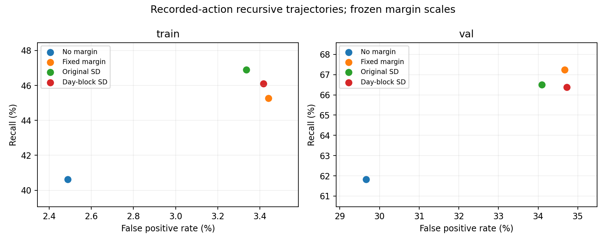

# e54 불확실성 신호의 탐지와 거짓양성 선별

동일한 기록 공기량과 e35 전이를 사용한 사후 위험 판단 대조다. 정책 제어 성과를 평가한 것은 아니다. 표의 cost는 95개 전이 중 NH4 위반으로 판정한 수이며, 여유를 적용한 학습 비용 진단값이다. 환경 상태, 원 NH4 기준 4 mg/L, 행동과 원본 데이터는 유지했다.

후보 kappa=5.5. 후보 build가 train 날짜만으로 정한 값을 그대로 사용했다. 로컬 실행 중 kappa나 경보 문턱을 탐색하지 않았다.

## train

관측 기록 NH4 비용: 5.6223.

| 판정 | 비용 | FPR % | 탐지율 % | 추가 경보의 실제 위반 비율 % | 추가 진양성 수 | 추가 거짓양성 수 |
| --- | --- | --- | --- | --- | --- | --- |
| 여유 없음 | 4.5074 | 2.4877 | 40.6244 | 0.000 | 0 | 0 |
| 고정 여유 0.45 | 5.6191 | 3.4399 | 45.2602 | 23.445 | 245 | 800 |
| 기존 불확실성 (kappa 10) | 5.6181 | 3.3363 | 46.8874 | 31.705 | 331 | 713 |
| 날짜 분할 불확실성 | 5.6457 | 3.4161 | 46.1116 | 27.103 | 290 | 780 |

| 불확실성 | SD 대 절대 오차 상관 | SD 대 과소예측량 상관 |
| --- | --- | --- |
| 기존 불확실성 (kappa 10) | 0.3098 | -0.0070 |
| 날짜 분할 불확실성 | 0.3412 | 0.0100 |
## val

관측 기록 NH4 비용: 16.4500.

| 판정 | 비용 | FPR % | 탐지율 % | 추가 경보의 실제 위반 비율 % | 추가 진양성 수 | 추가 거짓양성 수 |
| --- | --- | --- | --- | --- | --- | --- |
| 여유 없음 | 33.4700 | 29.6626 | 61.8237 | 0.000 | 0 | 0 |
| 고정 여유 0.45 | 38.2900 | 34.6658 | 67.2340 | 18.465 | 178 | 786 |
| 기존 불확실성 (kappa 10) | 37.7200 | 34.0929 | 66.5046 | 18.118 | 154 | 696 |
| 날짜 분할 불확실성 | 38.1950 | 34.7231 | 66.3830 | 15.873 | 150 | 795 |

| 불확실성 | SD 대 절대 오차 상관 | SD 대 과소예측량 상관 |
| --- | --- | --- |
| 기존 불확실성 (kappa 10) | 0.5264 | -0.4068 |
| 날짜 분할 불확실성 | 0.5567 | -0.4587 |

## 고정한 선별 기준의 결과

학습 날짜 비용 맞춤: True. 탐지/FPR 동시 개선 선별: False. 신뢰구간 방향 일치: False.
검증 탐지율 차이 -0.1216%p, 7일 날짜 블록 탐색 95% 구간 [-0.6516, +0.3154].
검증 FPR 차이 +0.6302%p, 같은 구간 [-0.0989, +1.3021].

검증 40일을 재사용한 탐색이며 독립 확증이 아니다. 블록 길이 7, 2000회, 고정 RNG 20261112이며 모델 구성원을 독립 표본으로 세지 않았다. 점추정치 선별과 구간 판정을 분리했다. 선별 미통과가 정책 학습의 실패를 증명하지는 않는다. 다만 불확실성 신호의 품질이 좋아졌다는 이유로 후보를 채택하거나 확대할 근거는 되지 못한다.

## 재현과 범위

실행 커밋 `1520d207f281d1d17f484afa1cebffa796782d26`, 소요 40.35초. 원 기록 재생의 상태와 기존 SD는 e53 감사 저장값과 배열 단위로 정확히 일치했다. 입력과 소스 해시 불변, test 평가 없음, 정책 가중치 갱신 없음.
전체 입력 해시와 원 시계열: `/home/jio/fcsrl_src/results/e54_uncertainty_gate_20261112`.

